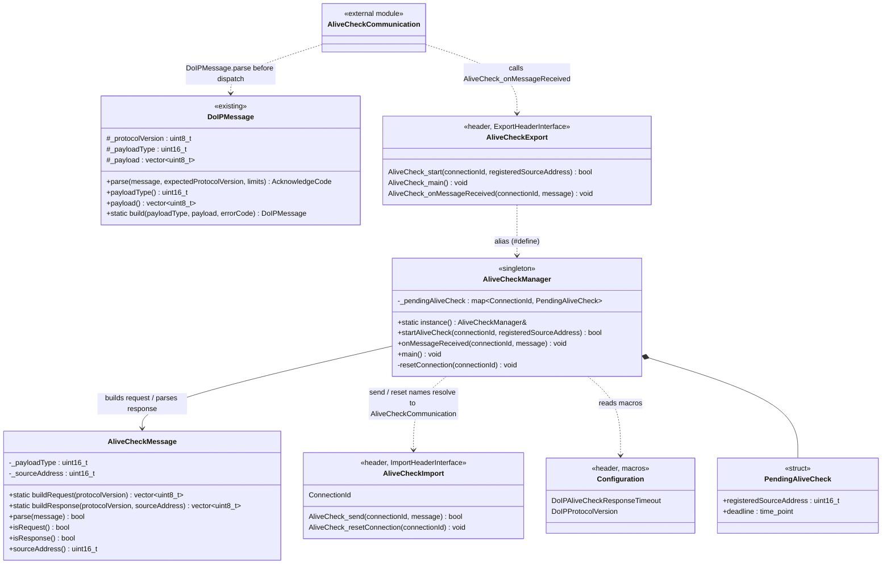
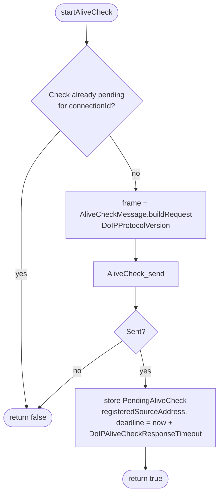
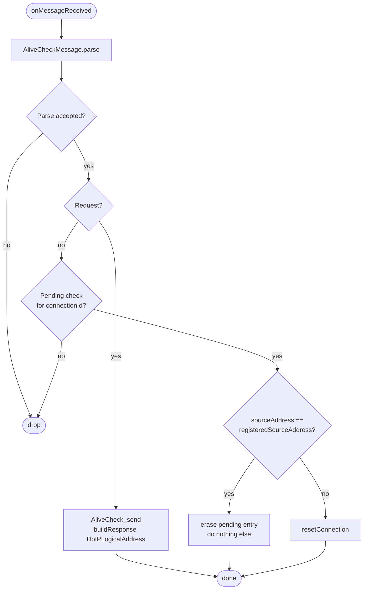
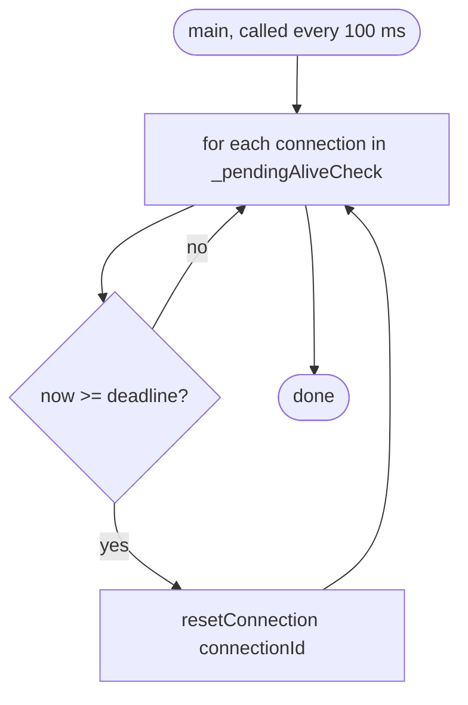
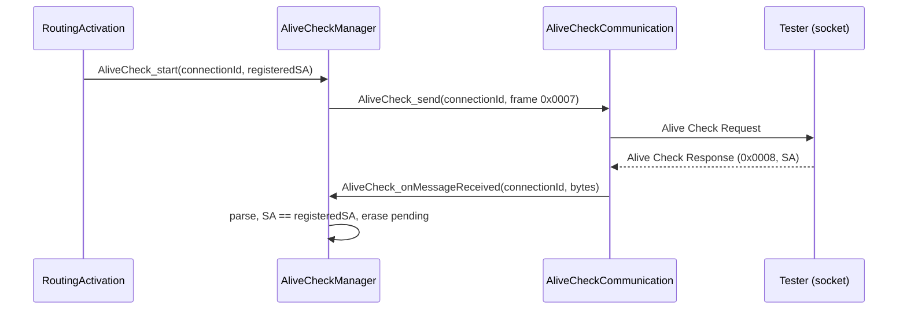
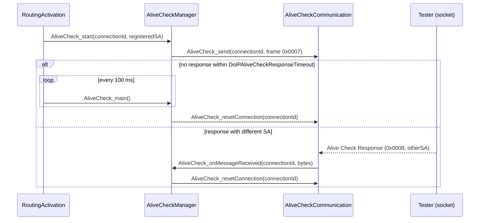

# DoIP Alive Check — Detailed Design (rev 3)

| Item | Value |
|---|---|
| Module | DoIP |
| Feature | Alive Check (request transmission, response validation, timeout) |
| Sources | `RequirementExtraction/AliveCheck_Requirements.arxml`, `RequirementExtraction/AliveCheck_Configurations.arxml` |
| Rule files | `DetailDesign-rules.md`, `Workflow-rules.md`, `Coding-rules.md` |
| Previous revision | [AliveCheck_old.md](./AliveCheck_old.md) |
| Status | **Approved for implementation. The interface relocation is implemented without changing message-processing behavior.** |

## Changes from previous revision

| # | Change |
|---|---|
| C1 | `AliveCheckRequestMessage` and `AliveCheckResponseMessage` merged into one class `AliveCheckMessage`. |
| C2 | Import header is `AliveCheckImport.hpp`; every name in it is `AliveCheck_<function>`, realised as a `#define` alias (no wrapper functions, see 2.3). `AliveCheckCommunication` is no longer an abstract class. |
| C3 | Export header follows the same convention (`AliveCheckExport.hpp`, `AliveCheck_<function>`). |
| C4 | `ConnectionId` moved to `AliveCheckImport.hpp` as a universal type. |
| C5 | `AliveCheckManager::handleResponse` merged into `AliveCheckManager::onMessageReceived`. |
| C6 | `AliveCheckManager::main` description: loops over pending connections every 100 ms. |
| C7 | `onMessageReceived` no longer checks that the frame is an Alive Check message; it is already dispatched. It only calls `AliveCheckMessage::parse`, which also tells request (`0x0007`) from response (`0x0008`). |
| C9 | A received Alive Check Request from a tester is handled in `onMessageReceived`: it is answered with an Alive Check Response carrying `DoIPLogicalAddress`. `AliveCheck_sendRequest` renamed `AliveCheck_send` (used for both request and response). |
| C8 | Superseded by C10. |
| C10 | `AliveCheck_onMessageReceived` is an export interface provided by this module and called by `AliveCheckCommunication`. It moves from `AliveCheckImport.hpp` to `AliveCheckExport.hpp`; the import header no longer includes `AliveCheckManager.hpp`. No message-processing behavior changes. |

## 1. Scope

In scope:

- Build and send an Alive Check Request (payload type `0x0007`, no payload) — SWS_DoIP_00139.
- Supervise the response for `DoIPAliveCheckResponseTimeout` and reset the socket connection on timeout — SWS_DoIP_00140.
- Validate the Alive Check Response (payload type `0x0008`) Source Address against the socket's registered Source Address — SWS_DoIP_00141.

Out of scope (owned by other features, only referenced):

- *When* an alive check is needed (SWS_DoIP_00105 / SWS_DoIP_00107, Routing Activation). Routing Activation is the caller of the export interface.
- The socket reset procedure itself (SWS_DoIP_00358, not in the provided extract); reached through the import interface.
- The SoAd send/receive mechanism and message dispatching by payload type (done by `AliveCheckCommunication`, outside this module).
- Generic header validation of the received frame (done by `DoIPMessage::parse`, called by `AliveCheckCommunication` before `AliveCheckMessage::parse`; see A1).

## 2. Architecture

The Alive Check logic is independent from the transport. It requires `AliveCheck_send` and `AliveCheck_resetConnection` (import header), implemented by `AliveCheckCommunication`. `AliveCheckCommunication` receives frames from the socket, dispatches Alive Check frames (request and response) by payload type and calls the `AliveCheck_onMessageReceived` export interface. Routing Activation / DoIP main use `AliveCheck_start` and `AliveCheck_main` (export header).

### 2.1 Class diagram



### 2.2 Source layout (per `Workflow-rules.md`)

| File | Directory | Responsibility |
|---|---|---|
| `Configuration.hpp` (existing, `DoIP/configuration/`) | `Configuration/` | Provides `DoIPAliveCheckResponseTimeout` (and `DoIPProtocolVersion`, `DoIPLogicalAddress`, see A8, A11) as `#define` values. No settings class. |
| `AliveCheckExport.hpp` | `ExportHeaderInterface/` | Aliases `AliveCheck_start`, `AliveCheck_main`, and `AliveCheck_onMessageReceived` to the manager (`#define`). |
| `AliveCheckImport.hpp` | `ImportHeaderInterface/` | `ConnectionId`; aliases `AliveCheck_send` and `AliveCheck_resetConnection` to the `AliveCheckCommunication` functions (`#define`). Does not include `AliveCheckManager.hpp`. |
| `AliveCheckMessage.hpp`, `PendingAliveCheck.hpp`, `AliveCheckManager.hpp` | `InternalHeaderInterface/` | Private message, state and singleton manager declarations. |
| `AliveCheckMessage.cpp`, `AliveCheckManager.cpp` | `InterfaceImplementation/` | Implementations. No forwarding function bodies exist. |

Existing code under `implementation/` uses a different layout and `snake_case`; it is not renamed (A6).

### 2.3 Interface header mechanism (no wrapper functions)

`AliveCheckImport.hpp` and `AliveCheckExport.hpp` are *name-mapping headers*. They contain multiple `#define` (or `using`/`typedef`, or any other compiler-supported renaming mechanism, e.g. function-like macros, `using` aliases for types) that rename an existing function or type when it crosses the module boundary:

- **Export header:** renames this module's own function to the public `AliveCheck_<function>` name used by other modules. `AliveCheck_onMessageReceived` is the name under which `AliveCheckCommunication` reaches this module's `onMessageReceived`.
- **Import header:** renames a function provided by another module (`AliveCheckCommunication`) to the `AliveCheck_<function>` name used inside this module, so this module never depends on the other module's real names.
- **Wrapper functions are forbidden** in these headers and their `.cpp`: a wrapper adds an extra call (delay cost). The alias must resolve to the target at preprocessing/compile time, so the call is direct.
- `AliveCheck_<function>` keeps names short: module name + short function name.

Illustrative mapping (target names of the other module are placeholders until its interface is defined):

```cpp
/* AliveCheckExport.hpp */
#define AliveCheck_start AliveCheckManager::instance().startAliveCheck
#define AliveCheck_main  AliveCheckManager::instance().main
#define AliveCheck_onMessageReceived AliveCheckManager::instance().onMessageReceived

/* AliveCheckImport.hpp */
using ConnectionId = std::uint64_t;
#define AliveCheck_send               AliveCheckCommunication_sendAliveCheck
#define AliveCheck_resetConnection    AliveCheckCommunication_resetSocketConnection
```

## 3. Type definitions

| Type | Kind | Purpose | Members | Usage |
|---|---|---|---|---|
| `ConnectionId` | `using` (`std::uint64_t`), in `AliveCheckImport.hpp` | Identifies one socket connection; universal type. | — | All interface calls. Same underlying type as the Routing Activation `ConnectionId`. |
| `DoIPAliveCheckResponseTimeout` | macro (`Configuration.hpp`) | Response wait time in **milliseconds** (A5). | — | Read by `startAliveCheck` to compute the deadline. |
| `DoIPProtocolVersion` | macro (`Configuration.hpp`) | DoIP protocol version byte (A8). | — | Used to build frames. |
| `DoIPLogicalAddress` | macro (`Configuration.hpp`) | ECU logical address, ECUC `DoIPLogicalAddress` (A11). | — | Source Address of the Alive Check Response sent to a tester request. |
| `PendingAliveCheck` | struct | State of one outstanding alive check. | `registeredSourceAddress : uint16_t`; `deadline : steady_clock::time_point` | Stored per connection from request send until response or timeout. |
| `AliveCheckMessage` | class (standalone) | Unified Alive Check message: builds the request, extracts the Source Address of the response. | `_sourceAddress : uint16_t` | Header already validated by `DoIPMessage::parse` before `AliveCheckMessage::parse` is called (A1). |
| `AliveCheckManager` | class (singleton) | Alive check state and logic. | `_pendingAliveCheck` | Accessed through `AliveCheckManager::instance()` (A10). |
| `PayloadType` | enum (existing, `DoIPMessage.hpp`) | Payload type identifiers. | uses `AliveCheckResponse = 0x0008`; add `AliveCheckRequest = 0x0007` | Message build and parse. |

Wire formats (generic header per SWS_DoIP_00004..00010, big-endian):

| Message | Byte 0 | Byte 1 | Bytes 2-3 | Bytes 4-7 | Payload |
|---|---|---|---|---|---|
| Alive Check Request | protocol version | inverse version | `0x0007` | `0x00000000` | none (SWS_DoIP_00139) |
| Alive Check Response | protocol version | inverse version | `0x0008` | `0x00000002` | Source Address, 2 bytes |

### 3.1 Interface names

| Header | Name | Direction | Maps to |
|---|---|---|---|
| `AliveCheckExport.hpp` | `bool AliveCheck_start(ConnectionId, uint16_t registeredSourceAddress)` | Called by Routing Activation | `AliveCheckManager::startAliveCheck` |
| `AliveCheckExport.hpp` | `void AliveCheck_main()` | Called by DoIP main function every 100 ms | `AliveCheckManager::main` |
| `AliveCheckExport.hpp` | `void AliveCheck_onMessageReceived(ConnectionId, const std::vector<uint8_t>&)` | Called by `AliveCheckCommunication` after `DoIPMessage::parse` and dispatch (export interface, C10) | `AliveCheckManager::onMessageReceived` |
| `AliveCheckImport.hpp` | `bool AliveCheck_send(ConnectionId, const std::vector<uint8_t>&)` | Required from `AliveCheckCommunication` | Its transmit function (request or response frame) |
| `AliveCheckImport.hpp` | `void AliveCheck_resetConnection(ConnectionId)` | Required from `AliveCheckCommunication` | Its socket reset function (SWS_DoIP_00358) |
## 4. Function design

| Function | Responsibility | Requirements |
|---|---|---|
| `AliveCheckMessage::buildRequest(protocolVersion)` | Returns the 8-byte Alive Check Request frame (type `0x0007`, length 0). | SWS_DoIP_00139 |
| `AliveCheckMessage::buildResponse(protocolVersion, sourceAddress)` | Returns the 10-byte Alive Check Response frame (type `0x0008`, length 2, Source Address). | — (A7) |
| `AliveCheckMessage::parse(message)` | Header is already validated by `DoIPMessage::parse` (called earlier by `AliveCheckCommunication`); this function only extracts the Source Address from the 2-byte payload. Returns false if the payload is too short. | SWS_DoIP_00141 |
| `AliveCheckManager::startAliveCheck(connectionId, registeredSourceAddress)` | Builds and sends the request, records a `PendingAliveCheck` with deadline = now + timeout. Returns false if a check is already pending or the send fails. | SWS_DoIP_00139, SWS_DoIP_00140 |
| `AliveCheckManager::onMessageReceived(connectionId, message)` | Frame is already dispatched as Alive Check, so no check of the message kind by the manager. Calls `AliveCheckMessage::parse` (reads payload type; for a response also the Source Address); on a parse error the frame is dropped. **Request** (`0x0007`): answers with `AliveCheckMessage::buildResponse(DoIPProtocolVersion, DoIPLogicalAddress)` through `AliveCheck_send` (independent of pending checks). **Response** (`0x0008`), if a check is pending for the connection: Source Address equals registered → erase pending entry, nothing else; mismatch → `resetConnection`; no pending check → ignored. (Replaces `handleResponse`.) | SWS_DoIP_00141, SWS_DoIP_00358 |
| `AliveCheckManager::main()` | Called every 100 ms. Loops through the `_pendingAliveCheck` connections and resets every connection whose deadline has expired. Timeout resolution is therefore 100 ms. | SWS_DoIP_00140, SWS_DoIP_00358 |
| `AliveCheckManager::resetConnection` | Removes the pending entry, then calls `AliveCheck_resetConnection`. | SWS_DoIP_00358 |

### 4.1 Flowchart — `startAliveCheck`



### 4.2 Flowchart — `onMessageReceived`



### 4.3 Flowchart — `main` (every 100 ms)



## 5. Sequence diagrams

### 5.1 Alive check answered correctly



### 5.2 Timeout or wrong Source Address



## 6. Configuration

| Parameter | ECUC ID | Parent | Type / range | Default | Mapping |
|---|---|---|---|---|---|
| `DoIPAliveCheckResponseTimeout` | ECUC_DoIP_00009 | `DoIPInterface` | `EcucFloatParamDef`, [0 .. INF] seconds in ECUC; **milliseconds in this project** (A5) | not specified | `#define` in `configuration/Configuration.hpp` (existing `500U`), used directly (no settings class). Pre-compile. Corresponds to T_TCP_AliveCheck of ISO 13400-2:2012. |

## 7. Requirement traceability

| Requirement | Summary | Design element(s) |
|---|---|---|
| SWS_DoIP_00139 | Request has generic header only, type `0x0007`, no payload. | `AliveCheckMessage::buildRequest`; `startAliveCheck`; wire format table §3 |
| SWS_DoIP_00140 | Wait `DoIPAliveCheckResponseTimeout` for a valid response; otherwise reset socket per SWS_DoIP_00358. | `PendingAliveCheck::deadline`; macro `DoIPAliveCheckResponseTimeout`; `startAliveCheck`; `main`; `resetConnection`; flowcharts 4.1, 4.3 |
| SWS_DoIP_00141 | Response Source Address equal to registered SA → nothing; otherwise reset socket per SWS_DoIP_00358. | `AliveCheckMessage::parse`; `onMessageReceived`; flowchart 4.2 |
| SWS_DoIP_00358 | Socket reset procedure (referenced only). | `AliveCheck_resetConnection` (import header) |
| ECUC_DoIP_00009 | `DoIPAliveCheckResponseTimeout`. | `#define DoIPAliveCheckResponseTimeout` in `Configuration.hpp` |
| SWS_DoIP_00105, SWS_DoIP_00107 | Callers of the alive check (Routing Activation). | `AliveCheck_start` (consumer side, not implemented here) |

## 8. Assumptions and unresolved items

| # | Type | Item | Proposed handling |
|---|---|---|---|
| U1 | Unresolved | The text of SWS_DoIP_00358 (socket reset) is not in the extracts. | Black box behind `AliveCheck_resetConnection`. |
| U2 | Unresolved | SWS_DoIP_00105 / 00107 are not in the extracts, so the caller's expectations (e.g. completion notification) are unknown. | No completion callback; a successful response clears the pending entry. |
| A1 | Assumption | `DoIPMessage::parse` (generic header validation) is called by `AliveCheckCommunication` before dispatch. `AliveCheckMessage::parse` does not repeat it; it only extracts the Source Address and checks the payload is at least 2 bytes. | Per user decision. |
| A2 | Assumption | A response with a wrong Source Address resets the connection immediately. | Follows SWS_DoIP_00141 literally. |
| A3 | Assumption | Only one alive check may be pending per connection; a second start returns false. | Not specified by the SWS. |
| A4 | Assumption | `main()` is called every 100 ms (fixed for now; a configuration parameter will be added later). The period is guaranteed by the caller, not by this module. | Per user decision. |
| A5 | Assumption | `DoIPAliveCheckResponseTimeout` is in **milliseconds** (existing `500U` kept). ECUC_DoIP_00009 specifies seconds (float); the project deliberately deviates. The manager uses `std::chrono::milliseconds`. | Per user decision. |
| A6 | Assumption | New code follows `Coding-rules.md`, except the `AliveCheck_<function>` alias names in the import/export headers (as requested). Routing Activation naming (`snake_case`) will be corrected by the user later. | Per user decision. |
| A7 | Assumption | An Alive Check Request (`0x0007`) received from a tester is handled in `onMessageReceived` and answered with an Alive Check Response (`0x0008`) whose Source Address is `DoIPLogicalAddress`. SWS_DoIP_00139-00141 do not define this direction. | Per user decision. |
| A8 | Assumption | `DoIPProtocolVersion` macro (e.g. `0x02`) is added to `Configuration.hpp`; not an ECUC parameter. | Confirmed by user. |
| A9 | Assumption | `AliveCheckCommunication` dispatches Alive Check Request and Response frames to the `AliveCheck_onMessageReceived` export interface in `AliveCheckExport.hpp`; the module does not re-check that the frame is an Alive Check message. | Confirmed by user. |
| A10 | Assumption | `AliveCheckManager` is a singleton, accessed through `AliveCheckManager::instance()`; the export/import aliases resolve to its methods. | Confirmed by user. |
| A11 | Assumption | `DoIPLogicalAddress` (ECUC parameter, present in `DoIP_Configuration_Parameters.arxml`) is added as a `#define` in `Configuration.hpp`; its value is to be provided by the user (placeholder in the implementation until then). | Needs your value. |

## 9. Verification plan

Compile with `g++ -std=c++14 -Wall -Wextra -Werror`. A host test defining fake `AliveCheck_send` / `AliveCheck_resetConnection` covers:

1. Request frame equals `<ver> <~ver> 00 07 00 00 00 00`.
2. Matching response clears the pending entry with no reset.
3. Mismatching Source Address triggers exactly one reset.
4. No response: no reset before the deadline, one reset at/after it.
5. Second start on the same connection returns false.
6. Response on a connection without a pending check is ignored.
7. A received Alive Check Request is answered once with a Response frame `<ver> <~ver> 00 08 00 00 00 02 <DoIPLogicalAddress>`.

## 10. Approval

Please review the design, in particular A11. Implementation will start only after explicit approval.
