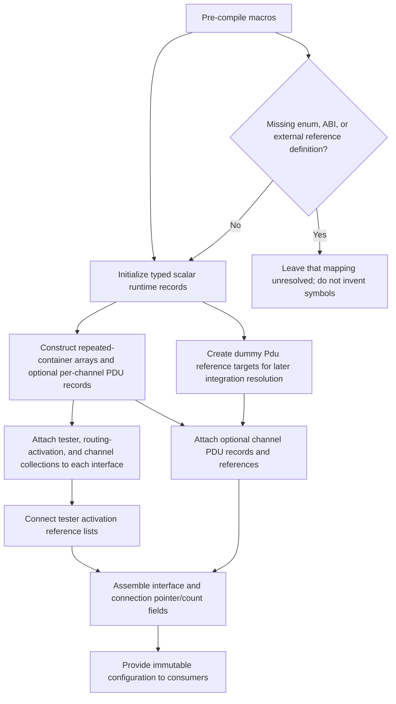
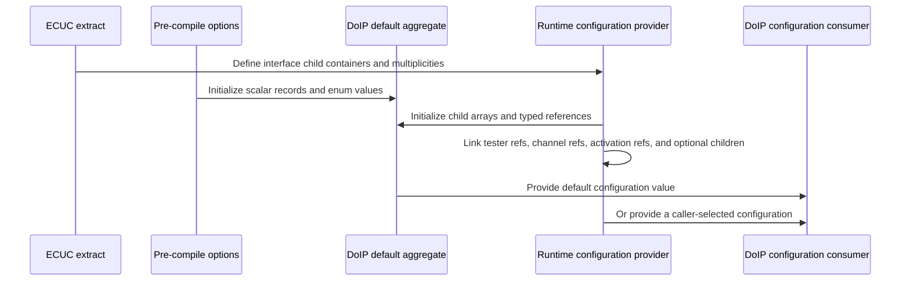

# DoIP Configuration — Detailed Design

| Item | Value |
|---|---|
| Module | DoIP |
| Feature | Configuration model for extracted ECUC parameter definitions |
| Source | `RequirementExtraction/DoIP_Configurations.arxml` |
| Source specification | `AUTOSAR_SWS_DiagnosticOverIP.pdf`, R21-11, Document ID 418 |
| Scope | 73 extracted ECUC annotations; configuration-layer runtime containers only (`consumer_wiring=config_layer_only`) |
| Status | **Approved and implemented; C++14 smoke validation and ARXML parsing passed.** |

## 1. Scope and interpretation

This design covers the configuration information represented by the 73 annotations currently present in `DoIP_Configurations.arxml`. It describes how those definitions are grouped, typed, traced, and made available to the DoIP module and its configured integrations.

The source is a traceability extract in an AUTOSAR-style XML envelope. It is not, by itself, a validated ECUC module definition or a complete configuration instance. Its annotations do not consistently specify values, container multiplicities, value-configuration classes, or all enumeration literals. This revision incorporates the newly extracted `DoIPChannel`, `DoIPRoutingActivation`, `DoIPTester`, and optional PDU/callback container definitions, including their explicit parent relationships. This revision also nests the optional `DoIPConnections` container (`0 .. 1` per interface) with its TCP, UDP, and vehicle-announcement connection children, the vehicle-announcement SoAd Tx PDU child, and the `DoIPTargetAddress` collection named in its relationship text. The prior duplicate `DoIPTargetAddressValue` annotation was removed; the remaining definition is retained in the inventory.

### 1.1 Extract update reflected by this revision

The following container records were added to the extraction and are represented in this design:

| ECUC item ID | Extracted container | Parent | Multiplicity | Design representation |
|---|---|---|---:|---|
| `ECUC_DoIP_00069` | `DoIPChannel` | `DoIPInterface` | 1..65535 | Per-interface channel collection; each channel references a tester and target address. |
| `ECUC_DoIP_00055` | `DoIPPduRRxPdu` | `DoIPChannel` | 0..1 | Nullable per-channel Rx PDU child record. |
| `ECUC_DoIP_00056` | `DoIPPduRTxPdu` | `DoIPChannel` | 0..1 | Nullable per-channel Tx PDU child record; omission means the channel is for functional addressing, as stated by the extract. |
| `ECUC_DoIP_00030` | `DoIPRoutingActivation` | `DoIPInterface` | 0..255 | Per-interface routing-activation collection; tester references remain represented separately. |
| `ECUC_DoIP_00035` | `DoIPRoutingActivationAuthenticationCallback` | `DoIPRoutingActivation` | 0..1 | Optional authentication callback configuration; callback lengths and configured-state are represented without defining a callback ABI. |
| `ECUC_DoIP_00061` | `DoIPRoutingActivationConfirmationCallback` | `DoIPRoutingActivation` | 0..1 | Optional confirmation callback configuration; callback lengths and configured-state are represented without defining a callback ABI. |
| `ECUC_DoIP_00031` | `DoIPTester` | `DoIPInterface` | 1..255 | Per-interface tester collection; retained from the existing runtime model and cross-referenced by channels. |

The removed duplicate was the older `ECUC_DoIP_00054` annotation for `DoIPTargetAddressValue`; the remaining annotation specifies range `0 .. 65535`, multiplicity `1`, `PostBuildVariant: true`, value-configuration classes `VARIANT-PRE-COMPILE`, `VARIANT-LINK-TIME`, and `VARIANT-POST-BUILD`, and no usable default. Its source reference is Section 10.2.14, PDF page 112. A missing `</ANNOTATION>` immediately after this retained entry was repaired with a single closing tag; no other ARXML content was changed by that repair.

In scope:

- The configuration groups and parameters listed in Section 4.
- Preservation of numeric ranges, multiplicities, references, symbolic identifiers, callback names, and post-build classification exactly as extracted.
- The explicitly described bindings to SoAd, PduR, Dcm, and callback interfaces.
- Configuration definitions in the existing `Implementation/ExportHeaderInterface/Configuration.hpp`, using the project’s current pre-compile macro convention.
- Clearly labeled project-example values where the extraction has no usable default, without presenting those values as AUTOSAR defaults.
- Typed C++ runtime configuration containers in the same header, initialized from pre-compile options where the mapping is unambiguous.

Out of scope:

- Implementing the DoIP protocol behavior described by the SWS.
- Generating or validating a production ECUC configuration.
- Defining unspecified container multiplicities, callback ABI, unresolved enum values, or unspecified cross-parameter relationships.
- Adding protocol behavior or changing DoIP/SoAd/PduR interfaces.

## 2. Architecture

### 2.1 Configuration structure

The configuration has two layers:

1. **Pre-compile options:** Keep existing `#define` values and add missing scalar options. These remain build-time defaults and feature switches.
2. **Runtime containers:** Add plain aggregate structs that group values by ECUC container and a top-level `DoIPConfiguration` value containing the general values and `DoIPConfigSet`, which owns the repeated `DoIPInterface` collection. The default configuration is initialized from macros; integrators may construct another configuration at runtime.

Runtime records use fixed-lifetime pointer/count views over caller-owned arrays for repeated ECUC containers, avoiding dynamic allocation and preserving any extracted container-count bounds. The two optional PDU child containers are represented by nullable pointers in `DoIPChannelConfig`; `nullptr` means that child container is not configured. Their pointed-to records have caller-managed storage lifetime. Single-instance values are stored directly as typed members. The record types do not perform general validation or protocol behavior.

`DoIPInterfaceConfig::channels` and `channelCount` represent each interface's repeated `DoIPChannel` children. The extracted multiplicity `1 .. 65535` is enforced by the configuration tool. `std::size_t` remains the count type, and the default example continues to provide one channel. The optional channel PDU children have multiplicity `0 .. 1`, also enforced by the configuration tool. The C++ configuration layer remains a passive data model and does not validate caller-supplied views.

`DoIPInterfaceConfig::testers` and `testerCount` represent the `DoIPTester` children of each interface. The extraction gives this collection multiplicity `1 .. 255`; C++ stores the child pointer/count without adding validation. `DoIPInterfaceConfig::routingActivations` and `routingActivationCount` represent the `DoIPRoutingActivation` children with multiplicity `0 .. 255`. `DoIPInterfaceConfig::channels` and `channelCount` represent the `DoIPChannel` children with multiplicity `1 .. 65535`. Each tester's `activations` and `activationCount` represent its `DoIPRoutingActivationRef` collection. Testers, activations, and channels have no top-level array; each interface is the single owner of its child collections. `DoIPInterfaceConfig::connections` is a nullable pointer to one `DoIPConnectionsConfig` record for the optional (`0 .. 1`) `DoIPConnections` container of each interface; `nullptr` means that container is not configured. The TCP, UDP, vehicle-announcement, and target collections are owned by that record and are not exposed at the top level.

Existing definitions are the compatibility baseline. Existing values and public macro names will be retained. New macros for parameters not yet represented will be annotated as project-example values when the extraction does not give a usable default. Example values are selected only within explicit source ranges and are not AUTOSAR defaults or a production ECU configuration.

### 2.2 Runtime configuration class diagram

The following types are value containers only. The default instance is initialized from pre-compile macro values; callers may instantiate the same types with runtime-selected values. Pointer/count pairs refer to storage owned by the configuration provider, which must outlive consumers.

```mermaid
classDiagram
    class DoIPConfiguration {
        +DoIPGeneralConfig general
        +DoIPConfigSet configSet
    }

    class DoIPGeneralConfig {
        +uint32_t maxRequestBytes
        +float mainFunctionPeriodSeconds
        +uint16_t hostNameSizeMax
        +uint8_t gidInvalidityPattern
        +uint8_t vinInvalidityPattern
        +uint8_t maxUdpRequestsPerConnection
        +bool developmentErrorDetect
        +bool dhcpOptionVinUse
        +bool entityStatusMaxByteFieldUse
        +bool useEidAsGid
        +bool versionInfoApi
        +bool vinGidMaster
        +DoIPNodeTypeValue nodeType
    }

    class DoIPConfigSet {
        +uint64_t eid
        +uint64_t gid
        +uint16_t logicalAddress
        +bool eidConfigured
        +bool gidConfigured
        +const DoIPInterfaceConfig* interfaces
        +size_t interfaceCount
    }

    class DoIPInterfaceConfig {
        +uint8_t interfaceId
        +float aliveCheckResponseTimeoutSeconds
        +float generalInactivityTimeSeconds
        +float initialInactivityTimeSeconds
        +float initialVehicleAnnouncementTimeSeconds
        +float vehicleAnnouncementIntervalSeconds
        +uint8_t maxTesterConnections
        +uint8_t vehicleAnnouncementCount
        +bool vehicleAnnouncementCountConfigured
        +bool vehicleAnnouncementIntervalConfigured
        +bool activationLineControl
        +bool useMacAddressForIdentification
        +bool useVehicleIdentificationSyncStatus
        +DoIPAnnouncementStart announcementStart
        +const DoIPTesterConfig* testers
        +size_t testerCount
        +const DoIPRoutingActivationConfig* routingActivations
        +size_t routingActivationCount
        +const DoIPChannelConfig* channels
        +size_t channelCount
        +const DoIPConnectionsConfig* connections
    }

    class DoIPConnectionsConfig {
        +const DoIPTcpConnectionConfig* tcpConnections
        +size_t tcpConnectionCount
        +const DoIPUdpConnectionConfig* udpConnections
        +size_t udpConnectionCount
        +const DoIPUdpVehicleAnnouncementConnectionConfig* announcementConnections
        +size_t announcementConnectionCount
        +const DoIPTargetAddressConfig* targets
        +size_t targetCount
    }

    class DoIPTcpConnectionConfig {
        +bool requestAddressAssignment
        +bool securityRequired
        +DoIPSoAdTcpRxPduConfig soAdTcpRxPdu
        +DoIPSoAdTcpTxPduConfig soAdTcpTxPdu
    }

    class DoIPSoAdTcpRxPduConfig {
        +uint16_t pduId
    }

    class DoIPSoAdTcpTxPduConfig {
        +uint16_t pduId
    }

    class DoIPUdpConnectionConfig {
        +bool requestAddressAssignment
        +DoIPSoAdUdpRxPduConfig soAdUdpRxPdu
        +DoIPSoAdUdpTxPduConfig soAdUdpTxPdu
    }

    class DoIPSoAdUdpRxPduConfig {
        +uint16_t pduId
    }

    class DoIPSoAdUdpTxPduConfig {
        +uint16_t pduId
    }

    class DoIPUdpVehicleAnnouncementConnectionConfig {
        +bool requestAddressAssignment
        +DoIPSoAdUdpVehicleAnnouncementTxPduConfig soAdUdpVehicleAnnouncementTxPdu
    }

    class DoIPSoAdUdpVehicleAnnouncementTxPduConfig {
        +uint32_t pduId
    }

    class DoIPPduRTxPduConfig {
        +uint16_t pduId
        +DoIPPduTypeValue pduType
        +bool pduTypeConfigured
        +const PduConfig* pduRef
    }

    class DoIPPduRRxPduConfig {
        +uint16_t pduId
        +const PduConfig* pduRef
    }

    class PduConfig {
    }

    class DoIPTargetAddressConfig {
        +uint16_t value
    }

    class DoIPRoutingActivationConfig {
        +uint8_t number
        +bool securityRequired
        +const DoIPTargetAddressConfig* targets
        +size_t targetCount
        +DoIPCallbackDataConfig callbackData
    }

    class DoIPTesterConfig {
        +uint16_t sourceAddress
        +uint32_t diagnosticAckNackBytes
        +const DoIPRoutingActivationConfig* activations
        +size_t activationCount
    }

    class DoIPChannelConfig {
        +const DoIPTesterConfig* sourceTester
        +const DoIPTargetAddressConfig* target
        +const DoIPPduRRxPduConfig* pduRRxPdu
        +const DoIPPduRTxPduConfig* pduRTxPdu
    }

    class DoIPCallbackDataConfig {
        +uint8_t authenticationRequestLength
        +uint8_t authenticationResponseLength
        +uint8_t confirmationRequestLength
        +uint8_t confirmationResponseLength
        +bool authenticationCallbackConfigured
        +bool confirmationCallbackConfigured
    }

    note for DoIPInterfaceConfig "testers/testerCount: 1..255 (ECUC_DoIP_00031)"
    note for DoIPInterfaceConfig "routingActivations/routingActivationCount: 0..255 (ECUC_DoIP_00030)"

    class DoIPNodeTypeValue {
        <<enum>>
        Gateway
    }

    class DoIPAnnouncementStart {
        <<enum>>
        Automatic
        OnTrigger
    }

    class DoIPPduTypeValue {
        <<enum>>
        InterfacePdu
        TransportProtocolPdu
    }

    DoIPConfiguration *-- DoIPGeneralConfig
    DoIPConfiguration *-- DoIPConfigSet
    DoIPConfigSet o-- DoIPInterfaceConfig : 1..255 ECUC_DoIP_00100
    DoIPInterfaceConfig o-- DoIPRoutingActivationConfig : 0..255 ECUC_DoIP_00030
    DoIPInterfaceConfig o-- DoIPChannelConfig : 1..65535 ECUC_DoIP_00069
    DoIPConnectionsConfig o-- DoIPTcpConnectionConfig
    DoIPTcpConnectionConfig *-- DoIPSoAdTcpRxPduConfig
    DoIPTcpConnectionConfig *-- DoIPSoAdTcpTxPduConfig
    DoIPConnectionsConfig o-- DoIPUdpConnectionConfig
    DoIPUdpConnectionConfig *-- DoIPSoAdUdpRxPduConfig
    DoIPUdpConnectionConfig *-- DoIPSoAdUdpTxPduConfig
    DoIPConnectionsConfig o-- DoIPUdpVehicleAnnouncementConnectionConfig
    DoIPUdpVehicleAnnouncementConnectionConfig *-- DoIPSoAdUdpVehicleAnnouncementTxPduConfig
    DoIPInterfaceConfig o-- DoIPConnectionsConfig : 0..1 ECUC_DoIP_00032
    DoIPConnectionsConfig o-- DoIPTargetAddressConfig
    DoIPInterfaceConfig o-- DoIPTesterConfig : 1..255 ECUC_DoIP_00031
    DoIPChannelConfig o-- DoIPPduRRxPduConfig : 0..1
    DoIPChannelConfig o-- DoIPPduRTxPduConfig : 0..1
    DoIPPduRRxPduConfig --> PduConfig : ECUC_DoIP_00058
    DoIPPduRTxPduConfig --> PduConfig : ECUC_DoIP_00059
    DoIPTesterConfig --> DoIPRoutingActivationConfig : activation references
    DoIPRoutingActivationConfig --> DoIPTargetAddressConfig : target references
    DoIPRoutingActivationConfig --> DoIPCallbackDataConfig : embedded record; flags model optional children (ECUC_DoIP_00035, ECUC_DoIP_00061)
    DoIPChannelConfig --> DoIPTesterConfig : source-address reference
    DoIPChannelConfig --> DoIPTargetAddressConfig : target reference
    DoIPGeneralConfig --> DoIPNodeTypeValue
    DoIPInterfaceConfig --> DoIPAnnouncementStart
    DoIPPduRTxPduConfig --> DoIPPduTypeValue
```

### 2.3 Configuration data flow

The following is a configuration data flow, not a DoIP protocol state machine.



There is no nontrivial configuration function in this design: the structures are aggregates and the default instance is initialized from macros. Range validation and conversion from seconds to scheduler ticks are out of scope.

## 3. Types and design elements

### 3.1 Runtime type table

The runtime types are aggregate value records. Use `<cstdint>` fixed-width integers for ECUC values, `float` for times expressed in seconds, `bool` for Boolean values, and `std::size_t` for array counts. No member has a constructor or behavior. The default configuration object contains pointers to static example arrays and is read-only; user-created configurations may point to other caller-owned arrays.

| Type | Members | Purpose and usage |
|---|---|---|
| `DoIPNodeTypeValue` | `Gateway` | Typed value for `DoIPGeneral.DoIPNodeType`; only the gateway literal is explicit in the extraction. The distinct type name avoids collision with the existing `DoIPNodeType` configuration macro. |
| `DoIPAnnouncementStart` | `Automatic`, `OnTrigger` | Typed interface announcement-start mode, mapped from the default macro `DOIP_AUTOMATIC_ANNOUNCE` to `Automatic`; `OnTrigger` is available for runtime values based on the description. |
| `DoIPPduTypeValue` | `InterfacePdu`, `TransportProtocolPdu` | Typed PduR Tx API type; maps the existing default macro `DOIP_TPPDU` to `TransportProtocolPdu`. The distinct type name avoids collision with the existing `DoIPPduType` configuration macro. |
| `DoIPGeneralConfig` | `maxRequestBytes:uint32_t`; `mainFunctionPeriodSeconds:float`; `hostNameSizeMax:uint16_t`; `gidInvalidityPattern:uint8_t`; `vinInvalidityPattern:uint8_t`; `maxUdpRequestsPerConnection:uint8_t`; Boolean switches for development error detection, DHCP VIN, entity max-byte support, EID-as-GID, version API, and VIN/GID master; `nodeType:DoIPNodeTypeValue` | Runtime values for the `DoIPGeneral` parameters. |
| `DoIPConfigSet` | `eid:uint64_t`; `gid:uint64_t`; `logicalAddress:uint16_t`; `eidConfigured:bool`; `gidConfigured:bool`; `interfaces:const DoIPInterfaceConfig*`; `interfaceCount:size_t` | Entity/group identity, logical address, and the repeated `DoIPInterface` collection (`ECUC_DoIP_00100`, 1..255). 48-bit value ranges fit without narrowing. Presence fields preserve the optional 0..1 multiplicity of EID and GID. |
| `DoIPInterfaceConfig` | `interfaceId:uint8_t`; `aliveCheckResponseTimeoutSeconds:float`; `generalInactivityTimeSeconds:float`; `initialInactivityTimeSeconds:float`; `initialVehicleAnnouncementTimeSeconds:float`; `vehicleAnnouncementIntervalSeconds:float`; `maxTesterConnections:uint8_t`; `vehicleAnnouncementCount:uint8_t`; `vehicleAnnouncementCountConfigured:bool`; `vehicleAnnouncementIntervalConfigured:bool`; `activationLineControl:bool`; `useMacAddressForIdentification:bool`; `useVehicleIdentificationSyncStatus:bool`; `announcementStart:DoIPAnnouncementStart`; `testers:const DoIPTesterConfig*`; `testerCount:size_t`; `routingActivations:const DoIPRoutingActivationConfig*`; `routingActivationCount:size_t`; `channels:const DoIPChannelConfig*`; `channelCount:size_t`; `connections:const DoIPConnectionsConfig*` | One interface container and its extracted child collections: 1..255 testers (`ECUC_DoIP_00031`), 0..255 routing activations (`ECUC_DoIP_00030`), 1..65535 channels (`ECUC_DoIP_00069`), and an optional `DoIPConnections` record (`0 .. 1`, `ECUC_DoIP_00032`) that is `nullptr` when absent. |
| `DoIPConnectionsConfig` | `tcpConnections:const DoIPTcpConnectionConfig*`; `tcpConnectionCount:size_t`; `udpConnections:const DoIPUdpConnectionConfig*`; `udpConnectionCount:size_t`; `announcementConnections:const DoIPUdpVehicleAnnouncementConnectionConfig*`; `announcementConnectionCount:size_t`; `targets:const DoIPTargetAddressConfig*`; `targetCount:size_t` | Connection container of one interface (`ECUC_DoIP_00032`) holding 2..255 TCP connections (`ECUC_DoIP_00045`), 1..255 UDP connections (`ECUC_DoIP_00052`), 0..255 vehicle-announcement connections (`ECUC_DoIP_00076`), and the `DoIPTargetAddress` collection named in its relationship text. |
| `DoIPTcpConnectionConfig` | `requestAddressAssignment:bool`; `securityRequired:bool`; `soAdTcpRxPdu:DoIPSoAdTcpRxPduConfig`; `soAdTcpTxPdu:DoIPSoAdTcpTxPduConfig` | One TCP connection container with its TCP SoAd Rx and Tx PDU subcontainers. |
| `DoIPSoAdTcpRxPduConfig` | `pduId:uint16_t` | TCP SoAd Rx PDU subcontainer nested in `DoIPTcpConnectionConfig`; ECUC_DoIP_00082. |
| `DoIPSoAdTcpTxPduConfig` | `pduId:uint16_t` | TCP SoAd Tx PDU subcontainer nested in `DoIPTcpConnectionConfig`; ECUC_DoIP_00085. |
| `DoIPUdpConnectionConfig` | `requestAddressAssignment:bool`; `soAdUdpRxPdu:DoIPSoAdUdpRxPduConfig`; `soAdUdpTxPdu:DoIPSoAdUdpTxPduConfig` | One UDP connection container with its UDP SoAd Rx and Tx PDU subcontainers. |
| `DoIPUdpVehicleAnnouncementConnectionConfig` | `requestAddressAssignment:bool`; `soAdUdpVehicleAnnouncementTxPdu:DoIPSoAdUdpVehicleAnnouncementTxPduConfig` | One vehicle-announcement UDP connection container with its SoAd Tx PDU subcontainer (`ECUC_DoIP_00077`). |
| `DoIPSoAdUdpVehicleAnnouncementTxPduConfig` | `pduId:uint32_t` | Vehicle-announcement SoAd Tx PDU subcontainer nested in `DoIPUdpVehicleAnnouncementConnectionConfig`; ECUC_DoIP_00078. |
| `DoIPSoAdUdpRxPduConfig` | `pduId:uint16_t` | UDP SoAd Rx PDU subcontainer nested in `DoIPUdpConnectionConfig`; ECUC_DoIP_00048. |
| `DoIPSoAdUdpTxPduConfig` | `pduId:uint16_t` | UDP SoAd Tx PDU subcontainer nested in `DoIPUdpConnectionConfig`; ECUC_DoIP_00051. |
| `DoIPPduRRxPduConfig` | `pduId:uint16_t`; `pduRef:const PduConfig*` | Optional `DoIPChannel` Rx PDU child container (`ECUC_DoIP_00055`); the required Pdu reference (`ECUC_DoIP_00058`) points to a dummy `PduConfig` placeholder until the integration target is defined. |
| `DoIPPduRTxPduConfig` | `pduId:uint16_t`; `pduType:DoIPPduTypeValue`; `pduTypeConfigured:bool`; `pduRef:const PduConfig*` | Optional `DoIPChannel` Tx PDU child container (`ECUC_DoIP_00056`); the optional type parameter is represented with a presence flag, and the required Pdu reference (`ECUC_DoIP_00059`) points to a dummy placeholder until the integration target is defined. |
| `PduConfig` | No members | Empty placeholder target for the Rx and Tx Pdu references. Separate static dummy instances represent the two references; replace them with the integration’s real Pdu type when available. |
| `DoIPTargetAddressConfig` | `value:uint16_t` | One logical target address. |
| `DoIPRoutingActivationConfig` | `number:uint8_t`; `securityRequired:bool`; `targets:const DoIPTargetAddressConfig*`; `targetCount:size_t`; embedded `DoIPCallbackDataConfig` | One routing activation nested under an interface (`ECUC_DoIP_00030`), with target references and optional authentication/confirmation callback child containers (`ECUC_DoIP_00035`, `ECUC_DoIP_00061`). |
| `DoIPTesterConfig` | `sourceAddress:uint16_t`; `diagnosticAckNackBytes:uint32_t`; `activations:const DoIPRoutingActivationConfig*`; `activationCount:size_t` | One tester nested under an interface and its 1..255 referenced routing-activation collection (`ECUC_DoIP_00062`). |
| `DoIPChannelConfig` | `sourceTester:const DoIPTesterConfig*`; `target:const DoIPTargetAddressConfig*`; nullable `pduRRxPdu:const DoIPPduRRxPduConfig*`; nullable `pduRTxPdu:const DoIPPduRTxPduConfig*` | One channel reference pair plus optional PDU child containers. The channel collection multiplicity is 1..65535 (`ECUC_DoIP_00069`); each child container is 0..1 (`ECUC_DoIP_00055`, `ECUC_DoIP_00056`). |
| `DoIPCallbackDataConfig` | `authenticationRequestLength:uint8_t`; `authenticationResponseLength:uint8_t`; `confirmationRequestLength:uint8_t`; `confirmationResponseLength:uint8_t`; `authenticationCallbackConfigured:bool`; `confirmationCallbackConfigured:bool` | Numeric callback data and presence of the optional authentication (`ECUC_DoIP_00035`) and confirmation (`ECUC_DoIP_00061`) child containers; callback function pointer fields are excluded until their ABI is specified. |
| `DoIPConfiguration` | `general:DoIPGeneralConfig`; `configSet:DoIPConfigSet` | Top-level aggregate; the default instance is initialized from existing pre-compile macros. The configuration tool enforces extracted multiplicities. |

### 3.2 Default runtime value mapping

The header defines a read-only `DOIP_DEFAULT_CONFIGURATION` aggregate in the `as::doip::configuration` namespace. Its scalar values map from existing macros without changing those macros. The default configuration includes one example interface, connection record, PDU ID record, target address, routing activation, tester, and channel record where the project macros currently provide a single example. Repeated containers are represented by static arrays; pointer/count values refer to those arrays.

| Runtime record/member | Pre-compile source | Notes |
|---|---|---|
| `DoIPGeneralConfig` members | Corresponding `DoIP...` macros in `DoIPGeneral` | `nodeType` maps `DOIP_GATEWAY` to `DoIPNodeTypeValue::Gateway`. |
| `DoIPConfigSet` values and presence flags | `DoIPEid`, `DoIPGid`, `DoIPLogicalAddress` | Presence flags are true for the configured macro examples; zero is still a valid configured value. |
| `DoIPInterfaceConfig` members | Corresponding `DoIP...` interface macros; default tester, routing-activation, channel, and connection records | Optional announcement count/interval presence flags reflect whether the default example is included. Per-interface pointer/count pairs refer to the same backing arrays; the default interface points to the single static `DOIP_DEFAULT_CONNECTIONS` record. |
| `DoIPTcpConnectionConfig`, `DoIPUdpConnectionConfig`, `DoIPUdpVehicleAnnouncementConnectionConfig` | Parent-qualified address-assignment macros plus `DoIPTcpConnectionSecurityRequired` | Keeps the three `ECUC_DoIP_00095` values separate by parent container. The default TCP list has two entries: the existing SoAd IDs, and a second project example using `DoIPSecondSoAdTcpRxPduId` and `DoIPSecondSoAdTcpTxPduId` (`1U`) to satisfy `ECUC_DoIP_00045` (2..255). The vehicle-announcement SoAd Tx PDU child uses `DoIPSoAdUdpVehicleAnnouncementTxPduId`. |
| `DoIPPduRRxPduConfig`, `DoIPPduRTxPduConfig` | `DoIPPduRRxPduId`, `DoIPPduRTxPduId`, `DoIPPduType` | Static child records are attached to the default channel; each points to its own dummy `PduConfig`. The Tx type presence flag reflects the included project example. |
| Target, activation, tester, and channel arrays | `DoIPTargetAddressValue`, `DoIPRoutingActivationNumber`, target/activation reference counts, and `DoIPTesterSA` | Internal references are linked with typed pointers to the default arrays; arrays are static and not dynamically allocated. Interface child collections alias the same arrays. The one default channel is within the extracted 1..65535 multiplicity. |
| `DoIPCallbackDataConfig` | Existing authentication/confirmation request/response length macros | Callback function pointers are not included without callback ABI information. |
| `DoIPConfigSet.interfaces` | Static `DOIP_DEFAULT_INTERFACES` array and its `sizeof(array) / sizeof(array[0])` count | The collection is non-owning; it does not allocate or free storage. |

### 3.3 Design functions

No new runtime function is required. The configuration tool enforces the extracted `DoIPChannel`, `DoIPRoutingActivation`, `DoIPTester`, and optional callback/PDU child multiplicities before producing configuration data. The C++ layer performs no additional count validation or protocol logic. The per-interface child collections are the sole ownership view; the top-level configuration has no arrays of child containers other than the `DoIPInterface` collection owned by `DoIPConfigSet`. Existing APIs mentioned in the descriptions remain external integration points.

The runtime configuration is an explicit typed access layer over compile-time defaults. It does not automatically replace existing consumers such as `RoutingActivationSettings`; wiring the new container into module behavior remains out of scope.

The default value maps only the values that the macros currently represent. Compile-time enum tokens are translated explicitly to typed enum members: `DOIP_GATEWAY` to `DoIPNodeTypeValue::Gateway`, `DOIP_AUTOMATIC_ANNOUNCE` to `DoIPAnnouncementStart::Automatic`, and `DOIP_TPPDU` to `DoIPPduTypeValue::TransportProtocolPdu`. The `Value` suffix avoids collision with the legacy object-like macros `DoIPNodeType` and `DoIPPduType`; those macros retain their original names and values. No enum literal is inferred for an unlisted node type.

### 3.4 External interactions and sequence

The sequence shows how compile-time options seed a runtime configuration and how that configuration is presented to consumers. It does not specify DoIP protocol behavior or module startup ordering.



Relevant referenced interactions:

- `DoIPMainFunctionPeriod` specifies the configured call frequency for `DoIP_MainFunction()` in seconds; scheduling and rounding are not described.
- `DoIPRequestAddressAssignment` is represented distinctly for TCP, UDP, and UDP vehicle-announcement connections.
- Per-channel PduR Rx/Tx IDs and the optional Tx type are carried in the new child-container records. Each Pdu reference points to a separate dummy `PduConfig`; replace these with the integration’s actual Pdu type when available. The combined `DoIPPduConfig` mapping is removed; `DiagnosticMessageManager` reads the Rx/Tx PduR IDs from the matched channel's optional PDU children.
- Callback payload lengths are represented in `DoIPCallbackDataConfig`; function-pointer bindings are unresolved until signatures and ABI are known.

## 4. Extracted parameter inventory and traceability

Each row maps an ECUC item ID from the source ARXML to the corresponding logical configuration member. The exact container and parameter name are both part of the trace key: `ECUC_DoIP_00095`, for example, occurs in three different connection containers. “Variant” reproduces the extract’s `PostBuildVariant` value; it is not interpreted as a complete ECUC value-configuration class.

Ranges, target types, and multiplicities below are transcribed from the extraction. “Not specified in source” means the design must not invent a constraint or default.

| ECUC item ID | Container / parameter | ECUC type | Multiplicity | Range or reference target | Variant |
|---|---|---|---:|---|---|
| `ECUC_DoIP_00004` | `DoIPGeneral.DoIPDevelopmentErrorDetect` | Boolean | 1 | Not specified in source | false |
| `ECUC_DoIP_00067` | `DoIPGeneral.DoIPDhcpOptionVinUse` | Boolean | 1 | Not specified in source | false |
| `ECUC_DoIP_00064` | `DoIPGeneral.DoIPEntityStatusMaxByteFieldUse` | Boolean | 1 | Not specified in source | false |
| `ECUC_DoIP_00065` | `DoIPGeneral.DoIPGIDInvalidityPattern` | Integer | 1 | 0 .. 255 | false |
| `ECUC_DoIP_00073` | `DoIPGeneral.DoIPHostNameSizeMax` | Integer | 1 | 5 .. 255 | false |
| `ECUC_DoIP_00006` | `DoIPGeneral.DoIPMainFunctionPeriod` | Float | 1 | ]0 .. INF[ seconds | false |
| `ECUC_DoIP_00019` | `DoIPGeneral.DoIPMaxRequestBytes` | Integer | 1 | 1 .. 4294967295 | false |
| `ECUC_DoIP_00074` | `DoIPGeneral.DoIPMaxUDPRequestPerConnection` | Integer | 1 | 1 .. 255 | false |
| `ECUC_DoIP_00021` | `DoIPGeneral.DoIPNodeType` | Enumeration | 1 | `DOIP_GATEWAY` listed; description: DoIP Gateway | false |
| `ECUC_DoIP_00018` | `DoIPGeneral.DoIPUseEIDasGID` | Boolean | 1 | Not specified in source | false |
| `ECUC_DoIP_00005` | `DoIPGeneral.DoIPVersionInfoApi` | Boolean | 1 | Not specified in source | false |
| `ECUC_DoIP_00017` | `DoIPGeneral.DoIPVinGidMaster` | Boolean | 1 | Not specified in source | false |
| `ECUC_DoIP_00066` | `DoIPGeneral.DoIPVinInvalidityPattern` | Integer | 1 | 0 .. 255 | false |
| `ECUC_DoIP_00093` | `DoIPFurtherActionByteCallback.DoIPFurtherActionByteDirect` | Function name | 0..1 | Not specified in source | Not specified |
| `ECUC_DoIP_00028` | `DoIPGetGidCallback.DoIPGetGidDirect` | Function name | 0..1 | Not specified in source | false |
| `ECUC_DoIP_00027` | `DoIPPowerModeCallback.DoIPPowerModeDirect` | Function name | 0..1 | Not specified in source | false |
| `ECUC_DoIP_00029` | `DoIPTriggerGidSyncCallback.DoIPTriggerGidSyncDirect` | Function name | 0..1 | Not specified in source | false |
| `ECUC_DoIP_00014` | `DoIPConfigSet.DoIPEid` | Integer | 0..1 | 0 .. 281474976710655 | true |
| `ECUC_DoIP_00015` | `DoIPConfigSet.DoIPGid` | Integer | 0..1 | 0 .. 281474976710655 | true |
| `ECUC_DoIP_00020` | `DoIPConfigSet.DoIPLogicalAddress` | Integer | 1 | 0 .. 65535 | true |
| `ECUC_DoIP_00009` | `DoIPInterface.DoIPAliveCheckResponseTimeout` | Float | 1 | [0 .. INF] seconds | false |
| `ECUC_DoIP_00068` | `DoIPInterface.DoIPGeneralInactivityTime` | Float | 1 | ]0 .. INF[ seconds | false |
| `ECUC_DoIP_00010` | `DoIPInterface.DoIPInitialInactivityTime` | Float | 1 | ]0 .. INF[ seconds | false |
| `ECUC_DoIP_00008` | `DoIPInterface.DoIPInitialVehicleAnnouncementTime` | Float | 1 | [0 .. INF] seconds | false |
| `ECUC_DoIP_00101` | `DoIPInterface.DoIPInterfaceActLineCtrl` | Boolean | 1 | Not specified in source | false |
| `ECUC_DoIP_00099` | `DoIPInterface.DoIPInterfaceAnnouncementStart` | Enumeration | 1 | `DOIP_AUTOMATIC_ANN` listed; description also defines OnTrigger | false |
| `ECUC_DoIP_00098` | `DoIPInterface.DoIPInterfaceId` | Integer (generated symbolic name) | 1 | 0 .. 255 | false |
| `ECUC_DoIP_00012` | `DoIPInterface.DoIPMaxTesterConnections` | Integer | 1 | 1 .. 255 | false |
| `ECUC_DoIP_00013` | `DoIPInterface.DoIPUseMacAddressForIdentification` | Boolean | 1 | Not specified in source; dependency names `DoIPEID` | false |
| `ECUC_DoIP_00016` | `DoIPInterface.DoIPUseVehicleIdentificationSyncStatus` | Boolean | 1 | Not specified in source | false |
| `ECUC_DoIP_00094` | `DoIPInterface.DoIPVehicleAnnouncementCount` | Integer | 0..1 | 1 .. 255 | false |
| `ECUC_DoIP_00007` | `DoIPInterface.DoIPVehicleAnnouncementInterval` | Float | 0..1 | [0 .. INF] seconds | false |
| `ECUC_DoIP_00031` | `DoIPInterface.DoIPTester` | EcucParamConfContainerDef | 1..255 | Not specified in source | false |
| `ECUC_DoIP_00069` | `DoIPInterface.DoIPChannel` | Container | 1 .. 65535 | Not specified in source | false |
| `ECUC_DoIP_00070` | `DoIPChannel.DoIPChannelSARef` | Reference | 1 | `DoIPTester` | Value |
| `ECUC_DoIP_00071` | `DoIPChannel.DoIPChannelTARef` | Reference | 1 | `DoIPTargetAddress` | Value |
| `ECUC_DoIP_00055` | `DoIPChannel.DoIPPduRRxPdu` | EcucParamConfContainerDef | 0..1 | Not specified in source | Not specified |
| `ECUC_DoIP_00056` | `DoIPChannel.DoIPPduRTxPdu` | Container (type not specified in source) | 0..1 | Not specified in source | Not specified |
| `ECUC_DoIP_00057` | `DoIPPduRRxPdu.DoIPPduRRxPduId` | Integer (generated symbolic name) | 1 | 0 .. 65535 | false |
| `ECUC_DoIP_00058` | `DoIPPduRRxPdu.DoIPPduRRxPduRef` | Reference | 1 | `Pdu` | Value |
| `ECUC_DoIP_00060` | `DoIPPduRTxPdu.DoIPPduRTxPduId` | Integer (generated symbolic name) | 1 | 0 .. 65535 | false |
| `ECUC_DoIP_00075` | `DoIPPduRTxPdu.DoIPPduType` | Enumeration | 0..1 | `DOIP_IFPDU` and `DOIP_TPPDU` described; source range is incomplete | true |
| `ECUC_DoIP_00059` | `DoIPPduRTxPdu.DoIPPduRTxPduRef` | Reference | 1 | `Pdu` | Value |
| `ECUC_DoIP_00054` | `DoIPTargetAddress.DoIPTargetAddressValue` | Integer | 1 | 0 .. 65535 | true |
| `ECUC_DoIP_00095` | `DoIPTcpConnection.DoIPRequestAddressAssignment` | Boolean | 1 | Not specified in source | false |
| `ECUC_DoIP_00097` | `DoIPTcpConnection.DoIPTcpConnectionSecurityRequired` | Boolean | 0..1 | Not specified in source | Not specified |
| `ECUC_DoIP_00082` | `DoIPSoAdTcpRxPdu.DoIPSoAdTcpRxPduId` | Integer (generated symbolic name) | 1 | 0 .. 65535 | false |
| `ECUC_DoIP_00083` | `DoIPSoAdTcpRxPdu.DoIPSoAdTcpRxPduRef` | Reference | 1 | `Pdu` | Value |
| `ECUC_DoIP_00085` | `DoIPSoAdTcpTxPdu.DoIPSoAdTcpTxPduId` | Integer (generated symbolic name) | 1 | 0 .. 65535 | false |
| `ECUC_DoIP_00084` | `DoIPSoAdTcpTxPdu.DoIPSoAdTcpTxPduRef` | Reference | 1 | `Pdu` | Value |
| `ECUC_DoIP_00095` | `DoIPUdpConnection.DoIPRequestAddressAssignment` | Boolean | 1 | Not specified in source | false |
| `ECUC_DoIP_00048` | `DoIPSoAdUdpRxPdu.DoIPSoAdUdpRxPduId` | Integer (generated symbolic name) | 1 | 0 .. 65535 | false |
| `ECUC_DoIP_00049` | `DoIPSoAdUdpRxPdu.DoIPSoAdUdpRxPduRef` | Reference | 1 | `Pdu` | Value |
| `ECUC_DoIP_00051` | `DoIPSoAdUdpTxPdu.DoIPSoAdUdpTxPduId` | Integer (generated symbolic name) | 1 | 0 .. 65535 | false |
| `ECUC_DoIP_00050` | `DoIPSoAdUdpTxPdu.DoIPSoAdUdpTxPduRef` | Reference | 1 | `Pdu` | Value |
| `ECUC_DoIP_00095` | `DoIPUdpVehicleAnnouncementConnection.DoIPRequestAddressAssignment` | Boolean | 1 | Not specified in source | false |
| `ECUC_DoIP_00078` | `DoIPSoAdUdpVehicleAnnouncementTxPdu.DoIPSoAdUdpVehicleAnnouncementTxPduId` | Integer (generated symbolic name) | 1 | 0 .. 4294967295 | false |
| `ECUC_DoIP_00079` | `DoIPSoAdUdpVehicleAnnouncementTxPdu.DoIPSoAdUdpVehicleAnnouncementTxPduRef` | Reference | 1 | `Pdu` | Value |
| `ECUC_DoIP_00030` | `DoIPInterface.DoIPRoutingActivation` | EcucParamConfContainerDef | 0..255 | Not specified in source | false |
| `ECUC_DoIP_00033` | `DoIPRoutingActivation.DoIPRoutingActivationNumber` | Integer | 1 | 0 .. 255 | true |
| `ECUC_DoIP_00096` | `DoIPRoutingActivation.DoIPRoutingActivationSecurityRequired` | Boolean | 0..1 | Not specified in source | Not specified |
| `ECUC_DoIP_00034` | `DoIPRoutingActivation.DoIPTargetAddressRef` | Reference | 1..65535 | `DoIPTargetAddress` | true |
| `ECUC_DoIP_00035` | `DoIPRoutingActivation.DoIPRoutingActivationAuthenticationCallback` | EcucParamConfContainerDef | 0..1 | Not specified in source | Not specified |
| `ECUC_DoIP_00039` | `DoIPRoutingActivationAuthenticationCallback.DoIPRoutingActivationAuthenticationFunc` | Function name | 0..1 | Not specified in source | false |
| `ECUC_DoIP_00040` | `DoIPRoutingActivationAuthenticationCallback.DoIPRoutingActivationAuthenticationReqLength` | Integer | 1 | 0 .. 4 | false |
| `ECUC_DoIP_00041` | `DoIPRoutingActivationAuthenticationCallback.DoIPRoutingActivationAuthenticationResLength` | Integer | 1 | 0 .. 4 | false |
| `ECUC_DoIP_00061` | `DoIPRoutingActivation.DoIPRoutingActivationConfirmationCallback` | EcucParamConfContainerDef | 0..1 | Not specified in source | Not specified |
| `ECUC_DoIP_00036` | `DoIPRoutingActivationConfirmationCallback.DoIPRoutingActivationConfirmationFunc` | Function name | 0..1 | Not specified in source | false |
| `ECUC_DoIP_00037` | `DoIPRoutingActivationConfirmationCallback.DoIPRoutingActivationConfirmationReqLength` | Integer | 1 | 0 .. 4 | false |
| `ECUC_DoIP_00038` | `DoIPRoutingActivationConfirmationCallback.DoIPRoutingActivationConfirmationResLength` | Integer | 1 | 0 .. 4 | false |
| `ECUC_DoIP_00042` | `DoIPTester.DoIPNumByteDiagAckNack` | Integer | 1 | 0 .. 4294967295 | true |
| `ECUC_DoIP_00043` | `DoIPTester.DoIPTesterSA` | Integer | 1 | 0 .. 65535 | true |
| `ECUC_DoIP_00062` | `DoIPTester.DoIPRoutingActivationRef` | Reference | 1..255 | `DoIPRoutingActivation` | true |

## 5. Configuration behavior and boundaries

1. Keep parameter identity tied to both its parent container and parameter short name. ECUC item IDs alone are not unique in this extract.
2. Apply only literal range, target, and multiplicity constraints present in the source. Do not infer defaults from the `DefaultValue` strings that say “Post-Build Variant false” or “Post-Build Variant true”.
3. Keep time values in seconds at the configuration boundary. Conversion to ticks, rounding, and scheduler behavior require the relevant implementation and SWS context.
4. A reference parameter remains a typed reference and is not replaced with a numeric address or identifier. For the extracted Pdu references, a dummy `PduConfig` target is used temporarily and must be replaced with the integration’s actual Pdu type before real Pdu-object integration.
5. Optional direct-callback parameters distinguish direct function calls from an RPort/service-interface path where the description explicitly says so. Do not select or synthesize an alternative interface when configuration does not establish which path is intended.
6. Descriptions naming `SoAd_RequestIpAddrAssignment()` apply separately to the TCP, UDP, and UDP vehicle-announcement connection parameter instances.
7. PDU IDs and PDU references are paired within their named Rx/Tx containers and must not be interchanged across protocol or direction.
8. `DoIPChannel`, `DoIPRoutingActivation`, and `DoIPTester` are children of `DoIPInterface`; they are reached only through `DoIPInterfaceConfig` pointer/count pairs. Authentication and confirmation callback container presence is independent and optional (0..1 each).
9. `DoIPConnections` (`ECUC_DoIP_00032`, `0 .. 1`) is a child of `DoIPInterface`. Its TCP, UDP, vehicle-announcement, and `DoIPTargetAddress` collections are reached only through `DoIPInterfaceConfig::connections`; the record is absent when that pointer is `nullptr`.

## 6. Parameter responsibilities and example-value policy

This section summarizes the purpose carried by each container group. The source ARXML description remains authoritative for exact wording and conditions.

| Container group | Responsibility |
|---|---|
| `DoIPGeneral` | Module-wide error-detection and API switches; DHCP host-name behavior and size; invalid VIN/GID fill patterns; main-function period; request and UDP request limits; node type; EID/GID master behavior. |
| `DoIPFurtherActionByteCallback`, `DoIPGetGidCallback`, `DoIPPowerModeCallback`, `DoIPTriggerGidSyncCallback` | Optional direct C function names; where stated, a configured direct function replaces the associated RPort/service-interface callback. |
| `DoIPConfigSet` | EID, GID, and the DoIP entity logical address used for vehicle identification/announcement or diagnostic routing. It also owns the repeated `DoIPInterface` collection. |
| `DoIPInterface` | Alive-check and socket inactivity timeouts; vehicle-announcement timing, count, and start mode; interface ID; tester connection limit; tester, routing-activation, channel, and optional connection child collections; activation-line behavior; identification source and synchronization-status options. |
| `DoIPChannel`, `DoIPTargetAddress` | Associate a tester with a target and provide the target logical address; each channel belongs to an interface and may contain the optional Rx/Tx PDU child containers. The `DoIPTargetAddress` collection is nested under `DoIPConnections`. |
| `DoIPPduRRxPdu`, `DoIPPduRTxPdu` | PduR Rx/Tx symbolic handles and global PDU references; select interface or TP API type for Tx where configured. |
| SoAd TCP/UDP PDU containers | SoAd-facing Rx/Tx PDU handles and references, including the vehicle-announcement Tx PDU. |
| `DoIPConnections` (`0 .. 1` per interface) and TCP, UDP, and vehicle-announcement connection containers | Group the connection containers of one interface. Each connection configures whether the related local address requests assignment through SoAd; TCP may also require secure transport. |
| `DoIPRoutingActivation` and callback containers | Configure each interface's routing-activation entries, activation number, security requirement, target references, and optional authentication/confirmation children (0..1 each). Child containers carry direct callback names and request/response lengths; callback ABI remains unresolved. |
| `DoIPTester` | Interface child container holding tester source address, original diagnostic request byte count used in NACK responses, and supported routing-activation references. |

For parameters whose source has no usable default, implementation will choose a labeled project-example value only where a scalar value is needed by the existing macro convention. The typed runtime default object maps those macros to their corresponding member types:

| Parameter category | Example-value policy |
|---|---|
| Boolean | Use disabled (`DOIP_CFG_FALSE`) unless enabling is required for a coherent example configuration. |
| Bounded integers | Use a value within the extracted range; prefer existing compatible values when already defined. |
| Times | Use a positive seconds value within the extracted range; preserve existing macro value and units when already consumed by current code. Do not silently convert a legacy value. |
| Enumeration | Use a literal listed in the extract only. If the extraction is incomplete and no listed literal is usable, do not invent an enum value; leave the macro explicitly marked unresolved rather than define an invalid token. |
| Optional references/callbacks | Represent absence using the repository’s existing disabled/empty convention if present. Otherwise document the missing representation and do not invent a function or target. |
| Repeated containers/references | Use the existing count/list macro pattern, preserving each parent container as a distinct group even when ECUC IDs repeat. |

These policies produce demonstrative pre-compile values, not verified ECUC defaults. Values already consumed by the existing runtime must not be changed merely to make the example more complete. The default runtime aggregate is illustrative; its static arrays preserve the currently configured single-instance example. The `DoIPTester`, `DoIPChannel`, `DoIPRoutingActivation`, and optional callback/PDU child containers use only their extracted multiplicities; multiplicities for other container groups remain unspecified.

## 7. Assumptions and unresolved requirements

### Assumptions for this revision

- The 73 annotation labels in the now well-formed extract are the complete task scope; no behavioral SWS requirements outside this file are being added.
- `ECUCItemID`, parent container, parameter short name, type, multiplicity, and source reference are retained as the traceability identity.
- Runtime structs represent values, not AUTOSAR ECUC generated container classes or protocol state.
- Repeated runtime container references use `const` typed pointers plus counts, with storage owned and lifetime-managed by the caller.
- Optional `DoIPChannel` PDU child containers use nullable pointers; the configuration tool enforces their extracted 0..1 multiplicities.
- `DoIPChannel` and `DoIPRoutingActivation` are attached to each interface through pointer/count pairs; no top-level array duplicates those children.
- The optional authentication and confirmation callback containers are represented by separate configured-state flags in `DoIPCallbackDataConfig`; their child multiplicities are each 0..1.
- `DoIPTester` records are nested under `DoIPInterfaceConfig`; the top-level tester pointer/count remains a flat index over the same backing records.
- The configuration tool enforces the extracted `DoIPTester` multiplicity of 1..255; the C++ layer does not validate it.
- The per-channel PDU child records carry the PduR Rx/Tx IDs. The combined `DoIPPduConfig` mapping is removed, and `DiagnosticMessageManager` reads these records through the matched channel.
- The default runtime aggregate is assembled from existing scalar macros and static example arrays; it does not own its referenced arrays.
- Compile-time enum tokens are mapped to the typed enum members documented in Section 3.2; the exact AUTOSAR enum literal set remains subject to source verification.
- The value “seconds” is retained for all time parameters whose descriptions specify it; no conversion policy is assumed.
- Values introduced because the extraction has no usable default are labeled project examples, and existing runtime-consumed values are preserved.

### Unresolved items requiring specification or user confirmation

1. **Effective defaults:** Many extracted `DefaultValue` entries contain “Post-Build Variant false/true” rather than a value. Direct-callback parameters also report “Regular Expression” as a default. Verify all defaults against the source SWS table before generating usable configuration values.
2. **Enumeration completeness:** `DoIPNodeType` only lists `DOIP_GATEWAY`; `DoIPInterfaceAnnouncementStart` names an automatic literal while its description also defines OnTrigger; `DoIPPduType` has an incomplete range string. Confirm all enum values and exact symbolic spellings.
3. **Container multiplicity:** `DoIPTester` is explicitly extracted with multiplicity 1..255 and `DoIPChannel` with 1..65535 under `DoIPInterface`; `DoIPRoutingActivation` is 0..255 under `DoIPInterface`; its authentication and confirmation callback children and the channel's `DoIPPduRRxPdu`/`DoIPPduRTxPdu` children are each 0..1. `DoIPConnections` is 0..1 under `DoIPInterface`; `DoIPTcpConnection` is 2..255, `DoIPUdpConnection` is 1..255, and `DoIPUdpVehicleAnnouncementConnection` is 0..255. The number of `DoIPInterface` instances remains unspecified.
4. **DoIPPduRTxPdu container type:** The extraction gives `DoIPPduRTxPdu` a parent, children, description, and 0..1 multiplicity but omits its `Type`; it is modeled as a typed C++ configuration record without inferring an ECUC type.
5. **Value configuration class:** The extraction’s `PostBuildVariant` field contains `true`, `false`, `Value`, and “Not specified”; confirm how these correspond to pre-compile, link-time, and post-build configurability.
6. **Repeated ECUC ID:** `ECUC_DoIP_00095` is assigned to `DoIPRequestAddressAssignment` in TCP, UDP, and vehicle-announcement UDP containers. Preserve all three qualified keys, and verify whether this repetition is intentional in the source.
7. **Cross-parameter dependencies:** `DoIPUseMacAddressForIdentification` names a dependency on `DoIPEID`, but the exact activation condition is not stated. Other relationships are mostly marked “Not specified in source.” Confirm constraints such as when `DoIPEid` is mandatory.
8. **Callbacks:** Direct function callback signatures, return values, calling convention, linkage, and interaction with service ports are not specified in this extract.
9. **External PDU references:** `ECUC_DoIP_00058` and `ECUC_DoIP_00059` are represented by typed pointers to separate empty dummy `PduConfig` objects. The actual integration Pdu type is unresolved and must replace the placeholder before the references are used by a Pdu integration.
10. **Callback ABI:** Runtime containers carry callback data lengths but not function pointers; direct callback signatures, linkage, and ABI are absent from the source.
11. **Operational behavior:** The timing, state transitions, call ordering, and error handling for named DoIP/SoAd/PduR APIs must be traced to their behavioral SWS requirements separately; this design does not derive them from parameter descriptions.
12. **Example-value acceptance:** This revision assumes project-example macro values are acceptable when explicitly labeled and constrained to the source range; they are not AUTOSAR defaults.
13. **Header compatibility:** Existing macro values are preserved; their source metadata is updated to this extraction without changing current values.
14. **Enum/macro identifier collision:** The existing object-like macros `DoIPNodeType` and `DoIPPduType` retain their names and values. Runtime enum types use the distinct names `DoIPNodeTypeValue` and `DoIPPduTypeValue`, so downstream code can refer to the types normally without macro interference.
15. **Routing-activation reference scope:** The extract establishes `DoIPRoutingActivation` as an interface child and `DoIPRoutingActivationRef` as a tester reference, but does not state whether a tester may reference only activations under its own interface. No same-interface restriction is assumed.
16. **Connection ownership and target placement:** `DoIPTargetAddress` is nested under `DoIPConnections` per its relationship text, but the extract has no container annotation for `DoIPTargetAddress` itself. Routing-activation and channel target references therefore depend on the optional `DoIPConnections` record; when it is absent, no target collection is available. Confirm this dependency, or move the targets to the view level.
17. **TCP default count:** `DoIPTcpConnection` is `2 .. 255`. The default includes a second project-example connection (`DoIPSecondSoAdTcpRxPduId`, `DoIPSecondSoAdTcpTxPduId`, both `1U`) so the example meets that range. These values are project examples, not AUTOSAR defaults.
18. **Routing requires channel PDU children:** `DiagnosticMessageManager` discards a diagnostic request whose matched channel lacks `DoIPPduRRxPdu` or `DoIPPduRTxPdu`. The configuration tool must generate both children for every channel used for diagnostic routing; the extract's optional `0 .. 1` multiplicity does not express this dependency.

The extract contains a few literal default strings, but they still need validation before being applied:

- `DoIPVersionInfoApi`: `false`.
- `DoIPInterfaceAnnouncementStart`: `DOIP_AUTOMATIC_ANNOUNCE`, which differs from the incomplete range literal `DOIP_AUTOMATIC_ANN`.
- `DoIPPduType`: `DOIP_TPPDU`.
- `DoIPRequestAddressAssignment`: `true` in each of the TCP, UDP, and vehicle-announcement UDP containers.
- `DoIPTcpConnectionSecurityRequired` and `DoIPRoutingActivationSecurityRequired`: `false`.
- `DoIPEid`: `97 of 126 Document ID 418: AUTOSAR_SWS_DiagnosticOverIP`, which appears to be extraction/page text rather than a usable default and must not be treated as a value.

## 8. Requirement traceability

The 73 ECUC items in Section 4 are the upstream identifiers and containers visible in this extraction. No `SWS_DoIP_xxxxx` behavioral IDs are present in this file, so behavioral traceability is intentionally not inferred here.

| Source ID | Design element |
|---|---|
| `ECUC_DoIP_00004`, `ECUC_DoIP_00067`, `ECUC_DoIP_00064`, `ECUC_DoIP_00065`, `ECUC_DoIP_00073`, `ECUC_DoIP_00006`, `ECUC_DoIP_00019`, `ECUC_DoIP_00074`, `ECUC_DoIP_00021`, `ECUC_DoIP_00018`, `ECUC_DoIP_00005`, `ECUC_DoIP_00017`, `ECUC_DoIP_00066` | Existing/new pre-compile macros and corresponding `DoIPGeneralConfig` members |
| `ECUC_DoIP_00093`, `ECUC_DoIP_00028`, `ECUC_DoIP_00027`, `ECUC_DoIP_00029`, `ECUC_DoIP_00039`, `ECUC_DoIP_00036` | Pre-compile callback names where already defined; callback-data lengths in `DoIPCallbackDataConfig`; unresolved direct callback pointers |
| `ECUC_DoIP_00014`, `ECUC_DoIP_00015`, `ECUC_DoIP_00020` | `DoIPConfigSet`; EID/GID presence and value fields plus logical-address field |
| `ECUC_DoIP_00100` | `DoIPConfigSet.interfaces` and `interfaceCount` (`DoIPInterface`, 1..255) |
| `ECUC_DoIP_00009`, `ECUC_DoIP_00068`, `ECUC_DoIP_00010`, `ECUC_DoIP_00008`, `ECUC_DoIP_00101`, `ECUC_DoIP_00099`, `ECUC_DoIP_00098`, `ECUC_DoIP_00012`, `ECUC_DoIP_00013`, `ECUC_DoIP_00016`, `ECUC_DoIP_00094`, `ECUC_DoIP_00007` | Pre-compile macros and `DoIPInterfaceConfig` runtime record |
| `ECUC_DoIP_00031` | `DoIPInterfaceConfig::testers` and `testerCount`; nested `DoIPTesterConfig` records owned by each interface |
| `ECUC_DoIP_00069` | Per-interface `DoIPInterfaceConfig::channels` and `channelCount`; owned by each interface; no flat top-level alias |
| `ECUC_DoIP_00030` | Per-interface `DoIPRoutingActivationConfig` collection; flat routing-activation index remains non-owning |
| `ECUC_DoIP_00035`, `ECUC_DoIP_00061` | Independent optional authentication and confirmation child-container presence and lengths in `DoIPCallbackDataConfig` |
| `ECUC_DoIP_00032`, `ECUC_DoIP_00045`, `ECUC_DoIP_00052`, `ECUC_DoIP_00076` | Optional `DoIPInterfaceConfig::connections` (`DoIPConnectionsConfig`) and its TCP, UDP, and vehicle-announcement collections |
| `ECUC_DoIP_00070`, `ECUC_DoIP_00071`, `ECUC_DoIP_00054` | `DoIPChannelConfig` typed pointers and `DoIPTargetAddressConfig::value`; target collection owned by `DoIPConnectionsConfig::targets` |
| `ECUC_DoIP_00055` | Optional `DoIPChannelConfig::pduRRxPdu` and `DoIPPduRRxPduConfig` |
| `ECUC_DoIP_00056` | Optional `DoIPChannelConfig::pduRTxPdu` and `DoIPPduRTxPduConfig` |
| `ECUC_DoIP_00057`, `ECUC_DoIP_00058`, `ECUC_DoIP_00060`, `ECUC_DoIP_00075`, `ECUC_DoIP_00059` | Nested PDU child records and dummy `PduConfig` reference targets; `DiagnosticMessageManager` reads the Rx/Tx IDs from these records |
| `ECUC_DoIP_00077`, `ECUC_DoIP_00078`, `ECUC_DoIP_00079` | `DoIPUdpVehicleAnnouncementConnectionConfig::soAdUdpVehicleAnnouncementTxPdu` (`DoIPSoAdUdpVehicleAnnouncementTxPduConfig::pduId`); the `ECUC_DoIP_00079` Pdu reference is unresolved, as for the other SoAd Pdu references |
| `ECUC_DoIP_00080`, `ECUC_DoIP_00081`, `ECUC_DoIP_00082`, `ECUC_DoIP_00083`, `ECUC_DoIP_00085`, `ECUC_DoIP_00084` | `DoIPSoAdTcpRxPduConfig` and `DoIPSoAdTcpTxPduConfig` subcontainers of `DoIPTcpConnectionConfig`; external PDU references unresolved |
| `ECUC_DoIP_00046`, `ECUC_DoIP_00047`, `ECUC_DoIP_00048`, `ECUC_DoIP_00049`, `ECUC_DoIP_00051`, `ECUC_DoIP_00050` | `DoIPSoAdUdpRxPduConfig` and `DoIPSoAdUdpTxPduConfig` subcontainers of `DoIPUdpConnectionConfig`; external PDU references unresolved |
| `ECUC_DoIP_00095` (TCP), `ECUC_DoIP_00097`, `ECUC_DoIP_00095` (UDP), `ECUC_DoIP_00095` (vehicle-announcement UDP) | Distinct typed TCP, UDP, and vehicle-announcement connection records |
| `ECUC_DoIP_00033`, `ECUC_DoIP_00096`, `ECUC_DoIP_00034`, `ECUC_DoIP_00040`, `ECUC_DoIP_00041`, `ECUC_DoIP_00037`, `ECUC_DoIP_00038` | `DoIPRoutingActivationConfig`; activation number, security flag, target pointers, and callback data lengths |
| `ECUC_DoIP_00042`, `ECUC_DoIP_00043`, `ECUC_DoIP_00062` | `DoIPTesterConfig`; tester address, NACK byte count, and activation pointers |

## 9. Implemented scope and source layout

The approved source delta in `Configuration.hpp` adds forward declarations and per-interface `routingActivations`/`routingActivationCount` and `channels`/`channelCount` pointer/count members to `DoIPInterfaceConfig`. The child arrays are declared before the default interface aggregate, which points at the existing activation and channel arrays. The flat top-level tester, routing-activation, and channel indexes of the former `DoIPConfigurationView` were removed so each interface is the sole owner. Consumers read these records through `DoIPInterfaceConfig`. `DoIPTesterConfig::activations` continues to represent `DoIPRoutingActivationRef`. Existing macro names/values, optional channel PDU records, separate dummy Pdu targets, the combined `DoIPPduConfig` mapping, and protocol consumers remain unchanged. No `.cpp` changes, consumer wiring, or validation behavior were added. The missing ARXML closing tag was repaired without changing the extracted records.

The `DoIPConnections` revision adds `DoIPConnectionsConfig` with pointer/count collections for TCP, UDP, vehicle-announcement connections, and `DoIPTargetAddress`, and adds the nullable `DoIPInterfaceConfig::connections` pointer (`ECUC_DoIP_00032`, `0 .. 1`). `DoIPUdpVehicleAnnouncementConnectionConfig` gains its SoAd Tx PDU child (`ECUC_DoIP_00077`, `ECUC_DoIP_00078`). The top-level connection and target indexes were removed from the former `DoIPConfigurationView`. The default TCP list gains a second project-example connection to satisfy `ECUC_DoIP_00045` (`2 .. 255`). No C++ consumer reads the removed indexes.

The `DoIPConfigurationView` revision removes that view entirely. The repeated `DoIPInterface` collection moves to `DoIPConfigSet::interfaces` and `interfaceCount` (`ECUC_DoIP_00100`). The combined `DoIPPduConfig` mapping and `DOIP_DEFAULT_PDU_MAPPINGS` are removed. `DiagnosticMessageManager` resolves the matched channel and reads its `DoIPPduRRxPdu` and `DoIPPduRTxPdu` children, discarding the request if either child is absent. `NodeInformationManager` reads the interface collection through `configSet`. The requirement extract contains no container corresponding to the removed view or mapping.

Existing user changes in the header and extraction were preserved outside the approved delta.

| Responsibility | Location | Notes |
|---|---|---|
| Detailed design | `infras/diagnostic/DoIP/Configuration/DetailDesign/DoIP_Configuration.md` | This document |
| ECUC requirement extract | `infras/diagnostic/DoIP/Configuration/RequirementExtraction/DoIP_Configurations.arxml` | Source of 73 trace entries; well-formedness verified with XML parsing |
| Pre-compile options and runtime configuration types | `infras/diagnostic/DoIP/Configuration/Implementation/ExportHeaderInterface/Configuration.hpp` | Implemented interface child pointer/count fields and matching default aggregate wiring; existing user changes and macro names/values preserved |
| Runtime protocol integration | Existing DoIP module APIs | Not changed; consumer wiring is intentionally excluded from the approved scope |
| Validation or conversion logic | None | Out of scope |
