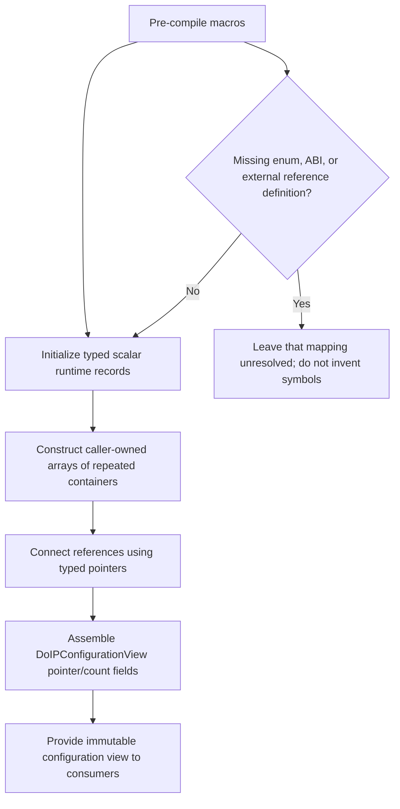
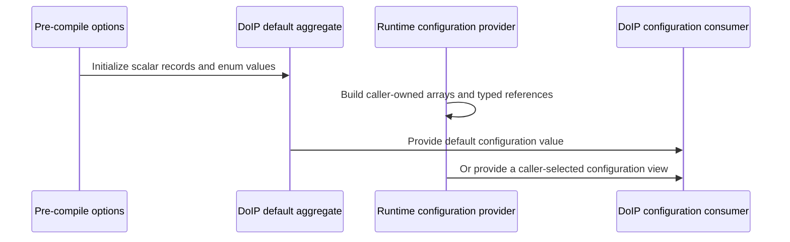

# DoIP Configuration — Detailed Design

| Item | Value |
|---|---|
| Module | DoIP |
| Feature | Configuration model for extracted ECUC parameter definitions |
| Source | `RequirementExtraction/DoIP_Configurations.arxml` |
| Source specification | `AUTOSAR_SWS_DiagnosticOverIP.pdf`, R21-11, Document ID 418 |
| Scope | 66 extracted parameter definitions; configuration-layer runtime containers only (`consumer_wiring=config_layer_only`) |
| Status | **Approved implementation complete — configuration layer only; consumer wiring is intentionally unchanged.** |

## 1. Scope and interpretation

This design covers the configuration information represented by the 66 annotations in `DoIP_Configurations.arxml`. It describes how those definitions are grouped, typed, traced, and made available to the DoIP module and its configured integrations.

The source is a traceability extract in an AUTOSAR-style XML envelope. It is not, by itself, a validated ECUC module definition or a complete configuration instance. In particular, its annotations do not consistently specify values, container multiplicities, value-configuration classes, or all enumeration literals. The design therefore preserves extracted constraints and relationships without treating incomplete extraction text as runtime behavior or as an effective default.

In scope:

- The configuration groups and parameters listed in Section 4.
- Preservation of numeric ranges, multiplicities, references, symbolic identifiers, callback names, and post-build classification exactly as extracted.
- The explicitly described bindings to SoAd, PduR, Dcm, and callback interfaces.
- Configuration definitions in the existing `configuration/Configuration.hpp`, using the project’s current pre-compile macro convention.
- Clearly labeled project-example values where the extraction has no usable default, without presenting those values as AUTOSAR defaults.
- Typed C++ runtime configuration containers in the same header, initialized from pre-compile options where the mapping is unambiguous.

Out of scope:

- Implementing the DoIP protocol behavior described by the SWS.
- Generating or validating a production ECUC configuration.
- Defining the missing container multiplicities, callback ABI, unresolved enum values, or unspecified cross-parameter relationships.
- Adding protocol behavior or changing DoIP/SoAd/PduR interfaces.

## 2. Architecture

### 2.1 Configuration structure

The configuration has two layers:

1. **Pre-compile options:** Keep existing `#define` values and add missing scalar options. These remain build-time defaults and feature switches.
2. **Runtime containers:** Add plain aggregate structs that group values by ECUC container and a top-level `DoIPConfiguration` value containing a view of repeated container instances. The default configuration is initialized from macros; integrators may construct another configuration at runtime.

Runtime records use fixed-lifetime pointer/count views over caller-owned arrays for repeated ECUC containers, avoiding dynamic allocation and assumptions about unspecified container counts. Single-instance values are stored directly as typed members. The record types do not perform validation or protocol behavior.

Existing definitions are the compatibility baseline. Existing values and public macro names will be retained. New macros for parameters not yet represented will be annotated as project-example values when the extraction does not give a usable default. Example values are selected only within explicit source ranges and are not AUTOSAR defaults or a production ECU configuration.

### 2.2 Runtime configuration class diagram

The following types are value containers only. The default instance is initialized from pre-compile macro values; callers may instantiate the same types with runtime-selected values. Pointer/count pairs refer to storage owned by the configuration provider, which must outlive consumers.

```mermaid
classDiagram
    class DoIPConfiguration {
        +DoIPGeneralConfig general
        +DoIPConfigSet configSet
        +DoIPConfigurationView containers
    }

    class DoIPGeneralConfig {
        +uint32_t maxRequestBytes
        +float mainFunctionPeriodSeconds
        +uint16_t hostNameSizeMax
        +uint8_t gidInvalidityPattern
        +uint8_t vinInvalidityPattern
        +uint8_t maxUdpRequestsPerConnection
        +bool developmentErrorDetect
        +bool dhcpOptionVinUse
        +bool entityStatusMaxByteFieldUse
        +bool useEidAsGid
        +bool versionInfoApi
        +bool vinGidMaster
        +DoIPNodeTypeValue nodeType
    }

    class DoIPConfigSet {
        +uint64_t eid
        +uint64_t gid
        +uint16_t logicalAddress
        +bool eidConfigured
        +bool gidConfigured
    }

    class DoIPInterfaceConfig {
        +uint8_t interfaceId
        +float aliveCheckResponseTimeoutSeconds
        +float generalInactivityTimeSeconds
        +float initialInactivityTimeSeconds
        +float initialVehicleAnnouncementTimeSeconds
        +float vehicleAnnouncementIntervalSeconds
        +uint8_t maxTesterConnections
        +uint8_t vehicleAnnouncementCount
        +bool vehicleAnnouncementCountConfigured
        +bool vehicleAnnouncementIntervalConfigured
        +bool activationLineControl
        +bool useMacAddressForIdentification
        +bool useVehicleIdentificationSyncStatus
        +DoIPAnnouncementStart announcementStart
    }

    class DoIPTcpConnectionConfig {
        +bool requestAddressAssignment
        +bool securityRequired
        +DoIPSoAdTcpRxPduConfig soAdTcpRxPdu
        +DoIPSoAdTcpTxPduConfig soAdTcpTxPdu
    }

    class DoIPSoAdTcpRxPduConfig {
        +uint16_t pduId
    }

    class DoIPSoAdTcpTxPduConfig {
        +uint16_t pduId
    }

    class DoIPUdpConnectionConfig {
        +bool requestAddressAssignment
        +DoIPSoAdUdpRxPduConfig soAdUdpRxPdu
        +DoIPSoAdUdpTxPduConfig soAdUdpTxPdu
    }

    class DoIPSoAdUdpRxPduConfig {
        +uint16_t pduId
    }

    class DoIPSoAdUdpTxPduConfig {
        +uint16_t pduId
    }

    class DoIPUdpVehicleAnnouncementConnectionConfig {
        +bool requestAddressAssignment
    }

    class DoIPPduConfig {
        +uint16_t pduRRxPduId
        +uint16_t pduRTxPduId
        +uint32_t announcementTxPduId
        +DoIPPduTypeValue txPduType
    }

    class DoIPTargetAddressConfig {
        +uint16_t value
    }

    class DoIPRoutingActivationConfig {
        +uint8_t number
        +bool securityRequired
        +const DoIPTargetAddressConfig* targets
        +size_t targetCount
        +DoIPCallbackDataConfig callbackData
    }

    class DoIPTesterConfig {
        +uint16_t sourceAddress
        +uint32_t diagnosticAckNackBytes
        +const DoIPRoutingActivationConfig* activations
        +size_t activationCount
    }

    class DoIPChannelConfig {
        +const DoIPTesterConfig* sourceTester
        +const DoIPTargetAddressConfig* target
    }

    class DoIPCallbackDataConfig {
        +uint8_t authenticationRequestLength
        +uint8_t authenticationResponseLength
        +uint8_t confirmationRequestLength
        +uint8_t confirmationResponseLength
        +bool authenticationCallbackConfigured
        +bool confirmationCallbackConfigured
    }

    class DoIPConfigurationView {
        +const DoIPInterfaceConfig* interfaces
        +size_t interfaceCount
        +const DoIPTcpConnectionConfig* tcpConnections
        +size_t tcpConnectionCount
        +const DoIPUdpConnectionConfig* udpConnections
        +size_t udpConnectionCount
        +const DoIPUdpVehicleAnnouncementConnectionConfig* announcementConnections
        +size_t announcementConnectionCount
        +const DoIPPduConfig* pduMappings
        +size_t pduMappingCount
        +const DoIPTargetAddressConfig* targets
        +size_t targetCount
        +const DoIPRoutingActivationConfig* routingActivations
        +size_t routingActivationCount
        +const DoIPTesterConfig* testers
        +size_t testerCount
        +const DoIPChannelConfig* channels
        +size_t channelCount
    }

    class DoIPNodeTypeValue {
        <<enum>>
        Gateway
    }

    class DoIPAnnouncementStart {
        <<enum>>
        Automatic
        OnTrigger
    }

    class DoIPPduTypeValue {
        <<enum>>
        InterfacePdu
        TransportProtocolPdu
    }

    DoIPConfiguration *-- DoIPGeneralConfig
    DoIPConfiguration *-- DoIPConfigSet
    DoIPConfiguration *-- DoIPConfigurationView
    DoIPConfigurationView o-- DoIPInterfaceConfig
    DoIPConfigurationView o-- DoIPTcpConnectionConfig
    DoIPTcpConnectionConfig *-- DoIPSoAdTcpRxPduConfig
    DoIPTcpConnectionConfig *-- DoIPSoAdTcpTxPduConfig
    DoIPConfigurationView o-- DoIPUdpConnectionConfig
    DoIPUdpConnectionConfig *-- DoIPSoAdUdpRxPduConfig
    DoIPUdpConnectionConfig *-- DoIPSoAdUdpTxPduConfig
    DoIPConfigurationView o-- DoIPUdpVehicleAnnouncementConnectionConfig
    DoIPConfigurationView o-- DoIPPduConfig
    DoIPConfigurationView o-- DoIPTargetAddressConfig
    DoIPConfigurationView o-- DoIPRoutingActivationConfig
    DoIPConfigurationView o-- DoIPTesterConfig
    DoIPConfigurationView o-- DoIPChannelConfig
    DoIPTesterConfig --> DoIPRoutingActivationConfig : activation references
    DoIPRoutingActivationConfig --> DoIPTargetAddressConfig : target references
    DoIPRoutingActivationConfig *-- DoIPCallbackDataConfig
    DoIPChannelConfig --> DoIPTesterConfig : source-address reference
    DoIPChannelConfig --> DoIPTargetAddressConfig : target reference
    DoIPGeneralConfig --> DoIPNodeTypeValue
    DoIPInterfaceConfig --> DoIPAnnouncementStart
    DoIPPduConfig --> DoIPPduTypeValue
```

### 2.3 Configuration data flow

The following is a configuration data flow, not a DoIP protocol state machine.

There is no nontrivial configuration function in this design: the structures are aggregates and the default instance is initialized from macros. Range validation and conversion from seconds to scheduler ticks are out of scope.

## 3. Types and design elements

### 3.1 Runtime type table

The runtime types are aggregate value records. Use `<cstdint>` fixed-width integers for ECUC values, `float` for times expressed in seconds, `bool` for Boolean values, and `std::size_t` for array counts. No member has a constructor or behavior. The default configuration object contains pointers to static example arrays and is read-only; user-created configuration views may point to other caller-owned arrays.

| Type | Members | Purpose and usage |
|---|---|---|
| `DoIPNodeTypeValue` | `Gateway` | Typed value for `DoIPGeneral.DoIPNodeType`; only the gateway literal is explicit in the extraction. The distinct type name avoids collision with the existing `DoIPNodeType` configuration macro. |
| `DoIPAnnouncementStart` | `Automatic`, `OnTrigger` | Typed interface announcement-start mode, mapped from the default macro `DOIP_AUTOMATIC_ANNOUNCE` to `Automatic`; `OnTrigger` is available for runtime values based on the description. |
| `DoIPPduTypeValue` | `InterfacePdu`, `TransportProtocolPdu` | Typed PduR Tx API type; maps the existing default macro `DOIP_TPPDU` to `TransportProtocolPdu`. The distinct type name avoids collision with the existing `DoIPPduType` configuration macro. |
| `DoIPGeneralConfig` | `maxRequestBytes:uint32_t`; `mainFunctionPeriodSeconds:float`; `hostNameSizeMax:uint16_t`; `gidInvalidityPattern:uint8_t`; `vinInvalidityPattern:uint8_t`; `maxUdpRequestsPerConnection:uint8_t`; Boolean switches for development error detection, DHCP VIN, entity max-byte support, EID-as-GID, version API, and VIN/GID master; `nodeType:DoIPNodeTypeValue` | Runtime values for the `DoIPGeneral` parameters. |
| `DoIPConfigSet` | `eid:uint64_t`; `gid:uint64_t`; `logicalAddress:uint16_t`; `eidConfigured:bool`; `gidConfigured:bool` | Entity/group identity and logical address; 48-bit value ranges fit without narrowing. Presence fields preserve the optional 0..1 multiplicity of EID and GID. |
| `DoIPInterfaceConfig` | `interfaceId:uint8_t`; `aliveCheckResponseTimeoutSeconds`, `generalInactivityTimeSeconds`, `initialInactivityTimeSeconds`, `initialVehicleAnnouncementTimeSeconds`, `vehicleAnnouncementIntervalSeconds` as `float`; `maxTesterConnections:uint8_t`; `vehicleAnnouncementCount:uint8_t`; `vehicleAnnouncementCountConfigured:bool`; `vehicleAnnouncementIntervalConfigured:bool`; `activationLineControl:bool`; `useMacAddressForIdentification:bool`; `useVehicleIdentificationSyncStatus:bool`; `announcementStart:DoIPAnnouncementStart` | One runtime interface container. |
| `DoIPTcpConnectionConfig` | `requestAddressAssignment:bool`; `securityRequired:bool`; `soAdTcpRxPdu:DoIPSoAdTcpRxPduConfig`; `soAdTcpTxPdu:DoIPSoAdTcpTxPduConfig` | One TCP connection container with its TCP SoAd Rx and Tx PDU subcontainers. |
| `DoIPSoAdTcpRxPduConfig` | `pduId:uint16_t` | TCP SoAd Rx PDU subcontainer nested in `DoIPTcpConnectionConfig`; ECUC_DoIP_00082. |
| `DoIPSoAdTcpTxPduConfig` | `pduId:uint16_t` | TCP SoAd Tx PDU subcontainer nested in `DoIPTcpConnectionConfig`; ECUC_DoIP_00085. |
| `DoIPUdpConnectionConfig` | `requestAddressAssignment:bool`; `soAdUdpRxPdu:DoIPSoAdUdpRxPduConfig`; `soAdUdpTxPdu:DoIPSoAdUdpTxPduConfig` | One UDP connection container with its UDP SoAd Rx and Tx PDU subcontainers. |
| `DoIPUdpVehicleAnnouncementConnectionConfig` | `requestAddressAssignment:bool` | One vehicle-announcement UDP connection container. |
| `DoIPSoAdUdpRxPduConfig` | `pduId:uint16_t` | UDP SoAd Rx PDU subcontainer nested in `DoIPUdpConnectionConfig`; ECUC_DoIP_00048. |
| `DoIPSoAdUdpTxPduConfig` | `pduId:uint16_t` | UDP SoAd Tx PDU subcontainer nested in `DoIPUdpConnectionConfig`; ECUC_DoIP_00051. |
| `DoIPPduConfig` | PduR Rx/Tx IDs as `uint16_t`; announcement Tx ID as `uint32_t`; `txPduType:DoIPPduTypeValue` | Numeric PDU handles and Tx type. SoAd TCP and UDP PDU IDs belong to their respective connection configs; external PDU references remain separately unresolved. |
| `DoIPTargetAddressConfig` | `value:uint16_t` | One logical target address. |
| `DoIPRoutingActivationConfig` | `number:uint8_t`; `securityRequired:bool`; `targets:const DoIPTargetAddressConfig*`; `targetCount:size_t`; embedded `DoIPCallbackDataConfig` | One routing-activation container, its target-address collection, and its numeric authentication/confirmation callback sizing. |
| `DoIPTesterConfig` | `sourceAddress:uint16_t`; `diagnosticAckNackBytes:uint32_t`; `activations:const DoIPRoutingActivationConfig*`; `activationCount:size_t` | One tester container and its referenced activation collection. |
| `DoIPChannelConfig` | `sourceTester:const DoIPTesterConfig*`; `target:const DoIPTargetAddressConfig*` | One channel reference pair using typed pointers to runtime container instances. |
| `DoIPCallbackDataConfig` | `authenticationRequestLength:uint8_t`; `authenticationResponseLength:uint8_t`; `confirmationRequestLength:uint8_t`; `confirmationResponseLength:uint8_t`; `authenticationCallbackConfigured:bool`; `confirmationCallbackConfigured:bool` | Runtime callback payload sizes and configured-state flags; callback function pointer fields are excluded until their ABI is specified. |
| `DoIPConfigurationView` | Const pointer/count pairs for arrays of `DoIPInterfaceConfig`, each connection type, `DoIPPduConfig`, `DoIPTargetAddressConfig`, `DoIPRoutingActivationConfig`, `DoIPTesterConfig`, and `DoIPChannelConfig` | Non-owning collection view for repeated runtime containers. |
| `DoIPConfiguration` | `general:DoIPGeneralConfig`; `configSet:DoIPConfigSet`; `containers:DoIPConfigurationView` | Top-level aggregate; the default instance is initialized from existing pre-compile macros. |

### 3.2 Default runtime value mapping

The header defines a read-only `DOIP_DEFAULT_CONFIGURATION` aggregate in the `as::doip::configuration` namespace. Its scalar values map from existing macros without changing those macros. The default configuration includes one example interface, connection record, PDU ID record, target address, routing activation, tester, and channel record where the project macros currently provide a single example. Repeated containers are represented by static arrays; pointer/count values in the view refer to those arrays.

| Runtime record/member | Pre-compile source | Notes |
|---|---|---|
| `DoIPGeneralConfig` members | Corresponding `DoIP...` macros in `DoIPGeneral` | `nodeType` maps `DOIP_GATEWAY` to `DoIPNodeTypeValue::Gateway`. |
| `DoIPConfigSet` values and presence flags | `DoIPEid`, `DoIPGid`, `DoIPLogicalAddress` | Presence flags are true for the configured macro examples; zero is still a valid configured value. |
| `DoIPInterfaceConfig` members | Corresponding `DoIP...` interface macros | Optional announcement count/interval presence flags reflect whether the default example is included. |
| `DoIPTcpConnectionConfig`, `DoIPUdpConnectionConfig`, `DoIPUdpVehicleAnnouncementConnectionConfig` | Parent-qualified address-assignment macros plus `DoIPTcpConnectionSecurityRequired` | Keeps the three `ECUC_DoIP_00095` values separate by parent container. |
| `DoIPPduConfig` | PDU ID and type macros | `DOIP_TPPDU` maps to `DoIPPduTypeValue::TransportProtocolPdu`; PDU object references remain unresolved. |
| Target, activation, tester, and channel arrays | `DoIPTargetAddressValue`, `DoIPRoutingActivationNumber`, target/activation reference counts, and `DoIPTesterSA` | Internal references are linked with typed pointers to the default arrays; arrays are static and not dynamically allocated. |
| `DoIPCallbackDataConfig` | Existing authentication/confirmation request/response length macros | Callback function pointers are not included without callback ABI information. |
| `DoIPConfigurationView` | Static default arrays and their `sizeof(array) / sizeof(array[0])` counts | The view is non-owning; it does not allocate or free storage. |

### 3.3 Design functions

No new runtime function is required. The implementation adds aggregate types and a default aggregate instance in the existing header, not configuration validation or protocol logic. Existing APIs mentioned in the descriptions remain external integration points.

The runtime configuration is an explicit typed access layer over compile-time defaults. It does not automatically replace existing consumers such as `RoutingActivationSettings`; wiring the new container into module behavior remains out of scope.

The default value maps only the values that the macros currently represent. Compile-time enum tokens are translated explicitly to typed enum members: `DOIP_GATEWAY` to `DoIPNodeTypeValue::Gateway`, `DOIP_AUTOMATIC_ANNOUNCE` to `DoIPAnnouncementStart::Automatic`, and `DOIP_TPPDU` to `DoIPPduTypeValue::TransportProtocolPdu`. The `Value` suffix avoids collision with the legacy object-like macros `DoIPNodeType` and `DoIPPduType`; those macros retain their original names and values. No enum literal is inferred for an unlisted node type.

### 3.4 External interactions and sequence

The sequence shows how compile-time options seed a runtime configuration view and how that view is presented to consumers. It does not specify DoIP protocol behavior or module startup ordering.

Relevant referenced interactions:

- `DoIPMainFunctionPeriod` specifies the configured call frequency for `DoIP_MainFunction()` in seconds; scheduling and rounding are not described.
- `DoIPRequestAddressAssignment` is represented distinctly for TCP, UDP, and UDP vehicle-announcement connections.
- Numeric PDU IDs and Tx type are carried in `DoIPPduConfig`, except SoAd TCP and UDP Rx/Tx PDU IDs, which are nested in their respective connection configs; external PDU references remain unresolved.
- Callback payload lengths are represented in `DoIPCallbackDataConfig`; function-pointer bindings are unresolved until signatures and ABI are known.

## 4. Extracted parameter inventory and traceability

Each row maps an ECUC item ID from the source ARXML to the corresponding logical configuration member. The exact container and parameter name are both part of the trace key: `ECUC_DoIP_00095`, for example, occurs in three different connection containers. “Variant” reproduces the extract’s `PostBuildVariant` value; it is not interpreted as a complete ECUC value-configuration class.

Ranges, target types, and multiplicities below are transcribed from the extraction. “Not specified in source” means the design must not invent a constraint or default.

| ECUC item ID | Container / parameter | ECUC type | Multiplicity | Range or reference target | Variant |
|---|---|---|---:|---|---|
| `ECUC_DoIP_00004` | `DoIPGeneral.DoIPDevelopmentErrorDetect` | Boolean | 1 | Not specified in source | false |
| `ECUC_DoIP_00067` | `DoIPGeneral.DoIPDhcpOptionVinUse` | Boolean | 1 | Not specified in source | false |
| `ECUC_DoIP_00064` | `DoIPGeneral.DoIPEntityStatusMaxByteFieldUse` | Boolean | 1 | Not specified in source | false |
| `ECUC_DoIP_00065` | `DoIPGeneral.DoIPGIDInvalidityPattern` | Integer | 1 | 0 .. 255 | false |
| `ECUC_DoIP_00073` | `DoIPGeneral.DoIPHostNameSizeMax` | Integer | 1 | 5 .. 255 | false |
| `ECUC_DoIP_00006` | `DoIPGeneral.DoIPMainFunctionPeriod` | Float | 1 | ]0 .. INF[ seconds | false |
| `ECUC_DoIP_00019` | `DoIPGeneral.DoIPMaxRequestBytes` | Integer | 1 | 1 .. 4294967295 | false |
| `ECUC_DoIP_00074` | `DoIPGeneral.DoIPMaxUDPRequestPerConnection` | Integer | 1 | 1 .. 255 | false |
| `ECUC_DoIP_00021` | `DoIPGeneral.DoIPNodeType` | Enumeration | 1 | `DOIP_GATEWAY` listed; description: DoIP Gateway | false |
| `ECUC_DoIP_00018` | `DoIPGeneral.DoIPUseEIDasGID` | Boolean | 1 | Not specified in source | false |
| `ECUC_DoIP_00005` | `DoIPGeneral.DoIPVersionInfoApi` | Boolean | 1 | Not specified in source | false |
| `ECUC_DoIP_00017` | `DoIPGeneral.DoIPVinGidMaster` | Boolean | 1 | Not specified in source | false |
| `ECUC_DoIP_00066` | `DoIPGeneral.DoIPVinInvalidityPattern` | Integer | 1 | 0 .. 255 | false |
| `ECUC_DoIP_00093` | `DoIPFurtherActionByteCallback.DoIPFurtherActionByteDirect` | Function name | 0..1 | Not specified in source | Not specified |
| `ECUC_DoIP_00028` | `DoIPGetGidCallback.DoIPGetGidDirect` | Function name | 0..1 | Not specified in source | false |
| `ECUC_DoIP_00027` | `DoIPPowerModeCallback.DoIPPowerModeDirect` | Function name | 0..1 | Not specified in source | false |
| `ECUC_DoIP_00029` | `DoIPTriggerGidSyncCallback.DoIPTriggerGidSyncDirect` | Function name | 0..1 | Not specified in source | false |
| `ECUC_DoIP_00014` | `DoIPConfigSet.DoIPEid` | Integer | 0..1 | 0 .. 281474976710655 | true |
| `ECUC_DoIP_00015` | `DoIPConfigSet.DoIPGid` | Integer | 0..1 | 0 .. 281474976710655 | true |
| `ECUC_DoIP_00020` | `DoIPConfigSet.DoIPLogicalAddress` | Integer | 1 | 0 .. 65535 | true |
| `ECUC_DoIP_00009` | `DoIPInterface.DoIPAliveCheckResponseTimeout` | Float | 1 | [0 .. INF] seconds | false |
| `ECUC_DoIP_00068` | `DoIPInterface.DoIPGeneralInactivityTime` | Float | 1 | ]0 .. INF[ seconds | false |
| `ECUC_DoIP_00010` | `DoIPInterface.DoIPInitialInactivityTime` | Float | 1 | ]0 .. INF[ seconds | false |
| `ECUC_DoIP_00008` | `DoIPInterface.DoIPInitialVehicleAnnouncementTime` | Float | 1 | [0 .. INF] seconds | false |
| `ECUC_DoIP_00101` | `DoIPInterface.DoIPInterfaceActLineCtrl` | Boolean | 1 | Not specified in source | false |
| `ECUC_DoIP_00099` | `DoIPInterface.DoIPInterfaceAnnouncementStart` | Enumeration | 1 | `DOIP_AUTOMATIC_ANN` listed; description also defines OnTrigger | false |
| `ECUC_DoIP_00098` | `DoIPInterface.DoIPInterfaceId` | Integer (generated symbolic name) | 1 | 0 .. 255 | false |
| `ECUC_DoIP_00012` | `DoIPInterface.DoIPMaxTesterConnections` | Integer | 1 | 1 .. 255 | false |
| `ECUC_DoIP_00013` | `DoIPInterface.DoIPUseMacAddressForIdentification` | Boolean | 1 | Not specified in source; dependency names `DoIPEID` | false |
| `ECUC_DoIP_00016` | `DoIPInterface.DoIPUseVehicleIdentificationSyncStatus` | Boolean | 1 | Not specified in source | false |
| `ECUC_DoIP_00094` | `DoIPInterface.DoIPVehicleAnnouncementCount` | Integer | 0..1 | 1 .. 255 | false |
| `ECUC_DoIP_00007` | `DoIPInterface.DoIPVehicleAnnouncementInterval` | Float | 0..1 | [0 .. INF] seconds | false |
| `ECUC_DoIP_00070` | `DoIPChannel.DoIPChannelSARef` | Reference | 1 | `DoIPTester` | Value |
| `ECUC_DoIP_00071` | `DoIPChannel.DoIPChannelTARef` | Reference | 1 | `DoIPTargetAddress` | Value |
| `ECUC_DoIP_00057` | `DoIPPduRRxPdu.DoIPPduRRxPduId` | Integer (generated symbolic name) | 1 | 0 .. 65535 | false |
| `ECUC_DoIP_00058` | `DoIPPduRRxPdu.DoIPPduRRxPduRef` | Reference | 1 | `Pdu` | Value |
| `ECUC_DoIP_00060` | `DoIPPduRTxPdu.DoIPPduRTxPduId` | Integer (generated symbolic name) | 1 | 0 .. 65535 | false |
| `ECUC_DoIP_00075` | `DoIPPduRTxPdu.DoIPPduType` | Enumeration | 0..1 | `DOIP_IFPDU` and `DOIP_TPPDU` described; source range is incomplete | true |
| `ECUC_DoIP_00059` | `DoIPPduRTxPdu.DoIPPduRTxPduRef` | Reference | 1 | `Pdu` | Value |
| `ECUC_DoIP_00054` | `DoIPTargetAddress.DoIPTargetAddressValue` | Integer | 1 | 0 .. 65535 | true |
| `ECUC_DoIP_00095` | `DoIPTcpConnection.DoIPRequestAddressAssignment` | Boolean | 1 | Not specified in source | false |
| `ECUC_DoIP_00097` | `DoIPTcpConnection.DoIPTcpConnectionSecurityRequired` | Boolean | 0..1 | Not specified in source | Not specified |
| `ECUC_DoIP_00082` | `DoIPSoAdTcpRxPdu.DoIPSoAdTcpRxPduId` | Integer (generated symbolic name) | 1 | 0 .. 65535 | false |
| `ECUC_DoIP_00083` | `DoIPSoAdTcpRxPdu.DoIPSoAdTcpRxPduRef` | Reference | 1 | `Pdu` | Value |
| `ECUC_DoIP_00085` | `DoIPSoAdTcpTxPdu.DoIPSoAdTcpTxPduId` | Integer (generated symbolic name) | 1 | 0 .. 65535 | false |
| `ECUC_DoIP_00084` | `DoIPSoAdTcpTxPdu.DoIPSoAdTcpTxPduRef` | Reference | 1 | `Pdu` | Value |
| `ECUC_DoIP_00095` | `DoIPUdpConnection.DoIPRequestAddressAssignment` | Boolean | 1 | Not specified in source | false |
| `ECUC_DoIP_00048` | `DoIPSoAdUdpRxPdu.DoIPSoAdUdpRxPduId` | Integer (generated symbolic name) | 1 | 0 .. 65535 | false |
| `ECUC_DoIP_00049` | `DoIPSoAdUdpRxPdu.DoIPSoAdUdpRxPduRef` | Reference | 1 | `Pdu` | Value |
| `ECUC_DoIP_00051` | `DoIPSoAdUdpTxPdu.DoIPSoAdUdpTxPduId` | Integer (generated symbolic name) | 1 | 0 .. 65535 | false |
| `ECUC_DoIP_00050` | `DoIPSoAdUdpTxPdu.DoIPSoAdUdpTxPduRef` | Reference | 1 | `Pdu` | Value |
| `ECUC_DoIP_00095` | `DoIPUdpVehicleAnnouncementConnection.DoIPRequestAddressAssignment` | Boolean | 1 | Not specified in source | false |
| `ECUC_DoIP_00078` | `DoIPSoAdUdpVehicleAnnouncementTxPdu.DoIPSoAdUdpVehicleAnnouncementTxPduId` | Integer (generated symbolic name) | 1 | 0 .. 4294967295 | false |
| `ECUC_DoIP_00079` | `DoIPSoAdUdpVehicleAnnouncementTxPdu.DoIPSoAdUdpVehicleAnnouncementTxPduRef` | Reference | 1 | `Pdu` | Value |
| `ECUC_DoIP_00033` | `DoIPRoutingActivation.DoIPRoutingActivationNumber` | Integer | 1 | 0 .. 255 | true |
| `ECUC_DoIP_00096` | `DoIPRoutingActivation.DoIPRoutingActivationSecurityRequired` | Boolean | 0..1 | Not specified in source | Not specified |
| `ECUC_DoIP_00034` | `DoIPRoutingActivation.DoIPTargetAddressRef` | Reference | 1..65535 | `DoIPTargetAddress` | true |
| `ECUC_DoIP_00039` | `DoIPRoutingActivationAuthenticationCallback.DoIPRoutingActivationAuthenticationFunc` | Function name | 0..1 | Not specified in source | false |
| `ECUC_DoIP_00040` | `DoIPRoutingActivationAuthenticationCallback.DoIPRoutingActivationAuthenticationReqLength` | Integer | 1 | 0 .. 4 | false |
| `ECUC_DoIP_00041` | `DoIPRoutingActivationAuthenticationCallback.DoIPRoutingActivationAuthenticationResLength` | Integer | 1 | 0 .. 4 | false |
| `ECUC_DoIP_00036` | `DoIPRoutingActivationConfirmationCallback.DoIPRoutingActivationConfirmationFunc` | Function name | 0..1 | Not specified in source | false |
| `ECUC_DoIP_00037` | `DoIPRoutingActivationConfirmationCallback.DoIPRoutingActivationConfirmationReqLength` | Integer | 1 | 0 .. 4 | false |
| `ECUC_DoIP_00038` | `DoIPRoutingActivationConfirmationCallback.DoIPRoutingActivationConfirmationResLength` | Integer | 1 | 0 .. 4 | false |
| `ECUC_DoIP_00042` | `DoIPTester.DoIPNumByteDiagAckNack` | Integer | 1 | 0 .. 4294967295 | true |
| `ECUC_DoIP_00043` | `DoIPTester.DoIPTesterSA` | Integer | 1 | 0 .. 65535 | true |
| `ECUC_DoIP_00062` | `DoIPTester.DoIPRoutingActivationRef` | Reference | 1..255 | `DoIPRoutingActivation` | true |

## 5. Configuration behavior and boundaries

1. Keep parameter identity tied to both its parent container and parameter short name. ECUC item IDs alone are not unique in this extract.
2. Apply only literal range, target, and multiplicity constraints present in the source. Do not infer defaults from the `DefaultValue` strings that say “Post-Build Variant false” or “Post-Build Variant true”.
3. Keep time values in seconds at the configuration boundary. Conversion to ticks, rounding, and scheduler behavior require the relevant implementation and SWS context.
4. A reference parameter remains a reference to its declared target type. The extract does not authorize replacing an unresolved reference with a numeric address or identifier.
5. Optional direct-callback parameters distinguish direct function calls from an RPort/service-interface path where the description explicitly says so. Do not select or synthesize an alternative interface when configuration does not establish which path is intended.
6. Descriptions naming `SoAd_RequestIpAddrAssignment()` apply separately to the TCP, UDP, and UDP vehicle-announcement connection parameter instances.
7. PDU IDs and PDU references are paired within their named Rx/Tx containers and must not be interchanged across protocol or direction.

## 6. Parameter responsibilities and example-value policy

This section summarizes the purpose carried by each container group. The source ARXML description remains authoritative for exact wording and conditions.

| Container group | Responsibility |
|---|---|
| `DoIPGeneral` | Module-wide error-detection and API switches; DHCP host-name behavior and size; invalid VIN/GID fill patterns; main-function period; request and UDP request limits; node type; EID/GID master behavior. |
| `DoIPFurtherActionByteCallback`, `DoIPGetGidCallback`, `DoIPPowerModeCallback`, `DoIPTriggerGidSyncCallback` | Optional direct C function names; where stated, a configured direct function replaces the associated RPort/service-interface callback. |
| `DoIPConfigSet` | EID, GID, and the DoIP entity logical address used for vehicle identification/announcement or diagnostic routing. |
| `DoIPInterface` | Alive-check and socket inactivity timeouts; vehicle-announcement timing, count, and start mode; interface ID; tester connection limit; activation-line behavior; identification source and synchronization-status options. |
| `DoIPChannel`, `DoIPTargetAddress` | Associate a tester with a target and provide the target logical address. |
| `DoIPPduRRxPdu`, `DoIPPduRTxPdu` | PduR Rx/Tx symbolic handles and global PDU references; select interface or TP API type for Tx where configured. |
| SoAd TCP/UDP PDU containers | SoAd-facing Rx/Tx PDU handles and references, including the vehicle-announcement Tx PDU. |
| TCP, UDP, and vehicle-announcement connection containers | Configure whether the related local address requests assignment through SoAd; TCP may also require secure transport. |
| Routing activation and callback containers | Configure activation number, security requirement, target references, direct callback, and request/response data lengths for authentication and confirmation. |
| `DoIPTester` | Tester source address, original diagnostic request byte count used in NACK responses, and supported routing activations. |

For parameters whose source has no usable default, implementation will choose a labeled project-example value only where a scalar value is needed by the existing macro convention. The typed runtime default object maps those macros to their corresponding member types:

| Parameter category | Example-value policy |
|---|---|
| Boolean | Use disabled (`DOIP_CFG_FALSE`) unless enabling is required for a coherent example configuration. |
| Bounded integers | Use a value within the extracted range; prefer existing compatible values when already defined. |
| Times | Use a positive seconds value within the extracted range; preserve existing macro value and units when already consumed by current code. Do not silently convert a legacy value. |
| Enumeration | Use a literal listed in the extract only. If the extraction is incomplete and no listed literal is usable, do not invent an enum value; leave the macro explicitly marked unresolved rather than define an invalid token. |
| Optional references/callbacks | Represent absence using the repository’s existing disabled/empty convention if present. Otherwise document the missing representation and do not invent a function or target. |
| Repeated containers/references | Use the existing count/list macro pattern, preserving each parent container as a distinct group even when ECUC IDs repeat. |

These policies produce demonstrative pre-compile values, not verified ECUC defaults. Values already consumed by the existing runtime must not be changed merely to make the example more complete. The default runtime aggregate is illustrative; its static arrays preserve the currently configured single-instance example and do not claim that the source defines those container multiplicities.

## 7. Assumptions and unresolved requirements

### Assumptions for this draft

- The 66 annotations in the tagged file are the complete task scope; no behavioral SWS requirements outside this file are being added.
- `ECUCItemID`, parent container, parameter short name, type, multiplicity, and source reference are retained as the traceability identity.
- Runtime structs represent values, not AUTOSAR ECUC generated container classes or protocol state.
- Repeated runtime container references use `const` typed pointers plus counts, with storage owned and lifetime-managed by the caller.
- The default runtime aggregate is assembled from existing scalar macros and static example arrays; it does not own its referenced arrays.
- Compile-time enum tokens are mapped to the typed enum members documented in Section 3.2; the exact AUTOSAR enum literal set remains subject to source verification.
- The value “seconds” is retained for all time parameters whose descriptions specify it; no conversion policy is assumed.
- Values introduced because the extraction has no usable default are labeled project examples, and existing runtime-consumed values are preserved.

### Unresolved items requiring specification or user confirmation

1. **Effective defaults:** Many extracted `DefaultValue` entries contain “Post-Build Variant false/true” rather than a value. Direct-callback parameters also report “Regular Expression” as a default. Verify all defaults against the source SWS table before generating usable configuration values.
2. **Enumeration completeness:** `DoIPNodeType` only lists `DOIP_GATEWAY`; `DoIPInterfaceAnnouncementStart` names an automatic literal while its description also defines OnTrigger; `DoIPPduType` has an incomplete range string. Confirm all enum values and exact symbolic spellings.
3. **Container multiplicity:** Parameter multiplicity does not define the number of instances of `DoIPInterface`, `DoIPTester`, connection containers, callback containers, or PDU containers. Confirm container-level multiplicities from the ECUC definition.
4. **Value configuration class:** The extraction’s `PostBuildVariant` field contains `true`, `false`, `Value`, and “Not specified”; confirm how these correspond to pre-compile, link-time, and post-build configurability.
5. **Repeated ECUC ID:** `ECUC_DoIP_00095` is assigned to `DoIPRequestAddressAssignment` in TCP, UDP, and vehicle-announcement UDP containers. Preserve all three qualified keys, and verify whether this repetition is intentional in the source.
6. **Cross-parameter dependencies:** `DoIPUseMacAddressForIdentification` names a dependency on `DoIPEID`, but the exact activation condition is not stated. Other relationships are mostly marked “Not specified in source.” Confirm constraints such as when `DoIPEid` is mandatory.
7. **Callbacks:** Direct function callback signatures, return values, calling convention, linkage, and interaction with service ports are not specified in this extract.
8. **External PDU references:** Runtime containers carry numeric PDU IDs but not PDU object references because the extraction does not establish a C++ PDU-handle type. Those references remain unresolved for a later integration-specific extension.
9. **Callback ABI:** Runtime containers carry callback data lengths but not function pointers; direct callback signatures, linkage, and ABI are absent from the source.
10. **Operational behavior:** The timing, state transitions, call ordering, and error handling for named DoIP/SoAd/PduR APIs must be traced to their behavioral SWS requirements separately; this design does not derive them from parameter descriptions.
11. **Example-value acceptance:** This revision assumes project-example macro values are acceptable when explicitly labeled and constrained to the source range; they are not AUTOSAR defaults.
12. **Header compatibility:** Existing macro values are preserved; their source metadata is updated to this extraction without changing current values.
13. **Enum/macro identifier collision:** The existing object-like macros `DoIPNodeType` and `DoIPPduType` retain their names and values. Runtime enum types use the distinct names `DoIPNodeTypeValue` and `DoIPPduTypeValue`, so downstream code can refer to the types normally without macro interference.

The extract contains a few literal default strings, but they still need validation before being applied:

- `DoIPVersionInfoApi`: `false`.
- `DoIPInterfaceAnnouncementStart`: `DOIP_AUTOMATIC_ANNOUNCE`, which differs from the incomplete range literal `DOIP_AUTOMATIC_ANN`.
- `DoIPPduType`: `DOIP_TPPDU`.
- `DoIPRequestAddressAssignment`: `true` in each of the TCP, UDP, and vehicle-announcement UDP containers.
- `DoIPTcpConnectionSecurityRequired` and `DoIPRoutingActivationSecurityRequired`: `false`.
- `DoIPEid`: `97 of 126 Document ID 418: AUTOSAR_SWS_DiagnosticOverIP`, which appears to be extraction/page text rather than a usable default and must not be treated as a value.

## 8. Requirement traceability

The 66 ECUC IDs in Section 4 are the upstream identifiers present in this extraction. No `SWS_DoIP_xxxxx` behavioral IDs are present in this file, so behavioral traceability is intentionally not inferred here.

| Source ID | Design element |
|---|---|
| `ECUC_DoIP_00004`, `ECUC_DoIP_00067`, `ECUC_DoIP_00064`, `ECUC_DoIP_00065`, `ECUC_DoIP_00073`, `ECUC_DoIP_00006`, `ECUC_DoIP_00019`, `ECUC_DoIP_00074`, `ECUC_DoIP_00021`, `ECUC_DoIP_00018`, `ECUC_DoIP_00005`, `ECUC_DoIP_00017`, `ECUC_DoIP_00066` | Existing/new pre-compile macros and corresponding `DoIPGeneralConfig` members |
| `ECUC_DoIP_00093`, `ECUC_DoIP_00028`, `ECUC_DoIP_00027`, `ECUC_DoIP_00029`, `ECUC_DoIP_00039`, `ECUC_DoIP_00036` | Pre-compile callback names where already defined; callback-data lengths in `DoIPCallbackDataConfig`; unresolved direct callback pointers |
| `ECUC_DoIP_00014`, `ECUC_DoIP_00015`, `ECUC_DoIP_00020` | `DoIPConfigSet`; EID/GID presence and value fields plus logical-address field |
| `ECUC_DoIP_00009`, `ECUC_DoIP_00068`, `ECUC_DoIP_00010`, `ECUC_DoIP_00008`, `ECUC_DoIP_00101`, `ECUC_DoIP_00099`, `ECUC_DoIP_00098`, `ECUC_DoIP_00012`, `ECUC_DoIP_00013`, `ECUC_DoIP_00016`, `ECUC_DoIP_00094`, `ECUC_DoIP_00007` | Pre-compile macros and `DoIPInterfaceConfig` runtime record |
| `ECUC_DoIP_00070`, `ECUC_DoIP_00071`, `ECUC_DoIP_00054` | `DoIPChannelConfig` typed pointers and `DoIPTargetAddressConfig::value` |
| `ECUC_DoIP_00057`, `ECUC_DoIP_00058`, `ECUC_DoIP_00060`, `ECUC_DoIP_00075`, `ECUC_DoIP_00059`, `ECUC_DoIP_00078`, `ECUC_DoIP_00079` | `DoIPPduConfig` numeric IDs and type; external PDU references unresolved |
| `ECUC_DoIP_00082`, `ECUC_DoIP_00083`, `ECUC_DoIP_00085`, `ECUC_DoIP_00084` | `DoIPSoAdTcpRxPduConfig` and `DoIPSoAdTcpTxPduConfig` subcontainers of `DoIPTcpConnectionConfig`; external PDU references unresolved |
| `ECUC_DoIP_00048`, `ECUC_DoIP_00049`, `ECUC_DoIP_00051`, `ECUC_DoIP_00050` | `DoIPSoAdUdpRxPduConfig` and `DoIPSoAdUdpTxPduConfig` subcontainers of `DoIPUdpConnectionConfig`; external PDU references unresolved |
| `ECUC_DoIP_00095` (TCP), `ECUC_DoIP_00097`, `ECUC_DoIP_00095` (UDP), `ECUC_DoIP_00095` (vehicle-announcement UDP) | Distinct typed TCP, UDP, and vehicle-announcement connection records |
| `ECUC_DoIP_00033`, `ECUC_DoIP_00096`, `ECUC_DoIP_00034`, `ECUC_DoIP_00040`, `ECUC_DoIP_00041`, `ECUC_DoIP_00037`, `ECUC_DoIP_00038` | `DoIPRoutingActivationConfig`; activation number, security flag, target pointers, and callback data lengths |
| `ECUC_DoIP_00042`, `ECUC_DoIP_00043`, `ECUC_DoIP_00062` | `DoIPTesterConfig`; tester address, NACK byte count, and activation pointers |

## 9. Approved implementation scope and source layout

Implementation adds the typed runtime aggregate types and default instance alongside the existing pre-compile macros in the configuration header. It does not alter DoIP protocol behavior or automatically replace existing consumers such as `RoutingActivationSettings`. Consumer wiring is excluded under the approved `consumer_wiring=config_layer_only` scope.

| Responsibility | Location | Notes |
|---|---|---|
| Detailed design | `implementation/Configuration/DetailDesign/DoIP_Configuration.md` | This document |
| ECUC requirement extract | `implementation/Configuration/RequirementExtraction/DoIP_Configurations.arxml` | Source of this design’s 66 trace entries |
| Pre-compile options and runtime configuration types | `configuration/Configuration.hpp` | Preserve existing macro names/values; add aggregate types, static example arrays, and `DOIP_DEFAULT_CONFIGURATION` |
| Runtime protocol integration | Existing DoIP module APIs | Not changed; consumer wiring is intentionally excluded from the approved scope |
| Validation or conversion logic | None | Out of scope |
