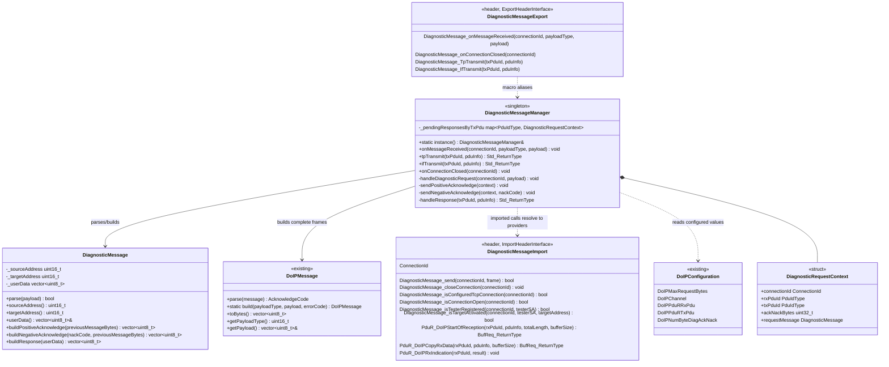
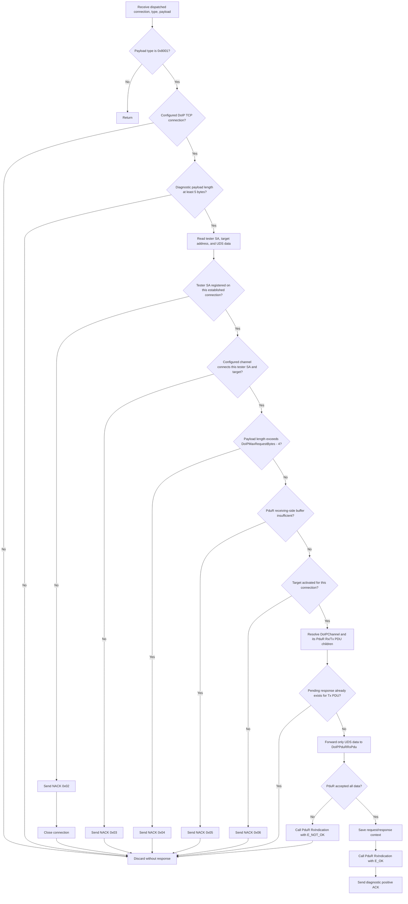
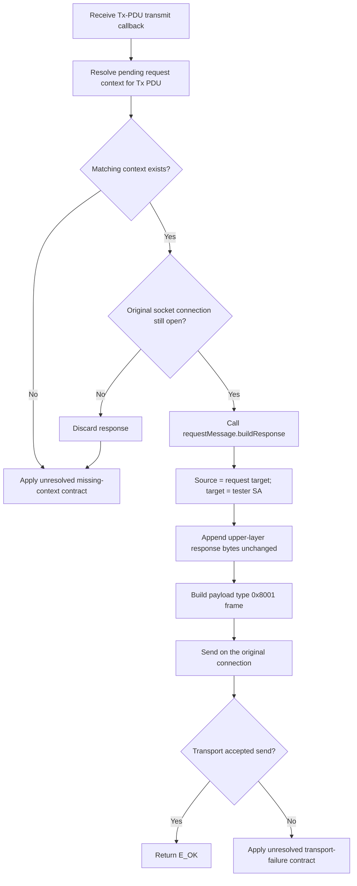
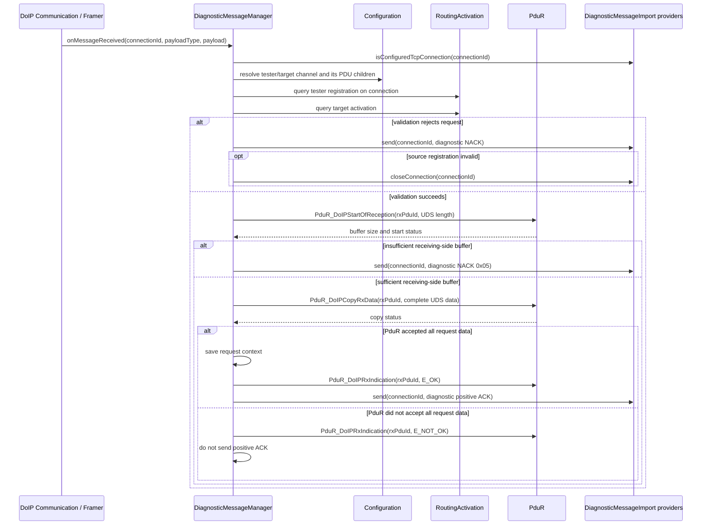
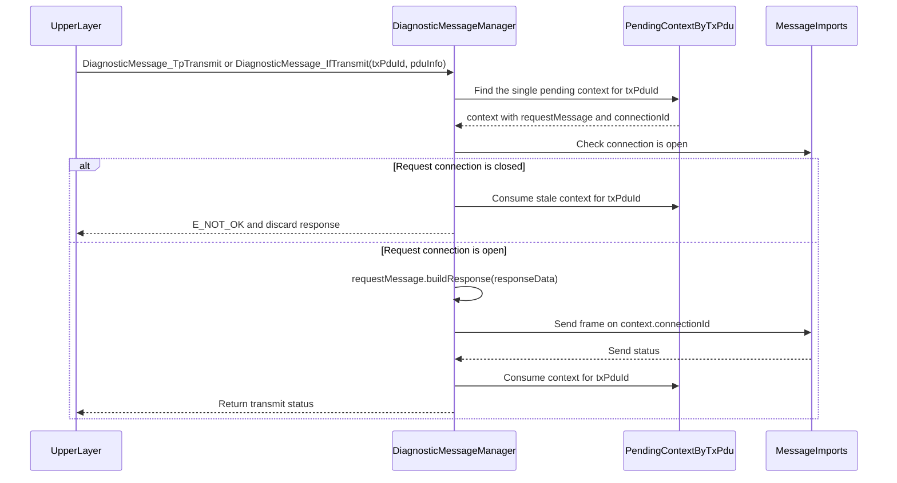

# DoIP Diagnostic Message — Detailed Design

| Item | Value |
|---|---|
| Module | DoIP |
| Feature | Diagnostic message reception, routing, ACK/NACK, and response transmission |
| Sources | `RequirementExtraction/DiagnosticMessage_Requirements.arxml` |
| Rule files | `DetailDesign-rules.md`, `Workflow-rules.md`, `Coding-rules.md` |
| Status | **Approved for implementation.** |

## 1. Scope

In scope:

- Discard Diagnostic Message payload type `0x8001` received on an unconfigured DoIP TCP connection — SWS_DoIP_00121.
- Validate the minimum diagnostic payload size, tester registration, tester/target channel, maximum request size, available receive buffer, and routing activation; send the specified diagnostic NACK and close the connection only where required — SWS_DoIP_00122–00127.
- Forward UDS data, excluding source and target addresses, to the configured `DoIPPduRRxPdu`; send a positive diagnostic ACK if PduR accepted all data — SWS_DoIP_00128–00129.
- Handle response callbacks for `DoIPPduRTxPdu`, discard a response if its request connection is closed, and preserve the upper-layer response data — SWS_DoIP_00130, SWS_DoIP_00131, SWS_DoIP_00173.
- Build diagnostic positive/negative ACKs with the specified addresses, NACK reason, and tester-specific `DoIPNumByteDiagAckNack` value — SWS_DoIP_00132–00138.

Out of scope:

- Generic DoIP header validation and transport-level payload dispatch, owned by the shared communication/message layer. The exported feature callback returns for a non-diagnostic payload type, as in NodeInformation.
- TCP connection establishment and routing-activation state management, owned by communication and Routing Activation.
- PduR's internal routing behavior and configuration generation.
- Generic DoIP header serialization beyond the diagnostic payload fields defined by the applicable AUTOSAR SWS.

Configuration identifiers retain the extracted spelling, including `DoIPTargetAdressValue`.

## 2. Architecture

The shared communication layer validates the generic DoIP header and dispatches a diagnostic frame to `DiagnosticMessageManager::onMessageReceived`. The manager follows the existing DoIP feature pattern: it is a singleton, reads the generated DoIP configuration, uses `DiagnosticMessage` for diagnostic payload parsing/building, and calls imported communication, Routing Activation, and PduR functions through `DiagnosticMessageImport.hpp` name aliases.

`DiagnosticMessageExport.hpp` maps the module's receive entry point and the module-prefixed `DiagnosticMessage_TpTransmit` / `DiagnosticMessage_IfTransmit` names directly to `DiagnosticMessageManager::instance()` methods. These aliases correspond to the AUTOSAR `DoIP_TpTransmit` / `DoIP_IfTransmit` callbacks. Import/export headers are name-mapping headers; they do not add wrapper functions. The providers for imported communication, routing-state, receive-buffer, and PduR functions remain in the integrating modules.

### 2.1 Class diagram

### 2.2 Source layout

| File | Directory | Responsibility |
|---|---|---|
| Existing `Configuration.hpp` | `Configuration/` | Provides DoIP configuration values, including channel and PDU child records; no duplicate settings are introduced. |
| `DiagnosticMessageExport.hpp` | `DiagnosticMessage/Implementation/ExportHeaderInterface/` | Maps diagnostic receive/connection-close notifications and module-prefixed transmit callback aliases to singleton methods. |
| `DiagnosticMessageImport.hpp` | `DiagnosticMessage/Implementation/ImportHeaderInterface/` | Declares imported communication, connection/routing-state, and standard PduR providers; maps their names for this module. |
| `DiagnosticMessage.hpp` | `DiagnosticMessage/Implementation/InternalHeader/` | Declares diagnostic payload parsing and diagnostic message construction. |
| `DiagnosticRequestContext.hpp` | `DiagnosticMessage/Implementation/InternalHeader/` | Declares the request metadata retained for ACK/NACK and response handling. |
| `DiagnosticMessageManager.hpp` | `DiagnosticMessage/Implementation/InternalHeader/` | Declares the singleton receive/transmit manager. |
| `DiagnosticMessage.cpp` | `DiagnosticMessage/Implementation/InternalImplement/` | Implements diagnostic payload parsing and frame construction. |
| `DiagnosticMessageManager.cpp` | `DiagnosticMessage/Implementation/InternalImplement/` | Implements validation, PduR forwarding, ACK/NACK handling, and response callbacks. |
| Existing `DoIPMessage.hpp/.cpp` | `DoIPMessage/` | Add `0x8002` / `0x8003` enum values and update the existing `build` method for outbound messages; preserve the inbound payload acceptance set. |
| `DiagnosticMessage.md` | `DiagnosticMessage/DetailDesign/` | This detailed design. |

The source locations follow this repository's current `Implementation/` layout. Existing neighboring modules retain their existing naming and are not moved.

### 2.3 Import/export header mechanism

Follow the adjacent AliveCheck and NodeInformation convention:

- Export names map directly to `DiagnosticMessageManager::instance()` methods using `#define` aliases; do not add forwarding wrappers.
- Imported provider functions are declared with their owning module's real symbol name, then aliased to a DiagnosticMessage-local name.
- `ConnectionId` and AUTOSAR PDU/API types use the existing project types where available; do not introduce a competing transport abstraction.

Use the standard PduR API symbols for diagnostic reception. The separate Routing Activation query API is an integration dependency that will be provided in a future implementation; the communication layer supplies the payload and connection services described in this design.

## 3. Types

| Type | Purpose | Members / values | Usage |
|---|---|---|---|
| `DiagnosticMessageManager` | Singleton that handles dispatched diagnostic messages and upper-layer response callbacks. | `instance`, `onMessageReceived`, `tpTransmit`, `ifTransmit`, `onConnectionClosed`; at most one pending request context per Tx PDU. | Owns the feature flow, matching neighboring DoIP managers. |
| `DiagnosticMessage` | Parses a diagnostic payload and retains its source address, target address, and UDS data; builds ACK/NACK/response frames from that parsed request. | Instance methods `buildPositiveAcknowledge`, `buildNegativeAcknowledge`, `buildResponse` use the parsed request addresses. | The original request object supplies address fields when building its corresponding ACK or response. |
| `DiagnosticRequestContext` | Retains request and routing metadata needed for ACK/NACK and later response handling. | Connection ID, Rx/Tx PDU IDs, configured ACK/NACK byte count, full parsed `DiagnosticMessage` request. | Stored in `map<PduIdType, DiagnosticRequestContext>`; each Tx PDU has at most one pending request, so its transmit callback identifies the corresponding context without relying on ordering. |
| `DiagnosticNackCode` | Diagnostic negative-acknowledgement codes. | `InvalidSourceAddress=0x02`, `UnknownTargetAddress=0x03`, `DiagnosticMessageTooLarge=0x04`, `OutOfMemory=0x05`, `TargetNotActivated=0x06`. | Kept distinct from the generic-header `AcknowledgeCode`. |
| `ConnectionId` | Existing DoIP connection identifier type. | `std::uint64_t` in neighboring feature imports. | Identifies the TCP connection used for reception and response transmission. |
| `PduIdType`, `PduInfoType`, `PduLengthType`, `BufReq_ReturnType`, `Std_ReturnType` | Existing AUTOSAR/PduR interface types. | Defined by the project's AUTOSAR type headers. | Used by `DoIP_TpTransmit` / `DoIP_IfTransmit` and standard PduR reception APIs; do not create local replacements. |
| `PayloadType` | Existing DoIP payload-type enum. | Add outgoing `0x8002` and `0x8003` values; keep the inbound supported-type check unchanged. | Selects the diagnostic positive/negative ACK payload types. |
| `DoIPConfiguration` | Existing generated configuration aggregate. | `DoIPMaxRequestBytes`, `DoIPChannel`, `DoIPPduRRxPdu`, `DoIPPduRTxPdu`, `DoIPNumByteDiagAckNack`. | Source of configured channel/PDU IDs and per-tester ACK/NACK byte count. |

`DoIPMessage` supplies the generic header parser and existing `build` method. Update `build` so its outgoing payload validation also permits `0x8002` and `0x8003`, while leaving the parser's inbound supported-type check unchanged.

## 4. Receive flow

### 4.1 `onMessageReceived` / `handleDiagnosticRequest`

The shared communication layer validates the generic header and dispatches the payload type and payload, following the NodeInformation call pattern. The diagnostic manager returns for other payload types. For a `0x8001` payload, it checks that the connection is a configured TCP connection and then handles the diagnostic data.

The UDS data begins after the two-byte source address and two-byte target address in the diagnostic payload. Neither address is forwarded as UDS data. The accepted request's UDS bytes are passed unchanged. The Rx/Tx PDU IDs are taken from the validated tester/target channel.

### 4.2 `handleDiagnosticRequest(connectionId, payload)`

`onMessageReceived` returns for payload types other than `0x8001`. It then discards a diagnostic message received on a connection that is not a configured `DoIPTcpConnection`, without emitting a diagnostic NACK (`SWS_DoIP_00121`).

`handleDiagnosticRequest` proceeds as follows:

1. Require the diagnostic payload length to be at least five bytes (`SWS_DoIP_00122`).
2. Decode source and target addresses as two-byte network-order fields; the remainder is user/UDS data.
3. Confirm the source address is registered on this established connection. If not, send diagnostic NACK code `0x02`, then close the connection as required (`SWS_DoIP_00123`).
4. Confirm the received source/target pair is linked through configured `DoIPRoutingActivationRef` and `DoIPTargetAdressRef` / `DoIPChannel`, and resolve its Rx/Tx PDU children. If not, send NACK `0x03` and discard (`SWS_DoIP_00124`).
5. If the payload length exceeds `DoIPMaxRequestBytes - 4`, send NACK `0x04` and discard (`SWS_DoIP_00125`).
6. If that maximum-length check did not fail, obtain the receiving-side buffer size through `PduR_DoIPStartOfReception`. If the reported buffer cannot hold the UDS data, send NACK `0x05` and discard (`SWS_DoIP_00126`).
7. Confirm the target address was activated by routing activation. If not, send NACK `0x06` and discard (`SWS_DoIP_00127`).
8. Use the validated channel mapping to pass only UDS data to its associated `DoIPPduRRxPdu` (`SWS_DoIP_00128`).
9. If a response context is already pending for the mapped Tx PDU, do not forward this request or send a positive ACK. No diagnostic NACK is emitted because no NACK code for this condition is defined.
10. Otherwise, send a diagnostic positive ACK only if PduR accepted all data (`SWS_DoIP_00129`); retain the request context until its response callback or connection-close notification.

For every diagnostic NACK, including code `0x02`, the code value is selected from the triggering condition, source and target addresses are reversed from the received request, and the tester-specific configured previous-diagnostic-message value is included (`SWS_DoIP_00123`–`SWS_DoIP_00127`, `SWS_DoIP_00135`–`SWS_DoIP_00138`). The payload layout follows AUTOSAR SWS Table 7.13, provided in `RequirementExtraction/Table_7.13.PNG`.

## 5. ACK/NACK construction

Positive and negative ACKs are diagnostic DoIP messages, not generic-header negative acknowledgements.

| Outgoing message | Payload type | Address fields | Additional fields | Trigger |
|---|---:|---|---|---|
| Diagnostic positive ACK | `0x8002` | Source = received target; target = received source. | Previous diagnostic message field uses `DoIPNumByteDiagAckNack` for the tester (`SWS_DoIP_00134`). | PduR accepted all data (`SWS_DoIP_00129`). |
| Diagnostic negative ACK | `0x8003` | Source = received target; target = received source. | NACK code from the triggering rule; previous diagnostic message field uses the tester-specific configured count. | Source, target/channel, length, buffer, or activation rejection. |

The diagnostic acknowledge payload uses the Table 7.13 field positions and lengths:

| Field | Position (byte) | Length (byte) | Value |
|---|---:|---:|---|
| Source address | 0 | 2 | Received target address. |
| Target address | 2 | 2 | Received source address. |
| ACK code | 4 | 1 | `0x00` for positive ACK; triggering NACK code for negative ACK. |
| Previous diagnostic message | 5 | 1 | Tester-specific configured `DoIPNumByteDiagAckNack` value. |

`sendPositiveAcknowledge` and `sendNegativeAcknowledge` call instance methods on the parsed request message. Those methods swap the request addresses and include the configured previous-message count; the negative-ACK method additionally encodes the reason code. `buildResponse` uses the same parsed request addresses and appends response user data unchanged. `DiagnosticMessage` delegates frame serialization to the existing `DoIPMessage::build`; its outgoing validation must permit `0x8002` and `0x8003` without changing inbound parsing acceptance.

## 6. Diagnostic response flow

### 6.1 `DiagnosticMessage_TpTransmit` and `DiagnosticMessage_IfTransmit`

`DiagnosticMessageExport.hpp` maps the module-prefixed aliases for AUTOSAR `DoIP_TpTransmit` and `DoIP_IfTransmit` to `DiagnosticMessageManager::tpTransmit` and `ifTransmit`; both call `handleResponse`. A response whose request connection has closed is discarded and the callback returns `E_NOT_OK` (`SWS_DoIP_00130`). Otherwise the stored request message builds the response on the original connection, with source set to the request target, target set to the request source/tester SA, and user data copied without modification (`SWS_DoIP_00131`, `SWS_DoIP_00173`).

### 6.2 `handleResponse(txPduId, pduInfo)`

1. Resolve the single pending request context associated with `DoIPPduRTxPdu`; the one-outstanding-request-per-Tx-PDU policy makes the Tx PDU sufficient to identify it (`SWS_DoIP_00130`).
2. Check liveness of the original request socket. If it has closed, discard the response and return `E_NOT_OK`.
3. Call `requestMessage.buildResponse` on the stored request object; it builds payload type `0x8001` with addresses derived from that request and appends response data byte-for-byte.
4. Send through the imported communication function on the original connection, then consume the pending context. Return mapping for a send failure is unresolved (U4).

The response context must not be reconstructed from current routing state: it must refer to the specific request and connection that produced the response. Until its callback (or connection close) consumes that context, later requests mapped to the same Tx PDU are declined without forwarding or a positive ACK. No extra NACK is sent because the extracted requirements define no NACK code for a busy Tx PDU.

## 7. External interactions and data flow

| Boundary | Import/export mapping | Information exchanged | Design constraint |
|---|---|---|---|
| Communication / SoAd adapter | Imports: `DiagnosticMessage_send`, `DiagnosticMessage_isConfiguredTcpConnection`, `DiagnosticMessage_isConnectionOpen`, `DiagnosticMessage_closeConnection`. Export: `DiagnosticMessage_onMessageReceived`. | Connection ID, the complete dispatched diagnostic payload, and complete serialized output. | The shared layer retains the payload bytes and passes them in full; use the neighboring modules' name-alias pattern and do not make socket calls directly. |
| Routing Activation | Imports: separate tester-registration and target-activation queries. | Connection registration and target activation state. | A separate query API will be provided in a future implementation so NACK `0x02` can be distinguished from `0x06`. |
| Configuration | Existing `configuration::DOIP_DEFAULT_CONFIGURATION`. | `DoIPMaxRequestBytes`, channel source/target references, PDU IDs/type, tester `DoIPNumByteDiagAckNack`. | Read configured values; do not duplicate defaults. |
| PduR | Imports: standard `PduR_DoIPStartOfReception`, `PduR_DoIPCopyRxData`, and `PduR_DoIPRxIndication` APIs. Exports: `DiagnosticMessage_TpTransmit`, `DiagnosticMessage_IfTransmit` (aliases for AUTOSAR `DoIP_TpTransmit` / `DoIP_IfTransmit`). | The UDS data and length; StartOfReception's receiving-side buffer size; PduR acceptance result; Tx PDU ID and response data. | Use standard AUTOSAR PduR APIs and types. Send the positive ACK only after PduR accepted the complete request data. |
| Connection lifecycle | Export: `DiagnosticMessage_onConnectionClosed`. | Connection ID whose socket has closed. | Remove pending response contexts for that connection; the callback provider is an integration dependency. |

### 7.1 Receive sequence

### 7.2 Response sequence

## 8. Verification plan

| Case | Expected result |
|---|---|
| Diagnostic message on nonconfigured connection | Discard; no diagnostic ACK/NACK. |
| Diagnostic payload of 4 bytes, then 5 bytes | Reject the shorter payload; process the minimum-size payload. |
| Unregistered tester SA on established connection | Send diagnostic NACK `0x02`, then close that connection. |
| Tester/target pair not configured | Send diagnostic NACK `0x03`; do not forward. |
| Declared length exceeds `DoIPMaxRequestBytes - 4` | Send diagnostic NACK `0x04`; do not forward. |
| Request fits the configured maximum but its UDS data exceeds the buffer size reported by `PduR_DoIPStartOfReception` | Send diagnostic NACK `0x05`; do not forward. |
| Target not activated | Send diagnostic NACK `0x06`; do not forward. |
| Valid request, PduR accepts all bytes | Forward only user data; send positive ACK with configured tester value. |
| Valid request, PduR does not accept all bytes | Do not send positive ACK. |
| Positive/negative ACK | Check payload type, address reversal, byte positions and lengths from Table 7.13, configured previous-message value, and NACK reason. |
| Outgoing ACK payload types `0x8002` / `0x8003` | Existing `DoIPMessage::build` can construct them; inbound parsing continues to reject unsupported send-only types. |
| Response on closed request connection | Discard response and return `E_NOT_OK`. |
| Response on open request connection | Send payload type `0x8001` to original connection; check reversed addresses and byte-for-byte unchanged response user data. |
| Another request maps to a Tx PDU with a pending response | Do not forward the later request and do not send a positive ACK or diagnostic NACK; allow one pending request per Tx PDU. |
| A response callback completes or its request connection closes | Consume the Tx PDU's pending context so a later request mapped to that Tx PDU can be accepted. |

## 9. Assumptions and unresolved requirements

### Assumptions

| ID | Assumption |
|---|---|
| A1 | The shared communication layer validates the generic header, retains all diagnostic payload bytes, and passes the complete payload with `(connectionId, payloadType, payload)` to `onMessageReceived`. |
| A2 | Source/target addresses are two-byte network-order values; diagnostic UDS data is the payload after these four bytes. |
| A3 | The extracted requirement's `DoIPMaxRequestBytes - 4` comparison applies to the DoIP payload length including the two addresses, exactly as written. |
| A4 | A `DoIPChannel` and its PDU children resolve to a unique tester/target/Rx-PDU/Tx-PDU association. |
| A5 | The ACK/NACK payload uses the field positions and lengths in AUTOSAR SWS Table 7.13 (`RequirementExtraction/Table_7.13.PNG`); generic DoIP header serialization follows the applicable SWS definitions. |
| A6 | The configured `DoIPNumByteDiagAckNack` value is selected using the tester source address associated with the received connection/request. |
| A7 | The receiving-side buffer size is supplied by PduR through `PduR_DoIPStartOfReception`; compare it with the UDS data length when deciding whether to send NACK `0x05`. |
| A8 | The standard AUTOSAR PduR APIs are used for diagnostic reception, and Routing Activation will provide a separate API for the registration/activation query needed to distinguish NACK codes. |
| A9 | Since the Tx transmit callback carries no request token or ordering guarantee, allow at most one pending request per Tx PDU. While a context is pending, decline later requests mapped to that Tx PDU without forwarding, a positive ACK, or a diagnostic NACK; consume the context after its response callback or connection-close notification. |
| A10 | Rx/Tx PDU IDs are read from the first channel matching the tester/target pair. A matched channel without its `DoIPPduRRxPdu` or `DoIPPduRTxPdu` child discards the request, because no PduR route exists. Several channels, each with its own PDU children, are supported. |

### Unresolved requirements / integration decisions

| ID | Unresolved item | Why it blocks a complete implementation decision |
|---|---|---|
| U4 | More detailed error-handling behavior for send failures, PduR nonacceptance, missing response context, or stale connections may be specified by a future requirement extraction. | For the current implementation, follow only the behavior explicitly specified by the available requirements and standard API return semantics; extend the design if a later extraction adds a detailed handling schema. This item is accepted as a future update, not a blocker for the current design. |

U1, U2, U3, U5, U6, and U7 are resolved by assumptions A1, A5, A7, A8, and A9 and the corresponding architecture, receive, and response sections. U4 is intentionally deferred as described above; this design does not invent behavior beyond the current requirements.

## 10. Requirement traceability

| Requirement | Design element |
|---|---|
| `SWS_DoIP_00121` | `onMessageReceived` / receive flow discards type `0x8001` on a nonconfigured `DoIPTcpConnection`, without sending a diagnostic response. |
| `SWS_DoIP_00122` | Diagnostic payload length check requires at least five bytes before address extraction. |
| `SWS_DoIP_00123` | `DiagnosticMessage_isTesterRegistered`; source failure sends NACK `0x02` and closes the socket. |
| `SWS_DoIP_00124` | Channel resolution checks the configured tester/target association; mismatch sends NACK `0x03` and discards. |
| `SWS_DoIP_00125` | Payload length greater than `DoIPMaxRequestBytes - 4` sends NACK `0x04` and discards. |
| `SWS_DoIP_00126` | Insufficient receiving-side buffer, reported by `PduR_DoIPStartOfReception` after `SWS_DoIP_00125` does not apply, sends NACK `0x05` and discards. |
| `SWS_DoIP_00127` | Target activation check sends NACK `0x06` and discards when routing activation has not enabled the target. |
| `SWS_DoIP_00128` | Valid UDS data (excluding source and target address fields) is forwarded to the configured channel's `DoIPPduRRxPdu`. |
| `SWS_DoIP_00129` | Positive diagnostic ACK is sent only after PduR reports all data accepted. |
| `SWS_DoIP_00130` | Tx callbacks resolve the corresponding Rx/Tx PDU request context, verify the original connection, discard if closed, and return `E_NOT_OK`. |
| `SWS_DoIP_00131` | Response type `0x8001` is sent on the original connection with source = request target and target = tester SA. |
| `SWS_DoIP_00173` | Upper-layer response user data is copied unchanged into the outgoing diagnostic message. |
| `SWS_DoIP_00132` | Diagnostic positive ACK source address is the received request's target address. |
| `SWS_DoIP_00133` | Diagnostic positive ACK target address is the received request's source address. |
| `SWS_DoIP_00134` | Diagnostic positive ACK previous-message field occupies byte 5, has length 1, and uses the request tester's configured `DoIPNumByteDiagAckNack` per Table 7.13. |
| `SWS_DoIP_00135` | Diagnostic negative ACK source address is the received request's target address. |
| `SWS_DoIP_00136` | Diagnostic negative ACK target address is the received request's source address. |
| `SWS_DoIP_00137` | Diagnostic negative ACK code matches the requirement that triggered the NACK (`0x02`–`0x06`). |
| `SWS_DoIP_00138` | Diagnostic negative ACK previous-message field occupies byte 5, has length 1, and uses the request tester's configured `DoIPNumByteDiagAckNack` per Table 7.13. |

## 11. Approval

The user approved this design for implementation. The one-outstanding-request-per-Tx-PDU response-correlation policy is a design constraint introduced to match the available callback interface. U4 is accepted as a deferred detail subject to future requirement updates.
