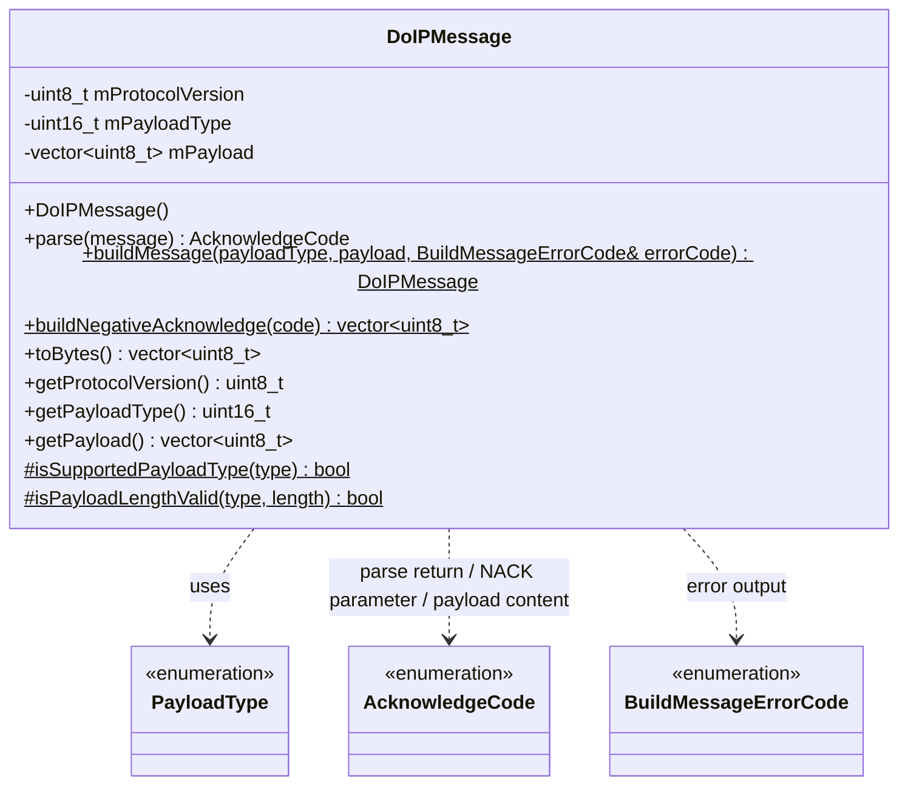
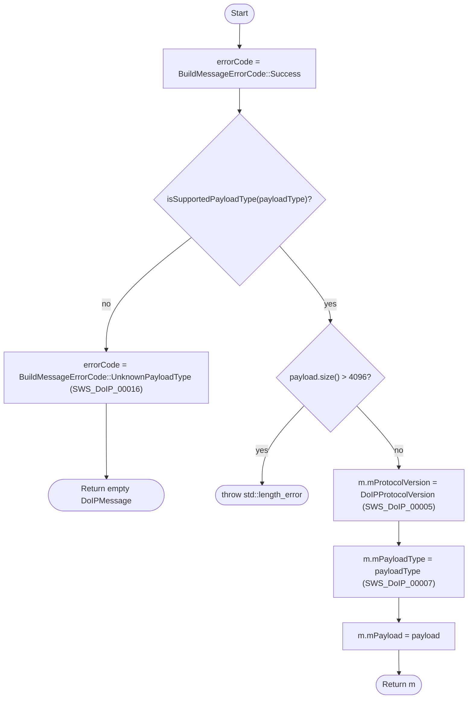
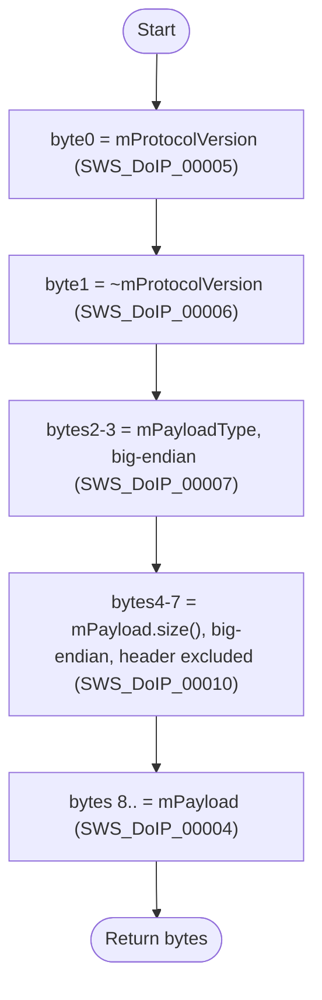
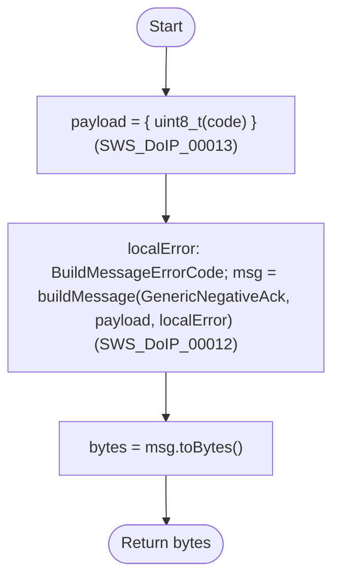
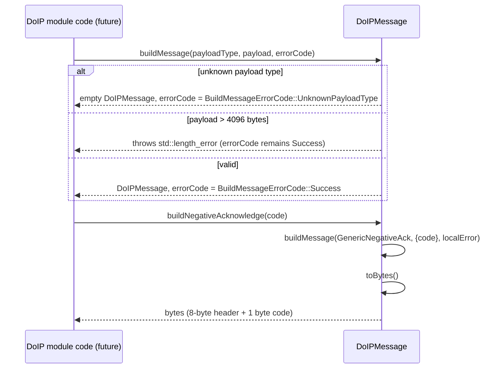

# DoIPMessage – Detailed Design: Generic Message Builder

Status: **REVISION 3 – all decisions settled and approved by the user; ready for implementation. No implementation code has been changed.**
Scope: add a generic static DoIP message builder; keep the existing negative-acknowledge API and build its payload through the generic function.

## 1. Current State (inspected)

| Item | Finding |
|---|---|
| Files | `infras/diagnostic/DoIP/DoIPMessage/Implementation/ExportHeaderInterface/DoIPMessage.hpp` and `infras/diagnostic/DoIP/DoIPMessage/Implementation/InternalImplement/DoIPMessage.cpp`. |
| `buildNegativeAcknowledge` | `static std::vector<std::uint8_t> buildNegativeAcknowledge(AcknowledgeCode)`. It hard-codes type `0x0000`, length 1, and returns raw bytes. |
| Callers | **None.** Referenced only by its declaration and definition. No DoIPMessage tests exist. |
| Defect fixed by this change | The current static function reads the non-static member `mProtocolVersion`, so it cannot compile. The new code uses the `DoIPProtocolVersion` macro instead. |
| Defect fixed by this change | `mPayload` is a `RingBuffer` while `getPayload()` returns `const std::vector<uint8_t>&`. Storage becomes `std::vector<std::uint8_t>`. |
| Out of scope (reported only) | `parse()` assigns `mProtocolVersion = message[0]` and then compares `message[0]` with it (check always true) and never stores the payload. Not changed. |
| `DoIPProtocolVersion` | Defined in `DoIPMessage.hpp` as `0x02` per D8, with an `#ifndef DoIPProtocolVersion` guard to avoid redefinition conflicts. `Configuration.hpp` is not changed and does not provide the selected value. |
| Docs | `DoIP_7.3.1_Generic_Header.md` (SWS_DoIP_00004..00010), `DoIP_7.3.2.1_Generic_Acknowledge.md` (SWS_DoIP_00012..00019). |

## 2. Decisions (approved by the user)

| # | Decision |
|---|---|
| D1 | Keep `buildNegativeAcknowledge(AcknowledgeCode)` unchanged in name, signature and byte output; add a generic builder. |
| D2 | Keep the existing `PayloadType` enum values unchanged (no Table 7.3 additions). |
| D3 | An unknown payload type returns a `DoIPMessage` plus an error code of type `BuildMessageErrorCode` through an output parameter (no exception). |
| D4 | A payload larger than 4096 bytes throws `std::length_error`. |
| D5 | The payload is stored in `std::vector<std::uint8_t>`. |
| D6 | Existing `mFoo` field names are left unchanged. |
| D7 | The protocol version comes from the `DoIPProtocolVersion` macro. |
| D8 | `DoIPProtocolVersion` is defined in `DoIPMessage.hpp` with value `0x02`. |
| D9 | The builder error code uses a dedicated enum `BuildMessageErrorCode`, not `AcknowledgeCode`. |
| D10 | `PayloadType` stays unchanged; send-only Table 7.3 values absent from the enum are reported as unknown for now. |

## 3. Proposed Signatures and Error-Code Semantics

The following enum is planned in `DoIPMessage.hpp`, in namespace `as::doip`, before class `DoIPMessage`:

```cpp
enum class BuildMessageErrorCode : std::uint8_t {
    Success = 0x00,
    UnknownPayloadType = 0x01
};
```

The numeric values are an internal choice, not from any AUTOSAR requirement. `UnknownPayloadType` corresponds to the condition of SWS_DoIP_00016 but is not a NACK code sent on the wire.

```cpp
// Generic builder. Static, uses no instance state.
static DoIPMessage buildMessage( PayloadType payloadType, const std::vector<std::uint8_t>& payload, BuildMessageErrorCode& errorCode );

// Unchanged public API.
static std::vector<std::uint8_t> buildNegativeAcknowledge( AcknowledgeCode code );

// New: serializes header + payload to bytes (needed to keep the NACK byte output).
std::vector<std::uint8_t> toBytes() const;
```

Required include: `<stdexcept>` (cpp) for `std::length_error`. `Util/RingBuffer.hpp` is no longer needed by this header.

`errorCode` semantics (type `BuildMessageErrorCode`):

| Situation | Return value | `errorCode` | Exception |
|---|---|---|---|
| Valid type, payload size <= 4096 | Message with type, version, payload | `BuildMessageErrorCode::Success` | none |
| `payloadType` not a supported value (checked with `isSupportedPayloadType`) | Default-constructed (empty) `DoIPMessage` | `BuildMessageErrorCode::UnknownPayloadType` | none |
| Valid type, payload size > 4096 | n/a | Remains `BuildMessageErrorCode::Success`, set at function entry | `std::length_error` |

Notes:
- `errorCode` is set to `BuildMessageErrorCode::Success` at function entry, so it is always defined.
- Check order: the payload type is checked first, then the size. An unknown type with an oversized payload therefore reports `UnknownPayloadType`, without throwing. This mirrors the order SWS_DoIP_00016 before SWS_DoIP_00017/00018 (assumption A4).
- Limit: size == 4096 is accepted; size == 4097 throws. The limit is `DOIP_MESSAGE_MAX_BUFFER_LENGTH` (4096). `DoIPMaxRequestBytes` is a receive limit and is not used for building.
- `buildNegativeAcknowledge` cannot fail (type 0x0000 is supported, payload is 1 byte). It calls `buildMessage` with a local `BuildMessageErrorCode`, and does not expose it. `AcknowledgeCode` remains the NACK parameter and the payload content.

## 4. Class Diagram



## 5. Types

| Type | Purpose | Members / values | Usage |
|---|---|---|---|
| `DoIPMessage` (existing class) | One DoIP message: header fields and payload. | `mProtocolVersion` (uint8_t), `mPayloadType` (uint16_t), `mPayload` (`std::vector<std::uint8_t>`, changed from RingBuffer). | Return type of `buildMessage`. |
| `PayloadType` (existing enum, `uint16_t`, **unchanged**) | Bytes 2-3 of the header (SWS_DoIP_00007). | Existing values 0x0000, 0x0001, 0x0002, 0x0003, 0x0004, 0x0005, 0x0008, 0x4001, 0x4003, 0x8001. | `buildMessage` parameter. |
| `AcknowledgeCode` (existing enum, `uint8_t`, **unchanged**) | NACK codes (SWS_DoIP_00013..00019); returned by `parse()`. | 0x00..0x04, `Accepted` = 0xFF. | `parse()` return type; in builder paths, only the `buildNegativeAcknowledge` parameter and NACK payload content, never the builder error-code type. |
| `BuildMessageErrorCode` (new enum, `uint8_t`) | Generic builder result, independent of wire NACK codes (D9). | `Success` = 0x00; `UnknownPayloadType` = 0x01. Numeric values are an internal choice. | `buildMessage` output parameter and the local output in `buildNegativeAcknowledge`. |
| `std::vector<std::uint8_t>` | Payload input; byte output of `toBytes` and the NACK builder. | n/a | Parameters and returns. |
| `std::length_error` | Signals a payload larger than 4096 bytes (D4). | n/a | Thrown by `buildMessage`. |
| `DOIP_MESSAGE_HEADER_LENGTH` (8) | Header size, SWS_DoIP_00004. | macro | `toBytes`. |
| `DOIP_MESSAGE_MAX_BUFFER_LENGTH` (4096) | Maximum payload size for building. | macro | Size check in `buildMessage`. |
| `DoIPProtocolVersion` | Protocol version byte, SWS_DoIP_00005. | Macro defined in `DoIPMessage.hpp` as `#define DoIPProtocolVersion 0x02`, inside an `#ifndef DoIPProtocolVersion` guard to avoid redefinition conflicts. The value is selected here per D8; `Configuration.hpp` is not changed and is not the source of this value. | Version byte; inverse is `~version`. |

## 6. Flowcharts

### 6.1 `buildMessage(payloadType, payload, errorCode)`



### 6.2 `toBytes()`



### 6.3 `buildNegativeAcknowledge(code)` (behaviour preserved)



Resulting bytes for version 0x02 and code 0x00: `02 FD 00 00 00 00 00 01 00`, identical in layout to the current output.

## 7. Sequence Diagram

No caller of `buildNegativeAcknowledge` exists today. External users would be future DoIP module code.



## 8. Requirement Traceability

| Requirement | Design element |
|---|---|
| SWS_DoIP_00004 | Header length and layout in `toBytes`. |
| SWS_DoIP_00005 | `DoIPProtocolVersion` macro defined in `DoIPMessage.hpp` as `0x02`, stored in `mProtocolVersion` by `buildMessage`; byte 0 in `toBytes`. |
| SWS_DoIP_00006 | Byte 1 = inverse of the version in `toBytes`. |
| SWS_DoIP_00007 | `payloadType` stored in `mPayloadType`; bytes 2-3 in `toBytes`. |
| SWS_DoIP_00010 | Bytes 4-7 = `mPayload.size()` in `toBytes`. |
| SWS_DoIP_00012 | Type 0x0000 message built by `buildNegativeAcknowledge` through `buildMessage`. |
| SWS_DoIP_00013 | One-byte NACK code payload. |
| SWS_DoIP_00014..00019 | NACK code values (`AcknowledgeCode`, unchanged). |
| SWS_DoIP_00016 | `BuildMessageErrorCode::UnknownPayloadType` reported by `buildMessage` (condition only; the NACK code 0x01 on the wire remains `AcknowledgeCode::UnknownPayloadType`). |
| SWS_DoIP_00008 | Supported-type check reuses `isSupportedPayloadType` (Table 7.2). |
| None (user decision D4) | `std::length_error` for payloads over 4096 bytes. Not an AUTOSAR requirement. |

Coding rule 8: at implementation, each requirement ID gets its own `/* @SWS_DoIP_000xx */` comment line immediately before the logic that implements it.

## 9. Planned Implementation Files

| File | Planned change |
|---|---|
| `infras/diagnostic/DoIP/DoIPMessage/Implementation/ExportHeaderInterface/DoIPMessage.hpp` | Declare `BuildMessageErrorCode` before class `DoIPMessage`; define the guarded `DoIPProtocolVersion` macro as `0x02`; declare `buildMessage` and `toBytes`; change `mPayload` to `std::vector<std::uint8_t>`; remove the `Util/RingBuffer.hpp` include. `buildNegativeAcknowledge` declaration stays. |
| `infras/diagnostic/DoIP/DoIPMessage/Implementation/InternalImplement/DoIPMessage.cpp` | Implement `buildMessage` and `toBytes`; reimplement `buildNegativeAcknowledge` through them; add `<stdexcept>`. |

Only `DoIPMessage.hpp` and `DoIPMessage.cpp` in the DoIPMessage implementation directories are planned for change. `Configuration.hpp` is **not** changed.

## 10. Assumptions

| ID | Assumption |
|---|---|
| A1 | The module uses responsibility-based subdirectories under `DoIPMessage/`; see `FolderStructure.md`. |
| A2 | `BuildMessageErrorCode` is a new enum local to `DoIPMessage.hpp`; its numeric values are arbitrary. |
| A3 | `buildMessage` does not check the payload length against the payload type; `isPayloadLengthValid` stays a reception check. |
| A4 | An unknown payload type is checked before the payload size (mirrors the order of SWS_DoIP_00016 and 00017/00018). |
| A5 | Unknown means "not accepted by `isSupportedPayloadType`", i.e. a value outside the unchanged `PayloadType` enum. Because D2 keeps the enum unchanged, send-only Table 7.3 values absent from it (e.g. 0x0006, 0x8002) are reported as unknown for now, per D10. |
| A6 | The value `0x02` is confirmed by the user (D8) and is defined by the `DoIPProtocolVersion` macro in `DoIPMessage.hpp`. |

## 11. Verification Plan

1. Compile the DoIPMessage implementation and verify the declared builder, enum, and macro match this design.
2. Build a supported payload and expect `ec == BuildMessageErrorCode::Success` and a populated message with the requested payload type and bytes.
3. Build an unsupported payload type and expect an empty message with `BuildMessageErrorCode::UnknownPayloadType`.
4. Check the payload-size boundary: 4096 bytes succeeds; 4097 bytes throws `std::length_error`.
5. Confirm send-only Table 7.3 values absent from `PayloadType` (such as 0x0006 and 0x8002) report `BuildMessageErrorCode::UnknownPayloadType`; confirm the NACK code carried on the wire remains `AcknowledgeCode` payload content.

Compile note: no `Configuration.hpp` include path is needed for `DoIPProtocolVersion`; `DoIPMessage.cpp` already includes `Configuration.hpp`, so keep its existing include path.

## 12. Unresolved Decisions

None. U1 (DoIPProtocolVersion location/value) and U2 (send-only types reported as unknown) are resolved by D8 and D10.