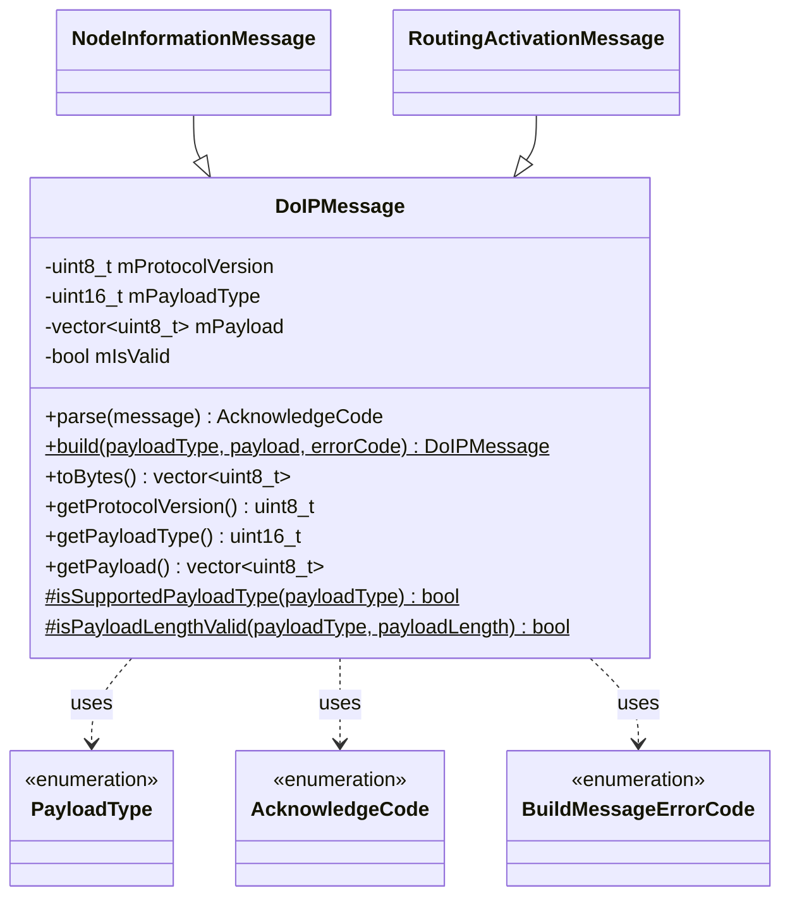
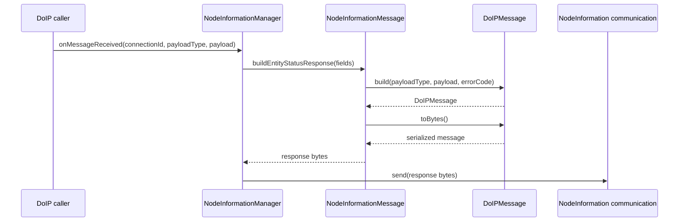

# DoIPMessage Folder Structure — Detailed Design

Status: **Approved and implemented.**

## 1. Scope

Reorganize the existing `DoIPMessage` module to follow the responsibility-based layout used by `NodeInformation`. This is a file-organization change only: DoIP message parsing, building, serialization, public signatures, and wire behavior remain unchanged.

The change will:

- Move the two generic-header/acknowledge requirement documents into `RequirementExtraction/`.
- Move `DoIPMessage.hpp` into `Implementation/ExportHeaderInterface/`, since sibling DoIP components include and use its API.
- Move `DoIPMessage.cpp` into `Implementation/InternalImplement/`.
- Update the DoIP `SConscript` source and include paths to match the new locations.
- Update include references that rely on the current header path.
- Correct the affected file paths and the folder-location assumption in `DetailDesign/DoIPMessage.md`, without changing its functional design decisions.

Proposed layout:

```text
DoIPMessage/
    RequirementExtraction/
        DoIP_7.3.1_Generic_Header.md
        DoIP_7.3.2.1_Generic_Acknowledge.md
    DetailDesign/
        DoIPMessage.md
        FolderStructure.md
    Implementation/
        ExportHeaderInterface/
            DoIPMessage.hpp
        InternalImplement/
            DoIPMessage.cpp
```

No `ImportHeaderInterface/` or `InternalHeader/` files are currently needed: the public header only depends on standard library headers, and this module has no separate private header. Empty directories will not be added.

## 2. Current Architecture and Move Mapping

| Current file | Proposed location | Responsibility |
|---|---|---|
| `DoIPMessage/DoIP_7.3.1_Generic_Header.md` | `DoIPMessage/RequirementExtraction/DoIP_7.3.1_Generic_Header.md` | Generic DoIP header requirements |
| `DoIPMessage/DoIP_7.3.2.1_Generic_Acknowledge.md` | `DoIPMessage/RequirementExtraction/DoIP_7.3.2.1_Generic_Acknowledge.md` | Generic acknowledge requirements |
| `DoIPMessage/DoIPMessage.hpp` | `DoIPMessage/Implementation/ExportHeaderInterface/DoIPMessage.hpp` | Shared DoIP message type and API |
| `DoIPMessage/DoIPMessage.cpp` | `DoIPMessage/Implementation/InternalImplement/DoIPMessage.cpp` | Implementation of the message API |
| `DoIPMessage/DetailDesign/DoIPMessage.md` | Unchanged location; update stale paths only | Existing behavioral design |
| `DoIP/SConscript` | Unchanged location; update path entries | Build source and include registration |

`DoIPMessage.hpp` is included by multiple DoIP components, including Node Information, Alive Check, and Diagnostic Message. It therefore belongs in the module's exported interface directory rather than an internal-only directory.

## 3. Class Diagram

No types, members, methods, or class relationships are added or removed. The diagram shows the existing API that moves as a unit.



## 4. Types

All types below already exist in `DoIPMessage.hpp` and will move together unchanged.

| Type | Purpose | Members or values | Usage |
|---|---|---|---|
| `DoIPMessage` | Generic DoIP header and payload representation | Protocol version, payload type, payload bytes, validity flag | Public shared API for parsing, building, and serializing messages |
| `PayloadType` | DoIP payload type identifiers | Existing payload type enumerators | `DoIPMessage::build`, parsing, and sibling components |
| `AcknowledgeCode` | Result of parsing a received DoIP message | Existing acknowledge and NACK codes | `DoIPMessage::parse` result |
| `BuildMessageErrorCode` | Result of building a DoIP message | Existing build error enumerators | `DoIPMessage::build` output parameter |
| `std::vector<std::uint8_t>` | Byte storage for payload and full messages | Standard library type | Existing API parameters and return values |

## 5. Function Flowcharts

No functions are added, removed, or behaviorally changed by this reorganization. Existing `parse`, `build`, `toBytes`, and accessors move with their implementation or declaration unchanged; consequently, no function-control-flow changes require a flowchart.

## 6. Sequence Diagram

This existing call path illustrates that the moved interface remains available to a sibling component. Call order and runtime behavior do not change.



## 7. Build and Include Updates

1. Register `DoIPMessage/Implementation/ExportHeaderInterface` as an include directory in `DoIP/SConscript`.
2. Register `DoIPMessage/Implementation/InternalImplement/DoIPMessage.cpp` as the source file in `DoIP/SConscript`.
3. Update `RoutingActivation.hpp`, which currently uses a relative include path, to include the moved public header.
4. Keep existing bare `#include "DoIPMessage.hpp"` references unchanged; the updated exported-header include path will resolve them.
5. Update only the path references in `DetailDesign/DoIPMessage.md` that become stale as a result of the moves.

## 8. Requirement Traceability

This change does not implement or alter requirement logic. The table records the requirements whose existing implementation remains at the moved `DoIPMessage` source/header locations.

| Requirement | Existing design element retained |
|---|---|
| SWS_DoIP_00004 | Generic header layout and `toBytes` serialization |
| SWS_DoIP_00005, SWS_DoIP_00006 | Protocol version and inverse-version header bytes |
| SWS_DoIP_00007, SWS_DoIP_00008 | Payload type serialization and supported-type handling |
| SWS_DoIP_00010 | Payload length serialization |
| SWS_DoIP_00012, SWS_DoIP_00013 | Generic negative acknowledge type and payload |
| SWS_DoIP_00014..00019 | Existing acknowledge-code handling |

The source requirement documents will be preserved and moved into `RequirementExtraction/`.

## 9. Assumptions and Unresolved Requirements

### Assumptions

| ID | Assumption |
|---|---|
| A1 | “Follow the same structure as NodeInformation” means use `RequirementExtraction/`, `DetailDesign/`, and responsibility-based directories under `Implementation/`. |
| A2 | `DoIPMessage.hpp` is an exported interface because multiple sibling DoIP components include and use it. |
| A3 | The refactor is behavior-preserving; changes to include and build paths are limited to making the new layout work. |
| A4 | No empty `ImportHeaderInterface/` or `InternalHeader/` directories are needed when there are no files with those responsibilities. |

### Unresolved requirements

None identified.
