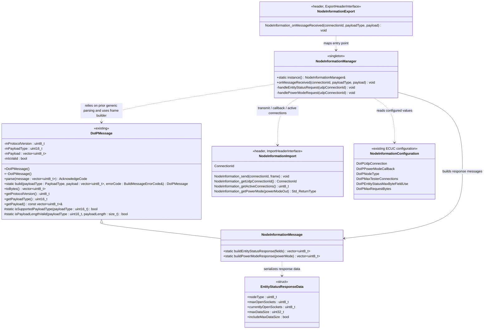
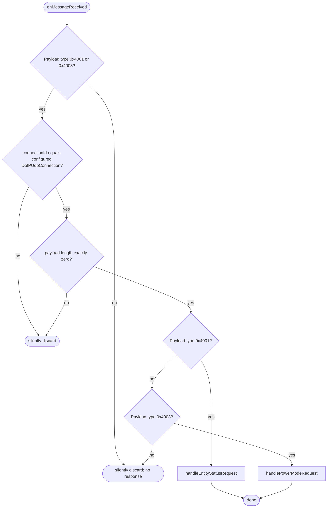
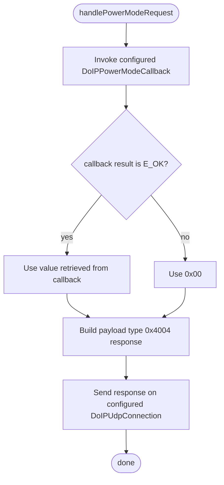
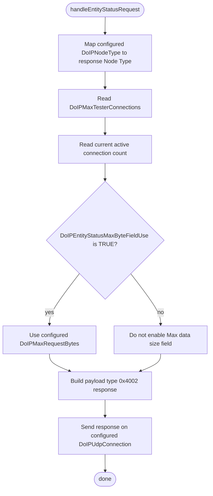
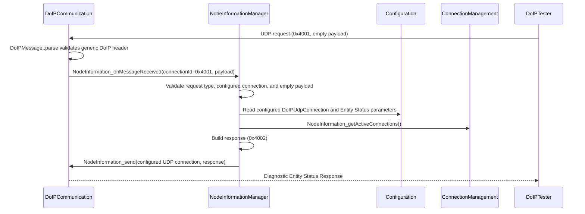
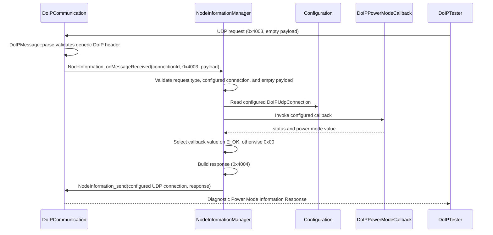

# DoIP Node Information — Detailed Design

| Item | Value |
|---|---|
| Module | DoIP |
| Feature | Node Information services (Diagnostic Entity Status and Diagnostic Power Mode) |
| Sources | `RequirementExtraction/NodeInformation_Requirements.arxml` |
| Rule files | `DetailDesign-rules.md`, `Workflow-rules.md`, `Coding-rules.md` |
| Status | **Implemented; verified with host tests. Integration import providers remain external.** |

## 1. Scope

In scope:

- Discard Diagnostic Power Mode Information Request messages (payload type `0x4003`) received on a connection other than the configured `DoIPUdpConnection` — SWS_DoIP_00090.
- Accept a Diagnostic Power Mode Information Request only with payload length exactly zero — SWS_DoIP_00091.
- After a valid request, send a Diagnostic Power Mode Information Response (payload type `0x4004`) on the configured `DoIPUdpConnection` — SWS_DoIP_00092.
- Set the Diagnostic Power Mode byte in the response using the configured `DoIPPowerModeCallback`: use the retrieved callback value on `E_OK`, otherwise use `0x00` — SWS_DoIP_00093.
- Discard Diagnostic Entity Status Request messages (payload type `0x4001`) received on a connection other than the configured `DoIPUdpConnection` — SWS_DoIP_00094.
- Accept a Diagnostic Entity Status Request only with payload length exactly zero — SWS_DoIP_00095.
- After a valid request, send a Diagnostic Entity Status Response (payload type `0x4002`) on the configured `DoIPUdpConnection` — SWS_DoIP_00096.
- Populate the response's Node Type from `DoIPNodeType`, encoding `DOIP_GATEWAY` as `0x00` and `DOIP_NODE` as `0x01` — SWS_DoIP_00097.
- Populate the response's Max open sockets byte with `DoIPMaxTesterConnections`, excluding the reserve socket — SWS_DoIP_00098.
- Populate the Currently open sockets byte with the currently active connections based on SWS_DoIP_00002 — SWS_DoIP_00099.
- Include the configured `DoIPMaxRequestBytes` in the Max data size field only when `DoIPEntityStatusMaxByteFieldUse` is `TRUE` — SWS_DoIP_00100.

Out of scope:

- Generic DoIP header validation, UDP socket reception, and payload-type dispatching, owned by the shared DoIP communication/message layer.
- Configuration generation and validation for the listed ECUC parameters.
- The source of active-connection counts and management of TCP_DATA sockets beyond consuming the information required by SWS_DoIP_00099.
- Behavior for non-Node-Information message types.

## 2. Architecture

The communication layer validates the generic DoIP wire header with `DoIPMessage::parse` before dispatch. The Node Information manager receives the dispatched payload type and payload with the ingress connection. `NodeInformationManager::onMessageReceived` directly checks whether the payload type is one of the Node Information requests, whether the request arrived on the configured UDP connection, and whether its payload is empty. It silently discards invalid or unsupported requests without sending a response. For a valid request, the manager builds the corresponding response using configuration and required external data providers, then requests transmission on the configured UDP connection.

The manager handles the two request/response pairs independently:

- `0x4001` → `0x4002`: Diagnostic Entity Status.
- `0x4003` → `0x4004`: Diagnostic Power Mode Information.

### 2.1 Class diagram



### 2.2 Source layout

| File | Directory | Responsibility |
|---|---|---|
| `Configuration.hpp` (existing) | `Configuration/` | Provides configured Node Information parameter values; this design does not add or redefine them. |
| `NodeInformationExport.hpp` | `NodeInformation/Implementation/ExportHeaderInterface/` | Exposes the module's receive entry point to the communication/dispatch layer. |
| `NodeInformationImport.hpp` | `NodeInformation/Implementation/ImportHeaderInterface/` | Declares the connection identifier, configured UDP connection, transmission, active-connection, and power-mode callback imports. |
| `NodeInformationMessage.hpp` | `NodeInformation/Implementation/InternalHeaderInterface/` | Declares Node Information response construction. |
| `EntityStatusResponseData.hpp` | `NodeInformation/Implementation/InternalHeaderInterface/` | Declares the data assembled for an Entity Status response. |
| `NodeInformationManager.hpp` | `NodeInformation/Implementation/InternalHeaderInterface/` | Declares message handling and request-specific operations. |
| `NodeInformationMessage.cpp` | `NodeInformation/Implementation/InterfaceImplementation/` | Implements response payload serialization and message construction. |
| `NodeInformationManager.cpp` | `NodeInformation/Implementation/InterfaceImplementation/` | Implements connection/payload checks, data acquisition, response selection, and transmission. |
| `DoIP/SConscript` | `DoIP/` | Adds DoIPMessage and Node Information implementations to the diagnostic DoIP library. |

Use the established `AliveCheck` import/export mapping convention: boundary names map directly to owning functions/types, without wrapper functions. Implementations of the imported provider functions remain the responsibility of the integrating communication, connection-management, and callback components (see §8).

### 2.3 Type definitions

| Type | Kind | Purpose | Members | Usage |
|---|---|---|---|---|
| `ConnectionId` | Shared type alias | Identifies the received/configured UDP connection. | Underlying type to match the communication layer. | In the receive entry point and transmit call. |
| `NodeInformationMessage` | Class | Builds Node Information response messages. | No instance members; response builders are static. | Used by the manager to construct responses after request validation and dispatch. |
| `EntityStatusResponseData` | Struct | Holds values needed to construct an Entity Status response. | `nodeType`, `maxOpenSockets`, `currentlyOpenSockets`, `maxDataSize`, `includeMaxDataSize` | Populated by the manager/configuration and serialized by the message builder in Table 7.11 order. |
| `Std_ReturnType` | Existing AUTOSAR type | Represents the configured power mode callback result. | Existing `E_OK`/non-`E_OK` status values. | Selects retrieved power mode versus fallback `0x00`. |
| `DoIPUdpConnection` | Existing configuration item | Identifies the UDP connection permitted to receive these requests and used for responses. | Runtime `ConnectionId` supplied by `NodeInformation_getUdpConnectionId()`. | Checked before processing each request and used as the response destination. |
| `DoIPPowerModeCallback` | Existing configuration item | Identifies the callback that supplies the diagnostic power mode value. | `Std_ReturnType` callback with a `std::uint8_t*` output. | Invoked for a valid power-mode request. |
| `DoIPNodeType` | Existing configuration item | Selects the configured entity node type. | `DOIP_GATEWAY` or `DOIP_NODE` per the extraction. | Encoded as `0x00` or `0x01` in the Entity Status response. |
| `DoIPMaxTesterConnections` | Existing configuration item | Configured maximum number of concurrent tester TCP_DATA sockets. | Configuration-defined numeric value. | Encoded as the Max open sockets byte; reserve socket excluded. |
| `DoIPEntityStatusMaxByteFieldUse` | Existing configuration item | Controls support/use of the Max data size field. | Boolean configuration value. | When true, `DoIPMaxRequestBytes` is included as a four-byte big-endian field; when false, that field is omitted. |
| `DoIPMaxRequestBytes` | Existing configuration item | Configured maximum request data size. | Configuration-defined numeric value. | Used for the Max data size field when the enable parameter is `TRUE`. |

## 3. Message formats and interfaces

Payload type values are taken from the requirement extraction. The shared `DoIPMessage::parse` handles the generic DoIP wire header. `onMessageReceived` handles Node Information request payload-type, connection, and zero-length payload validation and dispatch. `NodeInformationMessage` contains only response-building methods; a separate parser is unnecessary because invalid requests are silently discarded by `onMessageReceived`. The Entity Status response has a 3-byte payload, or a 7-byte payload when Max data size is enabled; its multi-byte field is big-endian. The Power Mode response has a 1-byte payload.

**Validation ownership decision:** Generic DoIP header validation belongs to `DoIPMessage::parse`. Node Information request payload-type, connection, and payload-length checks belong to `NodeInformationManager::onMessageReceived`. Invalid or unsupported requests are silently discarded without a response. `NodeInformationMessage` is stateless and provides only response-building methods.

| Message | Payload type | Request payload constraint / response content |
|---|---:|---|
| Diagnostic Entity Status Request | `0x4001` | Request payload length exactly `0` (SWS_DoIP_00095). |
| Diagnostic Entity Status Response | `0x4002` | Sent on configured `DoIPUdpConnection`; three single-byte fields in Table 7.11 order; includes `DoIPMaxRequestBytes` as a four-byte big-endian field when enabled (SWS_DoIP_00097 through SWS_DoIP_00100). |
| Diagnostic Power Mode Information Request | `0x4003` | Request payload length exactly `0` (SWS_DoIP_00091). |
| Diagnostic Power Mode Information Response | `0x4004` | Sent on configured `DoIPUdpConnection`; one-byte payload is the callback value on `E_OK`, otherwise `0x00` (SWS_DoIP_00092, SWS_DoIP_00093). |

### 3.1 Interface names

| Header | Name | Direction | Maps to |
|---|---|---|---|
| `NodeInformationExport.hpp` | `NodeInformation_onMessageReceived(connectionId, payloadType, payload)` | Called by DoIP communication dispatch | `NodeInformationManager::onMessageReceived`; no return value |
| `NodeInformationImport.hpp` | `NodeInformation_send(connectionId, frame)` | Required from DoIP communication | Existing UDP transmit operation; no return value |
| `NodeInformationImport.hpp` | `NodeInformation_getUdpConnectionId()` | Required from DoIP configuration/communication | Runtime `ConnectionId` for the configured `DoIPUdpConnection` |
| `NodeInformationImport.hpp` | `NodeInformation_getActiveConnections()` (required import) | Required from connection/socket management | Current active connection count required by SWS_DoIP_00099; no existing runtime getter was identified, so this import is the required boundary contract until an owning API is available. |
| `NodeInformationImport.hpp` | `NodeInformation_getPowerMode(powerModeOut)` | Required callback binding | Configured `DoIPPowerModeCallback`, returning `Std_ReturnType` and writing a `std::uint8_t` value |

The receive entry point and transmit import have no return value. Invalid requests are silently discarded; transmission status is not reported by this interface. `NodeInformation_getUdpConnectionId()` supplies the runtime handle for the configured UDP connection. `NodeInformation_getActiveConnections()` must return the current active connection count as defined by SWS_DoIP_00002. The configured TCP connection count in `DoIPInterfaceConfig::connections` is only the number of configured TCP connections and is not a substitute for the live count.

## 4. Function design

| Function | Responsibility | Requirements |
|---|---|---|
| `NodeInformationManager::onMessageReceived(connectionId, payloadType, payload)` | For Node Information request payload types, check the configured UDP connection and require an empty payload; silently discard an invalid request without a response; dispatch valid payload type `0x4001` or `0x4003` to its request-specific handler, with a defensive ignore branch for any other type. | SWS_DoIP_00090, SWS_DoIP_00091, SWS_DoIP_00094, SWS_DoIP_00095 |
| `NodeInformationManager::handlePowerModeRequest(udpConnectionId)` | Invoke the configured power-mode callback once for a valid request; select callback value only when result is `E_OK`, otherwise select `0x00`; build payload type `0x4004`; transmit using the configured UDP connection. | SWS_DoIP_00092, SWS_DoIP_00093 |
| `NodeInformationManager::handleEntityStatusRequest(udpConnectionId)` | Read configured Node Type, maximum tester connections, active connection count, and max-data-size configuration; build payload type `0x4002`; transmit using configured `DoIPUdpConnection`. | SWS_DoIP_00096, SWS_DoIP_00097, SWS_DoIP_00098, SWS_DoIP_00099, SWS_DoIP_00100 |
| `NodeInformationMessage::buildPowerModeResponse(powerMode)` | Construct the response message with payload type `0x4004` and the selected Diagnostic Power Mode byte; exact remaining format follows the authoritative protocol table once supplied. | SWS_DoIP_00092, SWS_DoIP_00093 |
| `NodeInformationMessage::buildEntityStatusResponse(fields)` | Construct the response message with payload type `0x4002` and serialize the entity status values per the authoritative protocol table once supplied. | SWS_DoIP_00096, SWS_DoIP_00097, SWS_DoIP_00098, SWS_DoIP_00099, SWS_DoIP_00100 |

### 4.1 Flowchart — `onMessageReceived`



### 4.2 Flowchart — `handlePowerModeRequest`



### 4.3 Flowchart — `handleEntityStatusRequest`



## 5. Data flow and external interactions

### 5.1 Valid Diagnostic Entity Status request



### 5.2 Valid Diagnostic Power Mode request



### 5.3 Invalid connection or request payload

```mermaid
sequenceDiagram
    participant UDP as DoIPCommunication
    participant NI as NodeInformationManager

    UDP->>NI: NodeInformation_onMessageReceived(connectionId, requestType, payload)
    NI->>NI: Check supported request type, configured connection, and empty payload
    alt invalid or unsupported request
        NI->>NI: Silently discard; send no response
    else valid Node Information request
        NI->>NI: Continue request-specific response processing
    end
```

## 6. Configuration and data providers

| Parameter / value | Requirement reference | Use in design | Source / detail |
|---|---|---|---|
| `DoIPUdpConnection` | SWS_DoIP_00090, SWS_DoIP_00092, SWS_DoIP_00094, SWS_DoIP_00096 | Authorizes the connection for these requests and is the response destination. | Runtime `ConnectionId` is obtained through `NodeInformation_getUdpConnectionId()`; provider binding remains an integration dependency (U3). |
| `DoIPPowerModeCallback` | SWS_DoIP_00093 | Supplies the Diagnostic Power Mode byte and callback status. | Imported callback uses `Std_ReturnType` and a `std::uint8_t*` output. |
| `DoIPNodeType` | SWS_DoIP_00097 | Maps `DOIP_GATEWAY` → `0x00`; `DOIP_NODE` → `0x01`. | Typed configuration enum contains the two specified values. |
| `DoIPMaxTesterConnections` | SWS_DoIP_00098 | Value of Max open sockets byte; does not include the reserve socket. | Configuration parameter range is 1 .. 255, matching the response byte width. |
| Current active connection count | SWS_DoIP_00099, SWS_DoIP_00002 | Value of Currently open sockets byte. | Read through the required `NodeInformation_getActiveConnections()` import from connection/socket management. Do not use the configured `DoIPConnectionsConfig::tcpConnectionCount` as a live count. |
| `DoIPEntityStatusMaxByteFieldUse` | SWS_DoIP_00100 | Selects whether the Max data size field is supported/included. | Boolean configuration value. Wire-level behavior when `FALSE` is unresolved (U2). |
| `DoIPMaxRequestBytes` | SWS_DoIP_00100 | Value placed in Max data size when the enable parameter is `TRUE`. | Encoded as a four-byte big-endian value; omitted when disabled. |

## 7. Requirement traceability

| Requirement | Summary | Design element(s) |
|---|---|---|
| SWS_DoIP_00090 | Discard payload type `0x4003` when received on a connection other than configured `DoIPUdpConnection`. | `onMessageReceived`; §4.1 flowchart; §6 configuration table. |
| SWS_DoIP_00091 | Expected payload length of payload type `0x4003` is exactly zero. | `onMessageReceived`; §4.1 flowchart. |
| SWS_DoIP_00092 | After a valid `0x4003` request, send a `0x4004` response on configured `DoIPUdpConnection`. | `handlePowerModeRequest`; `buildPowerModeResponse`; §5.2 sequence. |
| SWS_DoIP_00093 | Use callback-provided value when callback returns `E_OK`; otherwise set Diagnostic Power Mode to `0x00`. | `handlePowerModeRequest`; §4.2 flowchart; §5.2 sequence. |
| SWS_DoIP_00094 | Discard payload type `0x4001` when received on a connection other than configured `DoIPUdpConnection`. | `onMessageReceived`; §4.1 flowchart; §6 configuration table. |
| SWS_DoIP_00095 | Expected payload length of payload type `0x4001` is exactly zero. | `onMessageReceived`; §4.1 flowchart. |
| SWS_DoIP_00096 | After a valid `0x4001` request, send a `0x4002` response on configured `DoIPUdpConnection`. | `handleEntityStatusRequest`; `buildEntityStatusResponse`; §5.1 sequence. |
| SWS_DoIP_00097 | Encode configured Node Type: gateway `0x00`, node `0x01`. | `handleEntityStatusRequest`; `EntityStatusResponseData::nodeType`; §6 configuration table. |
| SWS_DoIP_00098 | Max open sockets byte is configured `DoIPMaxTesterConnections`, excluding reserve socket. | `handleEntityStatusRequest`; `EntityStatusResponseData::maxOpenSockets`; §6 configuration table. |
| SWS_DoIP_00099 | Currently open sockets byte is based on current active connections per SWS_DoIP_00002. | `handleEntityStatusRequest`; `NodeInformation_getActiveConnections`; §5.1 sequence. |
| SWS_DoIP_00100 | Use `DoIPMaxRequestBytes` in Max data size only when `DoIPEntityStatusMaxByteFieldUse` is `TRUE`. | `handleEntityStatusRequest`; `EntityStatusResponseData`; §4.3 flowchart; §6 configuration table. |
| SWS_DoIP_00002 | Defines the basis for determining currently active connections. | The `NodeInformation_getActiveConnections()` import consumed by `handleEntityStatusRequest` must return this live count. |

## 8. Assumptions and unresolved items

| # | Type | Item | Proposed handling |
|---|---|---|---|
| U1 | Resolved | The response payload sizes and field order were verified against the existing DoIP implementation and the extracted requirement texts. | Entity Status is 3 or 7 bytes; Power Mode is 1 byte; multibyte Max data size is big-endian. |
| U2 | Resolved | The existing DoIP implementation omits Max data size when `DoIPEntityStatusMaxByteFieldUse` is false. | Build 3-byte Entity Status payload when false and 7-byte payload when true. |
| U3 | Unresolved integration dependency | The imported functions `NodeInformation_send`, `NodeInformation_getUdpConnectionId`, `NodeInformation_getActiveConnections`, and `NodeInformation_getPowerMode` are declared, but their owning communication/configuration/callback providers are not present in this repository implementation. | The integration layer must define these imports and bind them to the configured UDP connection, UDP transmit operation, live connection manager count, and configured power-mode callback. Do not substitute the configured `DoIPConnectionsConfig::tcpConnectionCount` for the live count. |
| A1 | Assumption | The communication layer validates the generic DoIP header with `DoIPMessage::parse`, then dispatches the payload type before this feature runs. | Keep generic header validation upstream; `onMessageReceived` validates Node Information request payload type, connection, and length. Confirm the integration call path. |
| A2 | Assumption | Invalid Node Information requests, including requests with a nonzero payload length or wrong ingress connection, are silently discarded without a response. | No negative acknowledgement behavior is added unless another requirement mandates it. |
| A3 | Assumption | The configured UDP connection can be identified consistently both when checking the ingress connection and selecting the response destination. | Confirm connection handle semantics in the communication API. |
| A4 | Assumption | `NodeInformationManager` is a singleton with one receive entry point, consistent with the neighboring Alive Check design. | Confirm against existing module architecture before implementation. |
| A5 | Assumption | Transmission is performed by the shared DoIP communication layer, which owns UDP socket operations. | Node Information builds a complete response frame and calls the required transmit interface. |

## 9. Verification

The implementation was compiled with `g++ -std=c++14 -Wall -Wextra -Werror` and exercised using a host test with stubbed import providers. Checks covered:

1. Compile with `g++ -std=c++14 -Wall -Wextra -Werror` using the project-compatible host-test setup.
2. Verify `DoIPMessage::parse` validates the generic DoIP header before dispatch, and `onMessageReceived` silently discards invalid Node Information requests without responding.
3. Verify the manager ignores any unsupported payload type that reaches its defensive `else` branch.
4. Verify each supported request is discarded when received on a connection other than `DoIPUdpConnection`.
5. Verify both request payload types are discarded when payload length is nonzero and produce no response.
6. Verify valid payload type `0x4003` invokes the configured power callback once and sends a `0x4004` response on the configured UDP connection.
7. Verify callback result `E_OK` places the retrieved power value in the response; a non-`E_OK` result places `0x00`.
8. Verify valid payload type `0x4001` sends a `0x4002` response on the configured UDP connection.
9. Verify Node Type encodings: `DOIP_GATEWAY` → `0x00`, `DOIP_NODE` → `0x01`.
10. Verify Max open sockets uses `DoIPMaxTesterConnections` without adding the reserve socket.
11. Verify Currently open sockets uses `NodeInformation_getActiveConnections()` bound to a live count provider, not the configured TCP connection count.
12. Verify `DoIPMaxRequestBytes` is encoded big-endian only when `DoIPEntityStatusMaxByteFieldUse` is `TRUE`; the field is omitted when `FALSE`.

## 10. Approval

Implementation is complete for the approved feature design. The integration imports listed under U3 must be provided by the owning communication, connection-management, and callback components before runtime integration.
