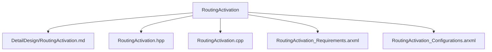
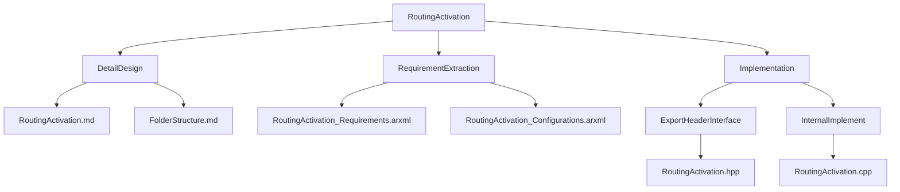
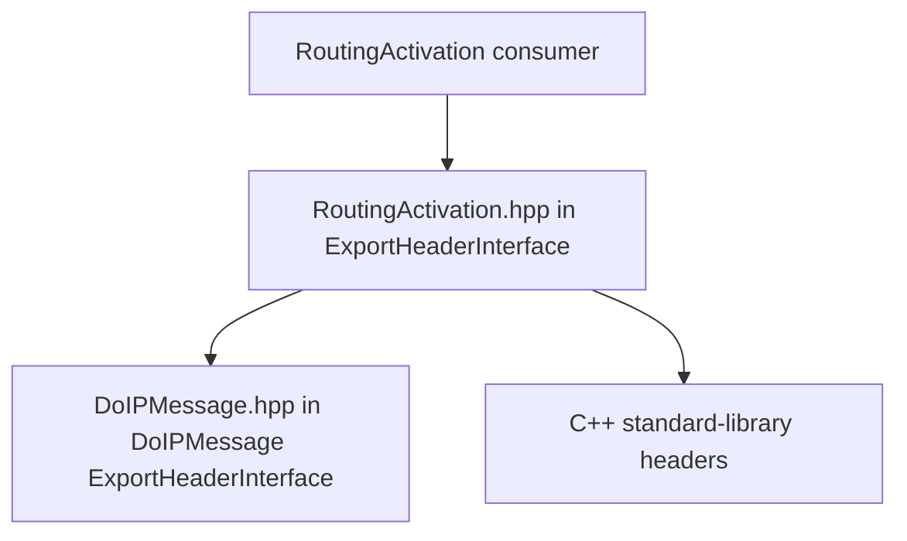
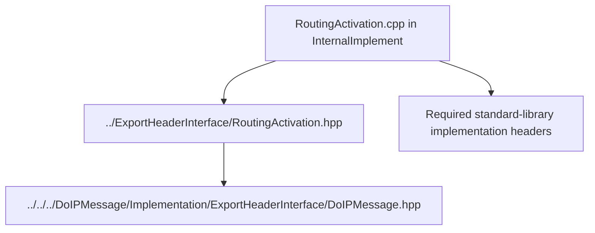
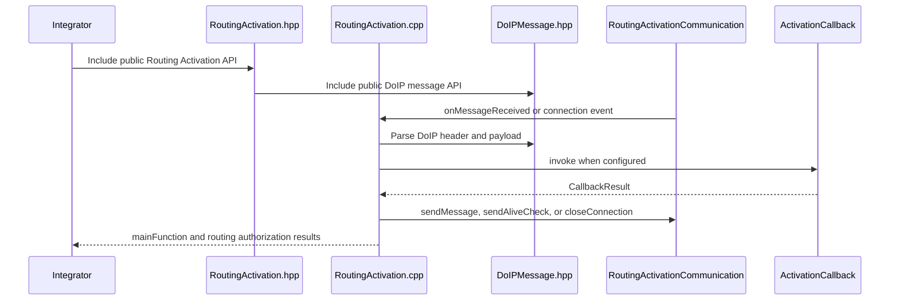
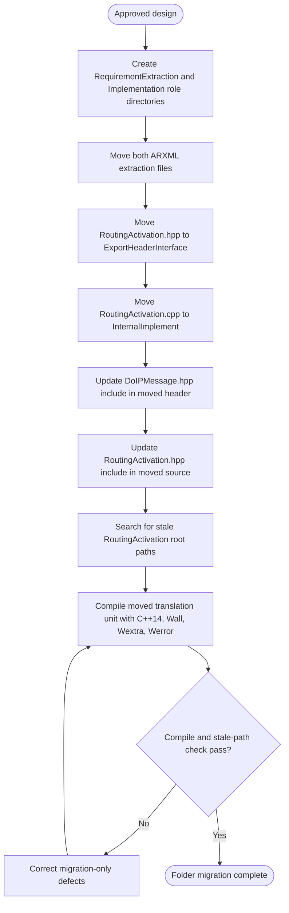

# DoIP Routing Activation Folder Structure - Detailed Design

| Item | Value |
|---|---|
| Module | DoIP |
| Feature | Routing Activation |
| Change | Reorganize source, extracted requirements, and design files |
| Status | **Approved and structurally implemented** |
| Source rules | `.github/Workflow-rules.md`, `.github/DetailDesign-rules.md`, `.github/Coding-rules.md` |

## 1. Scope

This change aligns the `RoutingActivation` feature with the folder organization already used by the neighboring DoIP features. It changes file locations and dependent include paths only.

In scope:

- Move Routing Activation requirement/configuration extraction files below `RequirementExtraction/`.
- Move the public Routing Activation header below `Implementation/ExportHeaderInterface/`.
- Move the Routing Activation source below `Implementation/InternalImplement/`.
- Update the moved source and header include paths.
- Preserve all namespaces, types, interfaces, behavior, requirement IDs, and runtime data flow.
- Compile-check the moved implementation as C++14.

Out of scope:

- Routing Activation protocol behavior changes.
- Renaming classes, methods, namespaces, fields, or variables.
- Splitting the existing public header into additional headers.
- Correcting pre-existing coding-style violations unrelated to the folder move.
- Creating `Configuration`, `ImportHeaderInterface`, or `InternalHeader` files when no file has one of those responsibilities.

## 2. Current and target architecture

### 2.1 Current folder structure



The current feature has public API, implementation, and requirement-extraction files directly under its root. That differs from the DoIP feature layout.

### 2.2 Target folder structure



Directories absent from the diagram are not required because the current feature has no corresponding configuration header, external-module interface header, or private header.

## 3. File relocation map

| Current path | Target path | Responsibility | Content change |
|---|---|---|---|
| `RoutingActivation/RoutingActivation.hpp` | `RoutingActivation/Implementation/ExportHeaderInterface/RoutingActivation.hpp` | Public Routing Activation interfaces and data types | Update the `DoIPMessage.hpp` relative include |
| `RoutingActivation/RoutingActivation.cpp` | `RoutingActivation/Implementation/InternalImplement/RoutingActivation.cpp` | Routing Activation implementation | Update the `RoutingActivation.hpp` relative include |
| `RoutingActivation/RoutingActivation_Requirements.arxml` | `RoutingActivation/RequirementExtraction/RoutingActivation_Requirements.arxml` | Extracted SWS requirements | Move only |
| `RoutingActivation/RoutingActivation_Configurations.arxml` | `RoutingActivation/RequirementExtraction/RoutingActivation_Configurations.arxml` | Extracted ECUC/configuration information | Move only |
| `RoutingActivation/DetailDesign/RoutingActivation.md` | Unchanged | Existing behavioral detailed design | None |
| `RoutingActivation/DetailDesign/FolderStructure.md` | Unchanged | Folder migration design | Added before implementation approval |

The existing `RoutingActivation.hpp` contains multiple related public types and is retained as the single public header. Its filename is a descriptive feature name and therefore satisfies the multi-type file-name rule.

## 4. Dependency architecture

```mermaid
classDiagram
    direction LR

    class DoIPMessage {
        +parse(message, expectedProtocolVersion, limits) AcknowledgeCode
    }

    class RoutingActivationMessage {
        -_isRoutingActivationRequest : bool
        -_testerAddress : uint16_t
        -_activationType : uint8_t
        -_oemData : vector~uint8_t~
        +parse(message, expectedProtocolVersion, limits) AcknowledgeCode
        +isRoutingActivationRequest() bool
        +testerAddress() uint16_t
        +activationType() uint8_t
        +oemData() vector~uint8_t~
    }

    class RoutingActivationHandler {
        +onConnectionOpened(connectionId, secureTransport) bool
        +onMessageReceived(connectionId, message) void
        +onAliveCheckResponse(connectionId, testerAddress) void
        +onConnectionClosed(connectionId) void
        +mainFunction() void
        +mayRouteDiagnostic(connectionId, sourceAddress, targetAddress) bool
    }

    class RoutingActivationManager {
        -_settings : RoutingActivationSettings
        -_communication : shared_ptr~RoutingActivationCommunication~
        -_connections : unordered_map
        -_pendingAliveChecks : unordered_map
        +onConnectionOpened(connectionId, secureTransport) bool
        +onMessageReceived(connectionId, message) void
        +onAliveCheckResponse(connectionId, testerAddress) void
        +onConnectionClosed(connectionId) void
        +mainFunction() void
        +mayRouteDiagnostic(connectionId, sourceAddress, targetAddress) bool
    }

    class RoutingActivationCommunication {
        +sendMessage(connectionId, message) bool
        +sendAliveCheck(connectionId) bool
        +closeConnection(connectionId) void
        +setReceiver(receiver) void
    }

    class ActivationCallback {
        +invoke(connectionId, testerAddress, activationType, requestData) CallbackResult
    }

    class AuthenticationCallback
    class ConfirmationCallback
    class RoutingActivationProfile
    class TesterConfiguration
    class RoutingActivationSettings

    DoIPMessage <|-- RoutingActivationMessage
    RoutingActivationHandler <|-- RoutingActivationManager
    ActivationCallback <|-- AuthenticationCallback
    ActivationCallback <|-- ConfirmationCallback
    RoutingActivationManager --> RoutingActivationCommunication
    RoutingActivationManager --> RoutingActivationSettings
    RoutingActivationSettings *-- TesterConfiguration
    TesterConfiguration *-- RoutingActivationProfile
    RoutingActivationProfile --> AuthenticationCallback
    RoutingActivationProfile --> ConfirmationCallback
```



The member names above express responsibilities in design notation. The relocation does not rename the corresponding existing source identifiers.

## 5. Type inventory

| Type | Purpose | Members / values | Usage |
|---|---|---|---|
| `ConnectionId` | Stable identity supplied by the transport adapter | Alias of `std::uint64_t` | Correlates all transport and manager events |
| `RoutingActivationMessage` | Parse and expose a Routing Activation Request | Parsed-request flag, tester address, activation type, OEM data | Message parsing before manager validation |
| `RoutingActivationResponseCode` | AUTOSAR response-code values | `UnknownSourceAddress` through `ConfirmationPending` | Selects the response code |
| `CallbackStatus` | Transport-independent callback result state | `Success`, `Pending`, `Rejected` | Drives authentication and confirmation state |
| `CallbackResult` | Callback return value and optional response bytes | `status`, `response_data` | Passed from callback to manager |
| `ActivationCallback` | Common callback interface | `invoke` | Base interface for authentication and confirmation |
| `AuthenticationCallback` | Authentication callback contract | Inherited `invoke` | Optional authentication processing |
| `ConfirmationCallback` | Confirmation callback contract | Inherited `invoke` | Optional confirmation processing |
| `RoutingActivationCommunication` | Required transport abstraction | Send, alive-check, close, and receiver registration | External communication boundary |
| `RoutingActivationTransport` | Compatibility alias | Alias of `RoutingActivationCommunication` | Existing caller compatibility |
| `RoutingActivationProfile` | One configured activation type | Activation type, targets, security flag, callback lengths, callback pointers | Activation lookup and authorization |
| `TesterConfiguration` | One configured tester source address | Source address and activation profiles | Tester lookup |
| `RoutingActivationSettings` | Complete feature configuration | Protocol version, entity address, capacity, timeout, testers | Manager construction and validation |
| `RoutingActivationHandler` | Manager event interface owned by the communication abstraction | Connection, message, alive-check, close, cycle, and routing methods | Receives external events |
| `RoutingActivationManager` | Concrete Routing Activation state machine | Settings, transport, connection state, pending alive checks | Existing feature behavior |
| `ConnectionState` | Per-connection private state | `Connected`, `CheckingAlive`, `AuthenticationPending`, `ConfirmationPending`, `Registered`, `Active` | Manager state machine |
| `AliveCheckPurpose` | Reason for probing an existing connection | `DuplicateAddress`, `Capacity` | Selects alive-check completion behavior |
| `ActivationRequest` | Parsed request retained while processing callbacks/alive checks | Tester address, activation type, OEM data | Per-connection request state |
| `Connection` | Private connection context | Transport/security flags, registration, state, request, selected profile, response data, targets | Manager-owned runtime state |
| `PendingAliveCheck` | Private group of outstanding alive checks | Purpose, probed/responding/failed IDs, deadline | Asynchronous duplicate/capacity checks |

## 6. Functions and data flow

No function implementation is redesigned by this change. The source remains byte-for-byte equivalent except for include paths. The existing nontrivial behavioral flow is documented in `RoutingActivation.md`; this design changes how its public and private source locations are classified.

### 6.1 Public-header dependency flow



After relocation, the `RoutingActivation.hpp` relative path to `DoIPMessage.hpp` becomes:

`../../../DoIPMessage/Implementation/ExportHeaderInterface/DoIPMessage.hpp`

### 6.2 Implementation dependency flow



After relocation, the source include for its public header becomes:

`../ExportHeaderInterface/RoutingActivation.hpp`

### 6.3 Message and external interaction sequence



This sequence is unchanged at runtime. Only the file locations used by the compiler change.

## 7. Implementation steps after approval



The implementation phase will use filesystem moves rather than copying, so no duplicate headers or translation units remain.

## 8. Verification plan

1. Confirm that the four original root files no longer exist.
2. Confirm that the two ARXML files parse as XML at their new locations.
3. Confirm that no tracked file references `RoutingActivation/RoutingActivation.hpp`, `RoutingActivation/RoutingActivation.cpp`, or the old ARXML root paths.
4. Compile the moved source with:

```text
g++ -std=c++14 -Wall -Wextra -Werror -I infras/diagnostic/DoIP/RoutingActivation/Implementation/ExportHeaderInterface -I infras/diagnostic/DoIP/DoIPMessage/Implementation/ExportHeaderInterface -c infras/diagnostic/DoIP/RoutingActivation/Implementation/InternalImplement/RoutingActivation.cpp
```

5. If a focused executable test harness already exists, run it unchanged. The relocation itself introduces no new behavior requiring a new test case.

### 8.1 Verification result

The folder move and XML parsing passed. A C++14 compile with `-Wall -Wextra -Werror` is currently blocked by pre-existing API incompatibilities between the moved Routing Activation source and the existing `DoIPMessage` interface: the current source expects `ParseLimits`, the three-argument `DoIPMessage::parse`, and `DoIPMessage::requires_socket_close`, while the current `DoIPMessage.hpp` does not expose those APIs and keeps the accessed parser state private. These errors are unrelated to the two include-path edits, so the folder-structure task does not silently repair that behavioral/API surface.

## 9. Requirement traceability

| Requirement / rule | Design element | Planned implementation evidence |
|---|---|---|
| `Workflow-rules.md` workflow step 1 | Section 2-8 detailed folder-migration design | This document exists before implementation |
| `Workflow-rules.md` workflow step 2 | Pending-approval status | User approval requested before source relocation |
| `Workflow-rules.md` workflow step 3 | Out-of-scope and pending status | No implementation files modified in design phase |
| `Workflow-rules.md` `ExportHeaderInterface/` | Target `RoutingActivation.hpp` path | Header moved to public-interface directory |
| `Workflow-rules.md` `InternalImplement/` | Target `RoutingActivation.cpp` path | Source moved to internal-implementation directory |
| `DetailDesign-rules.md` class diagrams | Section 4 | Existing designed classes, members, methods, and relationships |
| `DetailDesign-rules.md` flowcharts | Sections 2.1, 2.2, 6.1, 6.2, and 7 | Current layout, target layout, dependencies, and migration flow |
| `DetailDesign-rules.md` type tables | Section 5 | Public types and private design types listed |
| `DetailDesign-rules.md` external sequence | Section 6.3 | Integrator, header, parser, transport, and callback interactions |
| `DetailDesign-rules.md` assumptions and unresolved requirements | Section 10 | Explicit migration decisions and open compatibility item |
| `Coding-rules.md` descriptive multi-type file name | Section 3 file map | Existing descriptive `RoutingActivation.hpp` retained |
| `Coding-rules.md` requirement comments | No runtime logic changes | Existing `SWS_DoIP_*` comments and IDs are preserved verbatim |
| `SWS_DoIP_00101` through `SWS_DoIP_00274` | Requirement extraction files and existing implementation | Files move without content changes; no behavioral requirement is redesigned |

## 10. Assumptions and unresolved requirements

### 10.1 Assumptions

1. The repository-wide source layout applies to each DoIP feature beneath an `Implementation/` directory, matching `DoIPMessage` and the current `Configuration` feature conventions.
2. `RoutingActivation.hpp` is a public API header because it defines the transport, handler, callback, configuration, message, and manager types exposed to integrators.
3. `RoutingActivation.cpp` belongs in `InternalImplement` because it is the implementation translation unit.
4. The two ARXML files are requirement/configuration extracts and belong in `RequirementExtraction`.
5. No compatibility forwarding header is desired because the current repository has no consumer outside the feature and the task explicitly requests a compliant folder structure.
6. The current code's runtime behavior and existing AUTOSAR traceability are correct enough for this migration; this change does not certify them.

### 10.2 Unresolved requirements

1. **Out-of-repository consumers:** If external projects still include the old root path, they will need coordinated include-path migration. No old-path forwarding file will be added because it would leave a non-rule-compliant public header at the feature root.
2. **Unrelated coding-rule cleanup:** The existing implementation contains legacy naming and formatting. This structural migration will not rename those identifiers or rewrite logic because the requested scope is folder organization.
3. **Build-system integration:** No tracked build-system reference to these files was found during design preparation. If hidden or generated build integration uses the old paths, it must be updated when encountered without changing the target layout.
